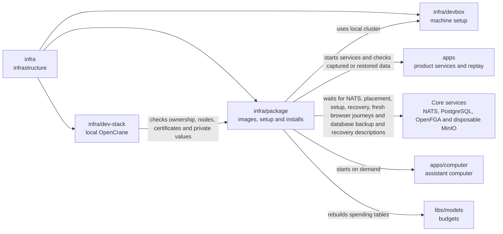

# Local Helm package

## What this is

This package installs a copy of OpenCrane on the developer machine's small
Kubernetes system, to try the approach intended for future customer installations.
It uses Helm, a tool that installs a set of Kubernetes programs together, so
developers can check the product before the customer installer is built.

## Where it fits

This is infrastructure beside [infra/dev-stack](../dev-stack/README.md) and
[infra/devbox](../devbox/README.md). It runs only in one of the two
[spare dev stacks](../../GLOSSARY.md#slot-spare-dev-stack), never the owner's copy.
Both install paths use local [Kubernetes](../../GLOSSARY.md#kubernetes),
which runs programs in [Pods](../../GLOSSARY.md#container-and-pod).
A spare stack can own a separate three-node cluster for installation checks.



The install runs a fake AI model for testing and creates its first owner through
saved [events](../../GLOSSARY.md#event). Workers start a computer when the owner
first chats. Computers belong to assistants, including shared group assistants,
and remain the same across chats. File storage and virus scanning are outside this package.

The dispatcher keeps its jobs in a separate database. It uses the server's read-only
content connection to coordinate gateway configuration changes with delivery.

The default database still runs as one container. An optional chart setting describes
PostgreSQL with a standby, a second copy ready to take over. CloudNativePG, a Kubernetes
controller for PostgreSQL, must be installed separately. This option currently checks
the installed controller version and private database settings before Helm starts.
It refuses passwords that the setup job cannot use and conflicting connection
settings in the setup job's Secret.
The shipped image review still refuses this option. Credential preparation and a
running install still need work.

An optional preview describes encrypted database backups and the write-ahead log,
the record PostgreSQL uses to recover changes. It refers to private settings already
held by Kubernetes. Its schedule is paused, and the installer refuses this option
until image, private-setting and storage checks are ready. Rendering the description
does not save a database backup.
A separate preview describes recovery from one named backup to an exact position
in that log. It keeps the existing database users and refers to saved private
settings by name. Installation remains blocked until a real restore is checked;
rendering cannot prove that the saved data is readable.

## What it is responsible for

- Installs the website, server, workers and core services together with [Helm](../../GLOSSARY.md#helm).
- Uses fixed, reviewed images and checks their licences before installation.
- Checks that a proposed server and website image matches its source and all shipped layers.
- Keeps the install in the test space [claimed](../../GLOSSARY.md#claim) by this worktree.
- Refuses missing private settings and public network access.
- Renders an optional three-peer event log and prepares its separate private certificates.
- Checks the three peers' nodes, certificates and image compatibility before installation.
- Checks event-log certificates, private keys and connection settings before installation.
- Waits for the event-log peers to be ready before creating the event stream.
- Gives computers the private gateway address and short-lived access passes.
- Saves a bounded private copy of the event log and its referenced files for an operator.
- Checks retained computer homes against saved events and current Kubernetes ownership.
- Encrypts all required homes together while checking that their ownership stays unchanged.
- Captures matching events, files and homes within one time limit while writers stay stopped.
- Restores checked events and files in order into empty disposable targets.
- Checks event and budget recovery after an interrupted change to handler subscriptions.
- Checks current memory deletion records before replaying older events.
- Checks company journey records against the full acceptance checklist.
- Checks three event-log placements against Kubernetes and fresh-install observations.
- Removes only this worktree's install, including after an interrupted launcher.

The recovery fixture compares restored files and spending, then checks who can read
those files. It uses disposable services and does not reopen a running installation.
The event and file targets keep private directory paths out of command arguments
and errors, including when setup or cleanup fails.

## Processes it handles

Before a new server and website image is approved, its source label, fixed image
digest and licence inventory must agree with the recorded review. The scan includes
files hidden by later image layers. The build copies the cleaned filesystem into
one filesystem layer, so removed npm and computer files are absent from the saved image.
The image checks follow every relative setup import and run the setup entry point
with made-up services and settings. This checks that the packaged code loads and
finishes the fixture; a running installation needs its own checks.
A separate candidate record checks the proposed package list, saved image bytes
and Debian main package versions. It keeps checksums for the shipped notices.
Detailed bundled licence review still needs work, so this record cannot approve an install.
Three-peer installation also needs an exact source revision in its compatibility
review. The current image has no such approval.

1. **A developer claims a spare stack.** Preparation checks that its Docker Compose
   stack is stopped, then creates a separate space in Kubernetes for the package.
2. **The package starts.** Helm starts the apps and services. A short setup job
   prepares the databases, event log and first owner. It waits for enough NATS peers
   to be ready. Their leader must report enough current copies of their shared settings.
   It retries a refused three-copy placement while peers finish starting.
   Every request to check or create the event log and dispatcher uses the time left.
   It refuses late replies and stops when the same two-minute limit expires.
   Before Helm runs, the installer checks that the private runtime and setup
   settings request the number of event copies described by the chart. Three peers
   also need separate prepared certificates, three eligible nodes and an image review
   for that mode. The shipped image still refuses it. The private values file's
   folder stays out of preflight and Helm command arguments, including during fresh
   browser journeys.
   It also checks the mounted certificates and requires the shipped storage,
   encrypted connection and account rules.
   Workers start the assistant's computer as needed.
3. **A developer opens the website.** A local port forward connects the private
   website to a browser on this machine. Preparation and forwarding use the same
   recorded cluster and private connection file as installation and cleanup.
   A missing or changed target stops the operation. Private connection and Secret
   folder paths stay out of the Kubernetes command arguments.
4. **A developer stops the package.** Cleanup checks ownership and removes only
   this developer's install, even after a crash.
5. **A developer checks fresh installs.** A check installs the package twice from
   scratch on one dedicated test cluster. Each run gets a new namespace and storage.
   The check confirms the second install starts empty and chat still works.
   Browser results record the namespace, storage and install time they checked.
   A separate browser with no
   session must receive only a refusal when it requests that chat history.
   A separate checker requires a linked result and supporting file for every company
   check, including each screen state and inherited feature. A rejected install leaves
   its checks untested while the other install keeps its valid results.
   The checker cannot qualify the product from synthetic records.

An internal capture helper saves events, their files and every required computer home
in sequence. The caller keeps writers stopped and supplies trusted readers. It returns
partial evidence only after comparing every saved archive with its original output
and checking that encrypted files and homes open with their saved descriptions.
These checks share the capture time limit. Database backups and a complete-system
backup still need work. Live checks of stopped writers and mounted home files remain untested.

## How to run or test it

The chart tests check that backup cancellation stops a real child process.
A controlled clock also checks that earlier ownership checks reduce the time
allowed for later commands. These checks run without a development stack:

```sh
nice -n 10 node --experimental-strip-types --test infra/package/chart.test.mjs
```

The development owner email is configured in a private file outside the repository.
The [operator notes](README.robot.md#private-owner-email) explain that setting.

The [operator notes](README.robot.md) explain the image review and private settings
needed before installation. After a claim, the returned stack number selects the install:

```sh
DEV_STACK_ID=$(infra/dev-stack/claim.sh) || exit 1
export DEV_STACK_ID
infra/dev-stack/run.sh package-prepare --id "$DEV_STACK_ID"
node --experimental-strip-types infra/package/prepare.ts /private/values.json
infra/dev-stack/run.sh package-up --id "$DEV_STACK_ID" --values /private/values.json
infra/package/forward.sh
infra/dev-stack/run.sh package-down --id "$DEV_STACK_ID"
infra/dev-stack/down.sh --id "$DEV_STACK_ID"
```

The optional event-log render describes three private NATS peers on separate Kubernetes
nodes. A separate preparation command creates their private certificates and public trust.
It checks ownership and uses the claimed cluster's private connection settings.
It preserves the same identities on retry. The shipped image review still refuses
three-peer installation. The preview includes the
complete setup job and its private file mounts. Source tests check that setup can
request three copies and keep that choice when creating the first owner. A compatible
image review, controller and storage prerequisites, and live checks remain outstanding.
A bounded collector can check recorded nodes, storage and replica state once a supported
install exists. It requires mounted claim storage and event history with no expiry limits.
It checks placement only; sign-in, chat and service refusals need their own checks.

The chart render test needs Helm and checks the installation files without starting
an install. It uses made-up settings. The [operator notes](README.robot.md) give the command.

The operator event-copy command saves native NATS bytes and a private description
of their source, positions and checksums. It refuses a log that changes during
capture or a snapshot that NATS reports as failed, and removes partial output.
Stable positions do not prove that writers stopped. This is only the
event part of recovery; database and computer-volume backups still need work.
The [operator notes](README.robot.md#event-byte-export) describe its limits.

The object-copy helper saves files named by the checked event archive, including
screenshots and files already delivered to computers. Writers must remain stopped.
It encrypts each file with a separate private backup key and checks its length and
checksum before saving a completion record. Its restore checker refuses changed
encrypted files before returning their contents.
It does not copy unreferenced files or prove that a whole installation can recover.
The [object notes](README.robot.md#event-referenced-object-copy) explain its limits.

The file restore helper checks every encrypted file before creating a new storage
bucket. It accepts only a fresh local MinIO instance made by the recovery provisioner.
It checks the owner marker at that destination and refuses other running processes
or another restore using the same instance. It restores the saved addresses and file
types, then reads every file back to check its size and checksum. Existing buckets refuse, including empty ones.
A failed transfer leaves the target isolated for inspection; it never retries or
deletes the bucket. Restored files grant no access and do not reopen the installation.
The [file restore notes](README.robot.md#file-object-restore) describe the requirements.

### Computer home ownership

The computer inventory helper reads the checked event copy to find every required
retained home. It checks the exact computer and assistant, Sandbox identity and
home volume owner in the already owned namespace. The home claim and its backing
volume must both be bound. The volume must point back to that exact claim, including
its namespace and unique identity. Each Sandbox must report that
its current version is suspended and its Pod has stopped. Any remaining Pod using
that home causes refusal. A second read refuses changed resources before returning
private metadata. This does not copy volume contents or prove a whole backup is safe.
The [inventory notes](README.robot.md#computer-volume-inventory) describe its limits.

The home export helper encrypts bytes from a trusted internal reader directly to a
private file for each required home. All homes share one size limit and deadline.
It checks ownership before and after copying and saves one completion record only
after every home passes its count, checksum and disk flush. Writers
must stay stopped. The tests use a local stream; reading a live Kubernetes volume
and proving which mount supplied its bytes still need work.
The [export notes](README.robot.md#computer-home-export) describe the format and limits.

The event restore command checks that copy against its reachable source, then sends
it to a separate disposable NATS server with no event stream. It checks the restored
events and leaves uncertain results isolated for inspection. It starts no product
processes. This does not restore or reopen a working installation.
The [restore notes](README.robot.md#event-byte-restore) explain the requirements.

The combined restore helper checks events, files and every encrypted computer home
before changing either target. It refuses missing homes or a different saved computer
generation. It checks each home without extracting or keeping its contents. It then
restores events, restores files and checks current memory keys under one time limit.
Restoring homes onto mounted volumes still needs work.
The current deletion evidence comes from a trusted source, separately from the old archive.
The proposed key folder must already be prepared; the helper copies no keys. Only privately
provisioned local targets can be used. Failed or cancelled work leaves both targets isolated
and never deletes or resends bytes. It starts no product readers or background work.
The [combined restore notes](README.robot.md#combined-event-and-file-restore) explain
what still blocks reopening.

A separate test interrupts a change to the events that background handlers receive.
It uses the combined restore helper before rebuilding membership, rights, spending
and file tables twice with reactions stopped. The helper checks current deletion
records separately from the old archive and proves that this fixture has no homes
to restore. Missing custody or omitted homes prevent replay and file reads.
Reservations keep their original identities and exact cents. Unresolved work keeps
its hold. This tests recovery with disposable services; it does not qualify a
package upgrade or reopen an installation.
The [recovery notes](README.robot.md#interrupted-handler-upgrade-check) explain the proof.
The memory recovery command compares a proposed key folder with the stopped, trusted
source and its current events. It refuses stale keys, missing deletion markers and
missing or damaged keys for live facts, even when both folders match. It completes
all deletion, identity and stability checks before decrypting any surviving value.
It then runs the existing memory replay. It changes no keys and does not reopen the installation.
The [memory recovery notes](README.robot.md#memory-restore-preflight) explain its limits.

## Folders

| Folder | What it does |
| --- | --- |
| [chart](chart/README.md) | Describes the local installation and its required settings. |
| [chart/templates](chart/templates/README.md) | Describes the programs, storage and network rules to install. |

## Where to read more

- [Local operator guide](README.robot.md#local-operator-guide): commands, evidence and recovery limits.
- [README.robot.md](README.robot.md): settings, image review, commands and current limits.
- [infra/dev-stack](../dev-stack/README.md): the other local install path and stack claims.
- [Planned customer installation](../../docs/architecture/target.md): the intended customer setup.
