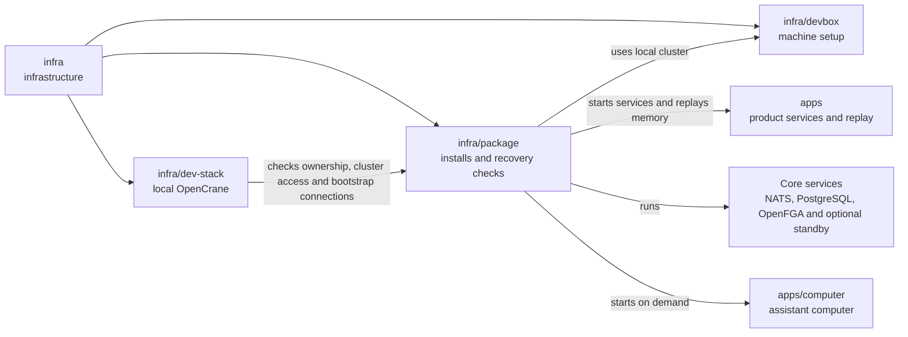

# Local Helm package

## What this is

This package installs a copy of OpenCrane on the developer machine's small
Kubernetes system, to try the approach intended for future customer installations.
It uses Helm, a tool that installs a set of Kubernetes programs together, so
developers can check the product before the customer installer is built.

## Where it fits

This is infrastructure beside [infra/dev-stack](../dev-stack/README.md) and
[infra/devbox](../devbox/README.md). It runs only in one of the two
[spare dev stacks](../../GLOSSARY.md#slot-spare-dev-stack), never the owner's copy.
Both install paths use local [Kubernetes](../../GLOSSARY.md#kubernetes),
which runs programs in [Pods](../../GLOSSARY.md#container-and-pod).
A spare stack can own a separate three-node cluster for installation checks.



The install runs a fake AI model for testing and creates its first owner through
saved [events](../../GLOSSARY.md#event). Workers start a computer when the owner
first chats. Computers belong to assistants, including shared group assistants,
and remain the same across chats. File storage and virus scanning are outside this package.

The dispatcher keeps its jobs in a separate database. It uses the server's read-only
content connection to coordinate gateway configuration changes with delivery.

The default database still runs as one container. An optional chart setting describes
PostgreSQL with a standby, a second copy ready to take over. CloudNativePG, a Kubernetes
controller for PostgreSQL, must be installed separately. This option currently checks
the installed controller version and private database settings before Helm starts.
It refuses passwords that the setup job cannot use and conflicting connection
settings in the setup job's Secret.
The shipped image review still refuses this option. Credential preparation and a
running install still need work.

## What it is responsible for

- Installs the website, server, workers and core services together with [Helm](../../GLOSSARY.md#helm).
- Uses fixed, reviewed images and checks their licences before installation.
- Keeps the install in the test space [claimed](../../GLOSSARY.md#claim) by this worktree.
- Refuses missing private settings and public network access.
- Renders an optional three-peer event log and prepares its separate private certificates.
- Gives computers the private gateway address and short-lived access passes.
- Saves a bounded private copy of the event log for an operator.
- Restores checked events into an empty disposable NATS target.
- Checks event recovery after an interrupted change to handler subscriptions.
- Checks current memory deletion records before replaying older events.
- Removes only this worktree's install, including after an interrupted launcher.

## Processes it handles

1. **A developer claims a spare stack.** Preparation checks that its Docker Compose
   stack is stopped, then creates a separate space in Kubernetes for the package.
2. **The package starts.** Helm starts the apps and services. A short setup job
   prepares the databases and first owner; workers start the assistant's computer as needed.
3. **A developer opens the website.** A local port forward connects the private
   website to a browser on this machine. Preparation and forwarding use the same
   recorded cluster and private connection file as installation and cleanup.
   A missing or changed target stops the operation.
4. **A developer stops the package.** Cleanup checks ownership and removes only
   this developer's install, even after a crash.
5. **A developer checks fresh installs.** A check installs the package twice from
   scratch and confirms the second install starts empty and chat still works.

## How to run or test it

The development owner email is configured in a private file outside the repository.
The [operator notes](README.robot.md#private-owner-email) explain that setting.

The [operator notes](README.robot.md) explain the image review and private settings
needed before installation. After a claim, the returned stack number selects the install:

```sh
DEV_STACK_ID=$(infra/dev-stack/claim.sh) || exit 1
export DEV_STACK_ID
infra/dev-stack/run.sh package-prepare --id "$DEV_STACK_ID"
node --experimental-strip-types infra/package/prepare.ts /private/values.json
infra/dev-stack/run.sh package-up --id "$DEV_STACK_ID" --values /private/values.json
infra/package/forward.sh
infra/dev-stack/run.sh package-down --id "$DEV_STACK_ID"
infra/dev-stack/down.sh --id "$DEV_STACK_ID"
```

The optional event-log render describes three private NATS peers on separate Kubernetes
nodes. A separate preparation command creates their private certificates and public trust.
It checks ownership and uses the claimed cluster's private connection settings.
It preserves the same identities on retry. Installation still uses
one peer; the ordinary installer refuses three-peer mode. Live checks remain outstanding.

The chart render test needs Helm and checks the installation files without starting
an install. It uses made-up settings. The [operator notes](README.robot.md) give the command.

The operator event-copy command saves native NATS bytes and a private description
of their source, positions and checksums. It refuses a log that changes during
capture or a snapshot that NATS reports as failed, and removes partial output.
Stable positions do not prove that writers stopped. This is only the
event part of recovery; database, file and computer-volume backups still need work.
The [operator notes](README.robot.md#event-byte-export) describe its limits.

The event restore command checks that copy against its reachable source, then sends
it to a separate disposable NATS server with no event stream. It checks the restored
events and leaves uncertain results isolated for inspection. It starts no product
processes. This does not restore or reopen a working installation.
The [restore notes](README.robot.md#event-byte-restore) explain the requirements.

A separate test interrupts a change to the events that background handlers receive.
It restores the earlier event copy and rebuilds membership tables with reactions
stopped. This checks event recovery only. It does not qualify a package upgrade.
The [recovery notes](README.robot.md#interrupted-handler-upgrade-check) explain the proof.
The memory recovery command compares a proposed key folder with the stopped, trusted
source and its current events. It refuses stale keys, missing deletion markers and
missing or damaged keys for live facts, even when both folders match. It completes
all deletion, identity and stability checks before decrypting any surviving value.
It then runs the existing memory replay. It changes no keys and does not reopen the installation.
The [memory recovery notes](README.robot.md#memory-restore-preflight) explain its limits.

## Folders

| Folder | What it does |
| --- | --- |
| [chart](chart/README.md) | Describes the local installation and its required settings. |
| [chart/templates](chart/templates/README.md) | Describes the programs, storage and network rules to install. |

## Where to read more

- [README.robot.md](README.robot.md): settings, image review, commands and current limits.
- [infra/dev-stack](../dev-stack/README.md): the other local install path and stack claims.
- [Planned customer installation](../../docs/architecture/target.md): the intended customer setup.
