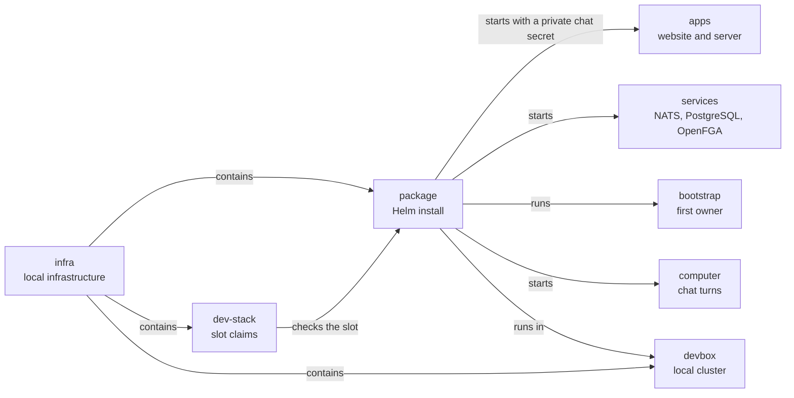

# Local Helm package

## What this is

This package defines a local Kubernetes install for the OpenCrane website,
server and core services. It uses one of the two spare development slots.
The application image is pinned in the local registry. The package also runs
the workers that keep the database up to date and a job that creates the first
owner through events.
It also runs the local stub model and gives each chat turn a private computer.
Helm applies these Kubernetes resources as one named release.

## Where it fits

The package sits beside the development stack. Both use the developer box's local
Kubernetes cluster, but each package has its own namespace.

## What it is responsible for

- Keep the installed images and chart version fixed.
- Refuse missing secrets and public network settings before installation.
- Keep the package inside the slot owned by the current worktree.
- Remove only the package owned by that worktree.
- Check the licences of the pinned images against reviewed package sources before
  they are shipped.

## Processes it handles

1. **A worktree claims a spare slot.** The claim records its owner. Preparing the
   package creates a separate namespace in the local cluster. Preparation refuses
   while that slot's Compose stack is running.
2. **The package starts.** The website and server run in separate Pods. NATS,
   PostgreSQL, OpenFGA, the stub model and the background workers run in the same
   private namespace. A short job prepares the databases and creates the first
   owner. A computer starts when the owner sends a chat message.
3. **A developer checks the website.** A loopback-only port forward makes the
   private website available to a browser on this machine.
4. **A developer stops the package.** Cleanup checks the saved namespace and Helm
   release before removing them. A random ID saved before installation must match
   the release label. This allows cleanup after a stopped launcher and refuses
   another worktree’s release.

## How to run or test it

The [operator notes](README.robot.md) describe the required image review, named
secrets and slot commands. The image pins and secret names must be ready before
installation.

## Where to read more

- [README.robot.md](README.robot.md): exact commands, settings and current limits.
- [infra/dev-stack](../dev-stack/README.md): how the spare slots are claimed.
