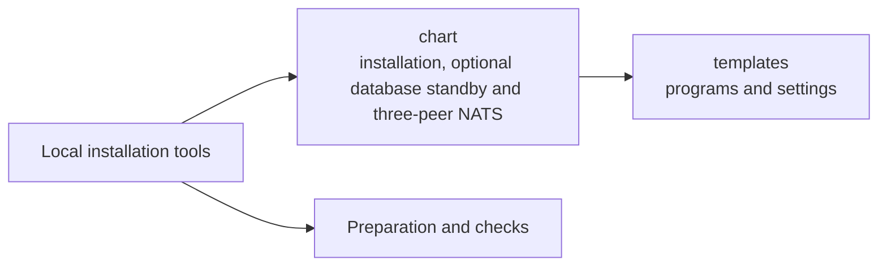

# Local installation package

This folder describes the programs and settings installed together for a local
OpenCrane trial. It lets developers try an installation with its own services and
saved data on a spare test stack. It is part of the work towards a customer installer.

## What it is responsible for

- Describes the package that Helm installs into Kubernetes.
- Can describe a PostgreSQL primary and standby with separate storage and nodes.
- Lists the required program images and names of private settings.
- Keeps public network access switched off in the default settings.
- Groups the templates that start apps, services, workers and assistant computers.

## Main files

| File or folder | What it does |
| --- | --- |
| `Chart.yaml` | Names the installation package and its version. |
| `cluster.conf` | Keeps a tested copy of the shared authenticated NATS route configuration. |
| `values.yaml` | Lists settings that installation preparation must supply. |
| [templates](templates/README.md) | Describes the programs, storage and access rules to install. |

## How it connects

The [local installation tools](../README.md) prepare settings and check the chosen
images before installation. [Helm](../../../GLOSSARY.md#helm), a package installer,
combines those settings with the templates.
[Kubernetes](../../../GLOSSARY.md#kubernetes) then runs the resulting programs.

## Not done here

Private credentials are prepared outside this folder. The chart refers to them by
name. The optional database standby needs separately prepared credentials and a
CloudNativePG controller. It has been checked by rendering the chart, which does
not prove a running standby. An optional render also describes three private NATS
peers. It needs separate route trust and one certificate reference per peer.
The installer checks prepared certificates, eligible nodes and reviewed images first.
The shipped image still refuses this mode; the
[operator notes](../README.robot.md#three-peer-nats-rendering) explain the remaining work. File storage and virus scanning are outside this package.
