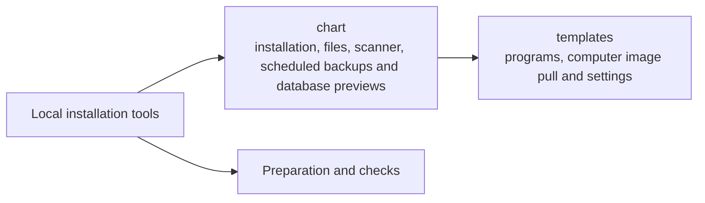

# Local installation package

This folder describes the programs and settings installed together for a local
OpenCrane trial. It lets developers try an installation with its own services and
saved data on a spare test stack. It is part of the work towards a customer installer.

## What it is responsible for

- Describes the package that Helm installs into Kubernetes.
- Can describe a PostgreSQL primary and standby with separate storage and nodes.
- Can preview encrypted database backups with a paused schedule; installation refuses.
- Can preview recovery from an exact backup and log position; installation refuses.
- Lists the required program images and names of private settings.
- Keeps public network access switched off in the default settings.
- Pulls the approved assistant computer image before installing or updating the apps.
- Schedules one nightly pilot backup on a separate volume with a read-only catalogue.
- Includes persistent file storage and a private virus scanner for chat attachments.
- Keeps the stand-in model by default or uses a provider connected through Settings.
- Can use a restricted free stand-in in provider mode to check the same spending limits.

## Main files

| File or folder | What it does |
| --- | --- |
| `Chart.yaml` | Names the installation package and its version. |
| `scanner.conf` | Shares the fixed production scan limits with the owned scanner launcher. |
| `cluster.conf` | Keeps a tested copy of the shared authenticated NATS route configuration. |
| `values.yaml` | Lists settings that installation preparation must supply. |
| [templates](templates/README.md) | Describes the programs, storage and access rules to install. |

## How it connects

The [local installation tools](../README.md) prepare settings and check the chosen
images before installation. [Helm](../../../GLOSSARY.md#helm), a package installer,
combines those settings with the templates.
[Kubernetes](../../../GLOSSARY.md#kubernetes) then runs the resulting programs.

## Not done here

Private installation credentials are prepared outside this folder. The chart refers
to them by name. With `models.mode: provider`, the owner saves the model key in
Settings. The startup permission check and the server and models containers mount its private volume;
the models mount is read-only. The server Pod stops before an update starts its replacement,
so the new models process can take the budget lock. No provider key belongs in Helm values.
Admins set monthly ceilings in Spending, in whole euro cents. The same limits apply
in `models: { mode: provider, qualification: true }`, where a local stand-in reports
token usage so Spending records a charge without an external provider request.
The optional database standby needs separately prepared credentials and a
CloudNativePG controller. It has been checked by rendering the chart, which does
not prove a running standby. An optional render also describes three private NATS
peers. It needs separate route trust and one certificate reference per peer.
The installer checks prepared certificates, eligible nodes and reviewed images first.
The shipped image still refuses this mode; the
[operator notes](../README.robot.md#three-peer-nats-rendering) explain the remaining work. File storage and virus scanning run inside the package;
the scanner needs a reviewed, current signature release before uploads are available.
