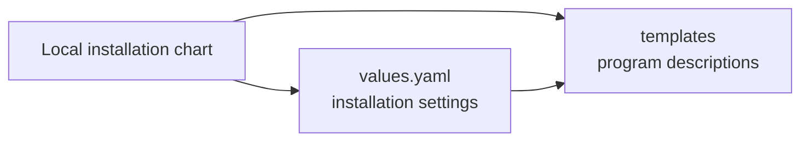

# Programs in the local installation

This folder describes what the local OpenCrane installation runs and how its parts
reach each other. It includes the website, back end, background workers and the
services they need. Helm fills in the chosen settings before installation.

## What it is responsible for

- Starts the apps, database, saved event log and permissions service.
- Gives background workers the settings and access needed for their jobs.
- Prepares storage, database setup and the first owner.
- Describes assistant computers and limits their network connections.
- Refuses public network access, missing private setting names and unpinned images.

## Main files

| File | What it does |
| --- | --- |
| `apps.yaml` | Runs the website, server, AI access process and permissions service. |
| `workers.yaml` | Runs background jobs and connects gateway preparation to content storage. |
| `data.yaml` | Runs the database and event log, and requests saved storage. |
| `services.yaml` | Gives the programs private network addresses. |
| `bootstrap.yaml` | Sets up initial data and the access needed by setup and workers. |
| `computer.yaml` | Describes assistant computers, their settings and network limits. |
| `guard.yaml` | Rejects unsafe or incomplete installation settings. |

## How it connects

The [chart](../README.md) supplies these templates to
[Helm](../../../../GLOSSARY.md#helm), the Kubernetes package installer.
The [installation tools](../../README.md) prepare the private settings and reviewed
images first. The setup job runs [bootstrap.ts](../../bootstrap.ts); workers run
[worker.mjs](../../worker.mjs).

