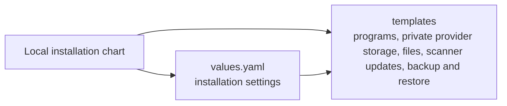

# Programs in the local installation

This folder describes what the local OpenCrane installation runs and how its parts
reach each other. It includes the website, back end, background workers and the
services they need. Helm fills in the chosen settings before installation.
The database normally runs as one container. The optional primary and standby description needs CloudNativePG,
a PostgreSQL controller installed separately. Rendering checks this description;
a running standby has not yet been tested. A backup preview describes encrypted base
backups and the write-ahead log, which PostgreSQL uses to recover changes.
Its schedule stays paused, and installation refuses until the remaining checks are ready.
A separate preview describes recovery into fresh storage from one named backup and
an exact log position. It keeps the existing database users and emits no backup schedule.

## What it is responsible for

- Starts the apps, database, saved event log and permissions service.
- Schedules one pilot backup of events, databases and files, with a private catalogue.
- Holds a new installation empty for restore, then opens verified reading with effects stopped.
- Runs persistent file storage and an authenticated scanner with a private ClamAV listener.
- Keeps the old scanner available while a new scanner Pod becomes ready.
- Describes an optional database standby with its own storage on another node.
- Gives background workers the settings and access needed for their jobs.
- Prepares storage, database setup and the first owner.
- Prepares private key permissions before giving server and models access.
- Describes assistant computers and limits their network connections.
- Refuses public network access, missing private setting names and unpinned images.

## Main files

| File | What it does |
| --- | --- |
| `files.yaml` | Runs MinIO and the scanner, and supplies the checked list of scanner hashes. |
| `apps.yaml` | Runs the website, server, AI access process and permissions service. |
| `workers.yaml` | Runs background jobs and connects gateway preparation to content storage. |
| `model-qualification.yaml` | Runs the separate free provider for restricted package checks. |
| `provider-secrets.yaml` | Keeps provider keys on private persistent storage when selected. |
| `data.yaml` | Describes the database, optional backup and recovery settings, event log and saved storage. |
| `pilot-backup.yaml` | Runs the pilot backup, restricted restore Job and private catalogue. |
| `backup.yaml` | Describes one paused database backup schedule for preview only. |
| `_backup.tpl` | Checks local storage addresses and existing private-setting references. |
| `_recovery.tpl` | Requires one exact recovery source, backup and log position. |
| `nats-cluster.yaml` | Renders three private event-log peers with separate storage and certificates. |
| `services.yaml` | Gives the programs private network addresses. |
| `bootstrap.yaml` | Sets up initial data and the access needed by setup and workers. |
| `computer.yaml` | Describes assistant computers, their settings and network limits. |
| `guard.yaml` | Rejects unsafe or incomplete installation settings. |

## How it connects

The [chart](../README.md) supplies these templates to
[Helm](../../../../GLOSSARY.md#helm), the Kubernetes package installer.
The [installation tools](../../README.md) prepare the private settings and reviewed
images first. The setup job runs [bootstrap.ts](../../bootstrap.ts); workers run
[worker.mjs](../../worker.mjs).

The setup job and its private file mounts appear in both the default and three-peer render.
Restore mode omits that job and holds app replicas until the restore checks pass.
The installer checks prepared certificates, eligible nodes and image compatibility
before admitting three peers. The shipped image still refuses this mode. The [operator notes](../../README.robot.md#three-peer-nats-rendering)
explain its settings and the live checks still needed.
