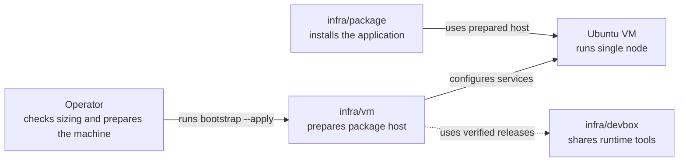

# infra/vm

## What this is

Prepare a fresh Ubuntu virtual machine to run the OpenCrane package.
A virtual machine is a computer rented or created for this installation.
The script installs single-node Kubernetes and the gVisor runtime that isolates
assistant computers. Its first real run still waits for the pilot machine.

## Where it fits

An operator runs this before the package installer. It shares verified runtime
releases with the developer-box setup, but never uses that setup to change a VM.



## What it is responsible for

- Refuse Docker, another Kubernetes installation or standalone containerd.
- Install k3s, gVisor, the assistant controller and local persistent storage.
- Disable swap and crash dumps before starting Kubernetes.
- Explain the work without changing the machine by default; require `--apply` to change it.
- Keep reruns limited to the k3s installation owned by this script.

## Processes it handles

1. **An operator prepares a fresh VM.** The script checks the machine before making
   changes. It installs verified releases, configures node protection and waits for
   Kubernetes, the assistant controller and local storage.
2. **An operator repeats preparation.** The script checks its ownership record and
   installed k3s checksum. It reapplies the same configuration and restarts k3s;
   running workloads may pause.
3. **An operator chooses a machine size.** The one-person journey passed on
   approved packaged source `abe90b2e9`:
   sign-in, chat, PDF upload, desktop viewing and spending at desktop and phone widths.
   Whole-node peaks were 2.695 cores / 5.21 GiB including swap; the package peaked at
   2.075 cores / 2.97 GiB working set. Installation was not sampled. These observations
   do not qualify a minimum machine size or spare-capacity recommendation. A run on
   the rebased source remains partial because PDF upload and desktop viewing did not pass.

## How to run or test it

On a fresh Ubuntu 22.04 or 24.04 LTS x86-64 VM, from a repository checkout:

```sh
sudo infra/vm/bootstrap.sh --dry-run
sudo infra/vm/bootstrap.sh --apply
```

No arguments also print a dry run. Only `--apply` permits host changes.
Reboot after preparation, then run the existing package preflight. The dry run
also refuses existing runtimes. Never run preparation on the developer box.

Safe local checks use disposable containers without networking or privileges:

```sh
nice -n 10 node --test infra/vm/bootstrap.test.mjs
```

## Where to read more

- [Operator details](README.robot.md): settings, versions, limitations and measurement procedure.
- [Package guide](../package/README.md): install and check the application.
- [Developer stack](../dev-stack/README.md): claim and release spare local slots.
- [Measurements ledger](../../docs/process/ledger.md#measurements): recorded sizing evidence.
