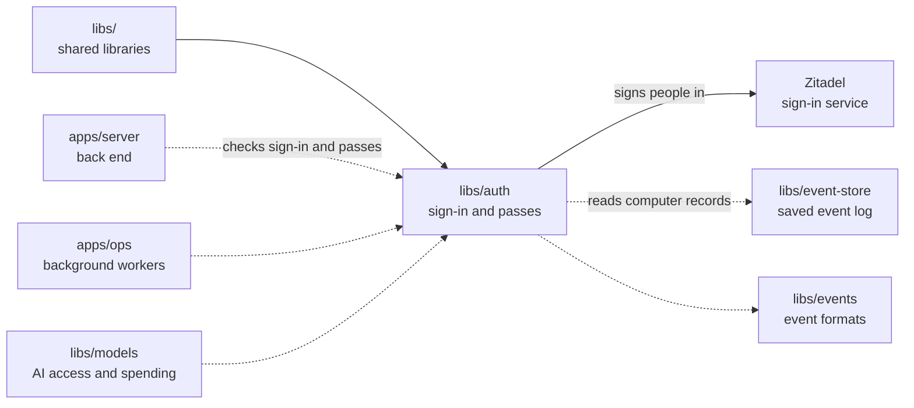

# Auth

## What this is

Sign-in and short-lived [access passes](../../GLOSSARY.md#access-token) for people
and [computers](../../GLOSSARY.md#computer). This library checks sign-in with
[Zitadel](../../GLOSSARY.md#zitadel-sign-in-service) and keeps the person's session
in a protected browser cookie. It also makes passes for each assistant's computer
and for each reply in a chat, so those requests can be checked.

## Where it fits

This shared library is used by [apps/server](../../apps/server/README.md), the back
end, [apps/ops](../../apps/ops/README.md), the background workers, and
[libs/models](../models/README.md), the AI access library.
It checks identity; [libs/authz](../authz/README.md) decides what a signed-in person
may do. It reads saved computer records to check computer and chat passes.



## What it is responsible for

- Send a person to Zitadel and check its sign-in response, including the signed
  email and whether Zitadel verified it.
- Keep signed-in sessions and sign-ins in progress in encrypted cookies.
- Check that the person belongs to this [silo](../../GLOSSARY.md#silo)'s organisation
  and has signed in recently enough for a sensitive action.
- Keep return links on the same website and end the Zitadel browser session at sign-out.
- Sign and check brief passes for computers, chat turns and memory calls. A chat
  turn is one message and the assistant's reply. Check work passes against the saved
  computer state and the matching turn.
- Stop new AI work while a person is taking control of an assistant's computer,
  using saved records alone. Sign separate stop requests that cannot authorise AI calls.
- Make one-minute passes for a computer to reach an approved outside service.
  Delivery of these passes to computers is not switched on yet.

## Processes it handles

1. **A person signs in.** The server gets a sign-in link and sends the browser to
   Zitadel. The library checks the response and prepares a protected session cookie.
2. **A person signs out.** The server clears the cookie and sends the browser to
   Zitadel to end its session.
3. **A person confirms a sensitive action.** If their sign-in is too old, the
   server asks them to sign in again before continuing.
4. **An assistant replies.** A worker gives a ready computer its pass. The server
   gives each chat turn a separate pass.
   The models process checks both before allowing an AI call.

## How to run or test it

```sh
nice -n 10 npx vitest run libs/auth
nice -n 10 npm run typecheck -w libs/auth
```

A small example checks that a return link stays on this website:

```ts
import { sanitizeReturnTo } from '@opencrane/auth';

const returnPath = sanitizeReturnTo('https://outside.example/');
```

## Where to read more

- [README.robot.md](README.robot.md): settings, pass contents, security rules and detailed tests.
- [The server](../../apps/server/README.md) uses the sign-in flow and cookie.
- [Permissions](../authz/README.md): what a signed-in person may do.
- [The glossary](../../GLOSSARY.md#access-token) explains access passes.
