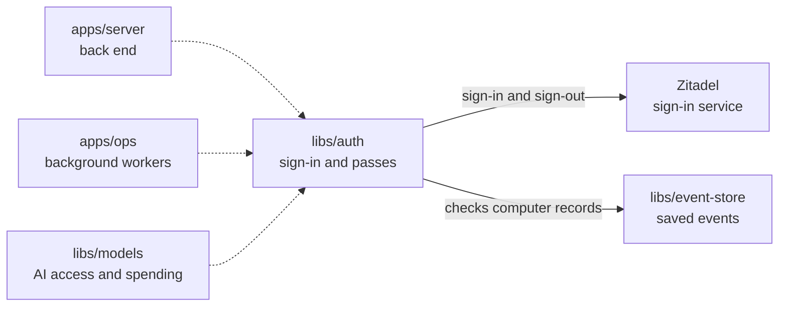

# Auth

## What this is

Sign-in and short-lived [access passes](../../GLOSSARY.md#access-token) for people and computers. The library sends people to [Zitadel](../../GLOSSARY.md#zitadel-sign-in-service), keeps their sign-in in a protected cookie, and checks it on later requests. It also makes short-lived passes for computers and chat turns.

## Where it fits

This is a shared library used by the back end, background workers and the models process. It talks to Zitadel during sign-in and uses the [event store](../../GLOSSARY.md#event-log-event-store) when it checks computer credentials.



## What it is responsible for

- Send a person to Zitadel and check the sign-in response using OIDC, a standard sign-in method.
- Keep sign-in and sign-in-flow details in protected cookies.
- Check that a person belongs to this silo's organisation and that a sensitive action follows a recent sign-in.
- Keep return links on the same website and end the Zitadel browser session at sign-out.
- Sign and check short-lived passes for computers and individual chat turns.
- Check computer and turn passes against the computer's recorded state.

## Processes it handles

1. **A person signs in.** The server asks this library for a sign-in link and sends the browser to Zitadel. The library checks the response and gives the server a protected session cookie.
2. **A person signs out or confirms a sensitive action.** The server clears the cookie and sends the browser to Zitadel to end its session, or asks for a fresh sign-in when the current one is too old.
3. **A computer starts a chat turn.** The worker gives it a short-lived computer pass, and the server gives it a pass for that turn. The models process checks both passes before allowing an AI call.

## How to run or test it

```sh
npm test -- libs/auth
npm run typecheck -w libs/auth
```

A small example checks that a return link stays on this website:

```ts
import { sanitizeReturnTo } from '@opencrane/auth';

const returnPath = sanitizeReturnTo('https://outside.example/');
```

## Where to read more

- [README.robot.md](README.robot.md): settings, pass contents, security rules and detailed tests.
- [The server](../../apps/server/README.md) uses the sign-in flow and cookie.
- [The glossary](../../GLOSSARY.md#access-token) explains access passes.
