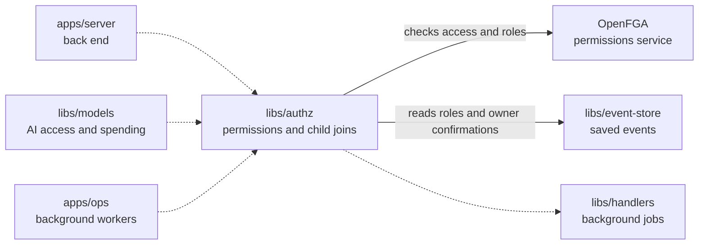

# Authz

## What this is

Checks and updates who may use OpenCrane resources. It keeps permission records in OpenFGA, a permissions service, and answers access questions for the server and models library. A [saved event](../../GLOSSARY.md#event) tells it what changed. Background workers apply saved changes and can rebuild the records from events.

## Where it fits

This is a shared library used by the back end, the models process and the background workers. It gives the background workers a [reaction](../../GLOSSARY.md#reaction-handler) that copies each permission change into OpenFGA, and it reads and writes permission records there.



## What it is responsible for

- Give named child participants access and keep the creator permission separate.
- Grants ownership only after the member record confirms the appointment.
- Turn membership, ownership, conversation, group and access-grant events into permission records.
- Answer whether a person, assistant or group may use a resource.
- Refuse access when OpenFGA cannot give a reliable answer.
- Keep repeated or delayed events from restoring access that has been removed.
- Rebuild permission records in a new OpenFGA store from the event history.

Conversation permissions name individual people. The creator can manage participants
only while they can still read the chat. Group membership does not grant chat access.

## Processes it handles

A Member or Admin role change saved after an ownership appointment keeps the owner
role and records the event as processed. Jobs wait for earlier role or ownership
changes to be applied, so delivering the jobs in a different order gives the same result.

1. **A person's access changes.** A background worker sends the event to this library. It updates OpenFGA and records which event it applied, so a retry cannot apply the same change twice.
2. **A protected request arrives.** The server or models process asks whether the person, assistant or group has access. The request continues only when OpenFGA confirms it.
3. **An operator rebuilds permissions.** The rebuild reads the event history into a new OpenFGA store. The server and the background workers can then switch to the new store.

When a release adds an older event to a reaction, the worker checks later saved
permission changes before applying it. Removing a person from the silo keeps
recorded grants, group membership, conversation participants and assistant links.
These records are available again if the person rejoins. The server and models
process still check current silo membership before allowing a request.

Removing someone from a conversation deletes their participant permission.
A delayed creation or join keeps a later removal, even when the events use
different streams. Adding the person again gives them access from their new join.
The server checks that history limit separately from OpenFGA permissions.

## How to run or test it

```sh
npm test -- libs/authz
npm run typecheck -w libs/authz
```

The tests start OpenFGA, NATS and PostgreSQL themselves, so Docker must be running. README.robot.md lists what they need.

A small example checks whether a person is an admin in an existing store. The store id and model id come from the OpenFGA store setup:

```ts
import { memberAuthorisation } from '@opencrane/authz';

const storeId = 'existing-store-id';
const authorizationModelId = 'existing-model-id';
const authorisation = memberAuthorisation({
  silo: 'acme',
  apiUrl: 'http://127.0.0.1:8080',
  storeId,
  authorizationModelId,
});
const decision = await authorisation.check('alice', 'admin');
```

## Where to read more

- [README.robot.md](README.robot.md): permission rules, retries, rebuilding and test setup.
- [The models library](../models/README.md) uses these checks for AI calls and tool rules.
- [The glossary](../../GLOSSARY.md#openfga-permissions-service) explains OpenFGA.
