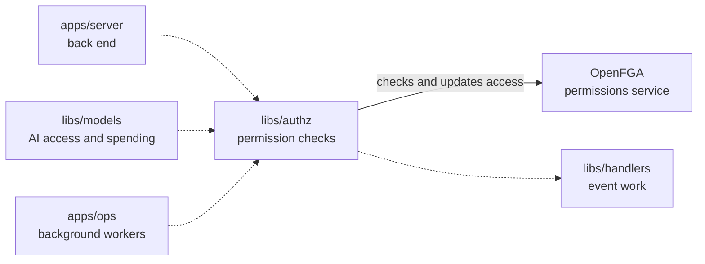

# Authz

## What this is

Checks and updates who may use OpenCrane resources. It keeps permission records in OpenFGA, a permissions service, and answers access questions for the server and models library. A [saved event](../../GLOSSARY.md#event) tells it what changed. Background workers apply saved changes and can rebuild the records from events.

## Where it fits

This is a shared library used by the back end, models process and background workers. It registers event work with the handler library and reads or writes permission records in OpenFGA.



## What it is responsible for

- Turn membership, ownership, conversation, team and access-grant events into permission records.
- Answer whether a person, assistant or group may use a resource.
- Refuse access when OpenFGA cannot give a reliable answer.
- Keep repeated or delayed events from restoring access that has been removed.
- Rebuild permission records in a new OpenFGA store from the event history.

## Processes it handles

1. **A person's access changes.** A background worker sends the event to this library. It updates OpenFGA and records which event it applied, so a retry cannot apply the same change twice.
2. **A protected request arrives.** The server or models process asks whether the person, assistant or group has access. The request continues only when OpenFGA confirms it.
3. **An operator rebuilds permissions.** The rebuild reads the event history into a new OpenFGA store. Workers and readers can then use the new store.

## How to run or test it

```sh
npm test -- libs/authz
npm run typecheck -w libs/authz
```

A small example checks whether a person is an admin:

```ts
import { createStore, memberAuthorisation } from '@opencrane/authz';

const binding = await createStore('http://127.0.0.1:8080', 'acme');
const authorisation = memberAuthorisation(binding);
const decision = await authorisation.check('alice', 'admin');
```

## Where to read more

- [README.robot.md](README.robot.md): permission rules, retries, rebuilding and test setup.
- [The models library](../models/README.md) uses these checks for AI calls and tool rules.
- [The glossary](../../GLOSSARY.md#openfga-permissions-service) explains OpenFGA.
