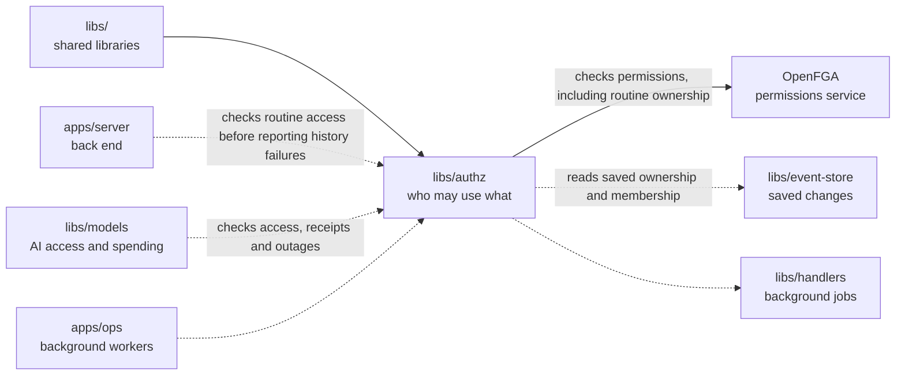

# Authz (permissions)

## What this is

Checks and updates who may use OpenCrane resources. It answers access questions
for the server and AI access library using
[OpenFGA](../../GLOSSARY.md#openfga-permissions-service), a permissions service.
[libs/auth](../auth/README.md) checks who you are; this package checks what you may do.

## Where it fits

This shared library is used by [apps/server](../../apps/server/README.md), the back
end, [libs/models](../models/README.md), the AI access library, and
[apps/ops](../../apps/ops/README.md), the background workers.
A [reaction](../../GLOSSARY.md#reaction-handler), work following a saved change,
copies permission changes from the [event log](../../GLOSSARY.md#event-log-event-store)
into OpenFGA. Those records can be
rebuilt from the log.



## What it is responsible for

- Turn saved membership, ownership, conversation, group and access changes into
  permission records.
- Answer whether a person, assistant or group may use a resource.
- Grant ownership only after the member record confirms the appointment.
- Give the people named in a side conversation, a child chat started from another
  chat, access to it. Keep its creator's permission to manage participants separate.
- Refuse access when OpenFGA cannot give a reliable answer.
- Let connection checks distinguish a permission-service outage from a missing
  applied change. Keep existing yes-or-no receipt checks available to other callers.
- Keep delayed or repeated events from restoring access that was removed.
- Rebuild permissions in a fresh OpenFGA store from the saved history.
- Give routine owners management permission and current admins metadata access only.
  Retired routines keep permitted metadata readers, but cannot be managed.
  Retirement reads the saved owner even when earlier permission jobs arrive late.

## Processes it handles

1. **A person's access changes.** A worker passes the saved
   [event](../../GLOSSARY.md#event) to this library.
   It updates OpenFGA and records which event it applied, so a repeated job cannot
   apply the change twice.
2. **A protected request arrives.** The server or models process asks whether the
   person, assistant or group has access. The request proceeds only when OpenFGA
   confirms it and the caller's other access checks pass.
3. **A routine is checked.** Saved ownership and membership must agree with permission
   records and their receipts. Admin metadata access gives no private instructions,
   management or execution rights.
   Failed history still checks read permission. Non-readers receive a refusal;
   permitted readers receive unavailable. Incomplete history never grants access.
   The result distinguishes failed history from an unavailable permissions service,
   so retirement can report broken records only to permitted readers.
   A writer can load history first, then check permissions within its short write limit.
   It must refuse if the saved access records have changed before append.
4. **A person rejoins a chat.** Their permission to read is restored. In ordinary
   chats, rejoining restores messages from the new join. In shared child chats,
   an explicit invitation releases the whole shared history.
5. **An operator rebuilds permissions.** The library reads the event history into
   a new OpenFGA store. Readers and workers switch to it together before resuming.

## How to run or test it

```sh
nice -n 10 npm test -- libs/authz
nice -n 10 npm run typecheck -w libs/authz
```

The tests start their own services, so Docker must be running.
The [technical notes](README.robot.md#real-service-tests-and-licences) list what they need.

This example checks whether a person is an admin. The store and model ids
come from the existing OpenFGA setup:

```ts
import { memberAuthorisation } from '@opencrane/authz';

const storeId = 'existing-store-id';
const authorizationModelId = 'existing-model-id';
const authorisation = memberAuthorisation({
  silo: 'acme',
  apiUrl: 'http://127.0.0.1:8080',
  storeId,
  authorizationModelId,
});
const decision = await authorisation.check('alice', 'admin');
```

## Folders

| Folder | What it does |
| --- | --- |
| [model](model/README.md) | Describes who may use each kind of OpenCrane resource. |

## Where to read more

- [README.robot.md](README.robot.md): permission rules, retries, rebuilding and test setup.
- [The models library](../models/README.md) uses these checks for AI calls and tool rules.
- [The glossary](../../GLOSSARY.md#openfga-permissions-service) explains OpenFGA.
