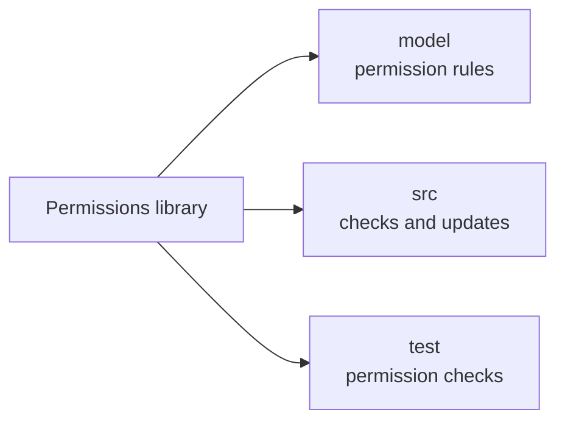

# Permission rules

This folder describes who may use each part of OpenCrane. It gives the permissions
service rules for people, assistants, groups and conversations. These rules help
keep private chats private and limit organisation settings to the right people.

## What it is responsible for

- Defines which relationships can give someone access.
- Requires current membership as well as a role for organisation owners and admins.
- Keeps conversation participation separate from permission to manage participants.
- Keeps routine metadata readable after retirement while removing management rights.
- Describes explicit grants for resources such as models and tools.
- Keeps a readable description and the version installed by the application together.

## Main files

| File | What it does |
| --- | --- |
| `v1.fga` | Describes the permission rules in OpenFGA's text format. |
| `v1.json` | Holds the same rules in the data format sent to OpenFGA. |

## How it connects

The [permissions library](../README.md) installs these rules in
[OpenFGA](../../../GLOSSARY.md#openfga-permissions-service), the service that answers
access questions. The [client code](../src/client.ts) loads the data file during
setup. The [permission tests](../test/projection.test.ts) check that both files agree.

## Not done here

These files describe the rules, rather than keeping each person's current access.
The library builds that access from the saved history of changes.
