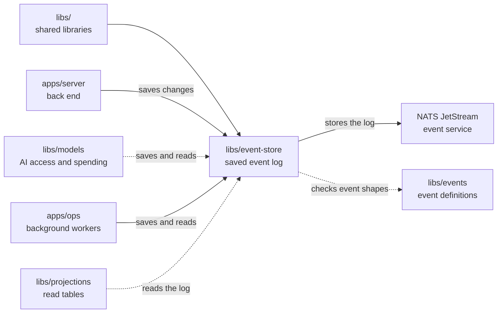

# Event store

## What this is

This package saves OpenCrane's events in a permanent log and reads them back in order.
An [event](../../GLOSSARY.md#event) is a saved record of something that happened,
such as a message being sent. NATS JetStream, a service that stores and passes on messages, keeps this log
for one customer’s private OpenCrane installation, called a
[silo](../../GLOSSARY.md#silo).

## Where it fits

This is one of the packages that build everything from the
[event log](../../GLOSSARY.md#event-log-event-store).
The [back end](../../apps/server/README.md),
[AI access library](../models/README.md) and
[background workers](../../apps/ops/README.md) save changes through it.
[libs/projections](../projections/README.md) reads it to rebuild database tables.
[libs/events](../events/README.md) supplies the rules for checking every stored record.



## What it is responsible for

- Save a valid event only if the relevant history has not changed since the caller
  read it. Report a conflict when another change came first. For some changes,
  check the whole log position as well as one item's history.
- Check that saved memory facts belong to the right person or group before saving them.
- Stop retrying when the caller cancels or its access time limit runs out.
  Repeat the caller's access check before saving when requested.
- Return the earlier result when the same request is repeated, rather than save it twice.
- Read one record, one item's history or the whole log in order.
- Keep [stream summaries](../../GLOSSARY.md#stream-summary), small sets of facts
  from an item's history, in memory. Read new events before using them and drop
  older summaries when their memory allowance is full.
- Check that the log keeps its history, disallows deletion and uses encrypted
  connections with the right credentials for each program.

## Processes it handles

1. **The server records a change.** It sends an event and the last position it
   read for that item. The store checks the record, then saves it or reports a
   conflict. The caller reloads and checks its decision again after a conflict.
2. **A worker catches up.** It reads events after its saved position and handles
   them in order. After a restart, it can continue from that position.
3. **A reader uses a summary.** The library adds new events before returning the
   saved facts. A reader that runs out of time refuses the call; catch-up can
   continue so the next call can use its progress.

## How to run or test it

Tests share a port picker that avoids outgoing connections and the secondary dev stacks.
It tries another port if one is busy. Each fixture starts its own NATS server and
keeps its own event history, while reusing certificates to reduce setup time.

Run the type check and event-store tests with these commands. The test command
needs the local NATS test server fetched first. The helper `wireSubject` turns an
event stream name into its NATS name:

```sh
nice -n 10 npm run typecheck -w libs/event-store
sh scripts/fetch-nats.sh
nice -n 10 npx vitest run libs/event-store/test
```

```ts
import { wireSubject } from '@opencrane/event-store';

const subject = wireSubject('member-alice');
// Expect 'ev.member.alice'.
```

## Where to read more

- [README.robot.md](README.robot.md): settings, exact behaviour, recovery and tests.
- [Events](../events/README.md): the event shapes checked before saving.
- [Projections](../projections/README.md): tables built from the saved event log.
- [Why NATS JetStream holds the event log](../../docs/adr/0001-event-store-nats-jetstream.md).
- [Glossary](../../GLOSSARY.md): plain meanings of shared terms.
