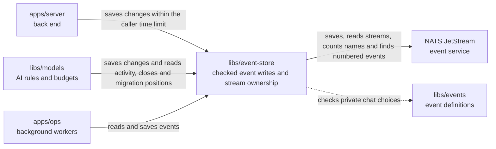

# libs/event-store

## What this is

Store events in NATS JetStream and read them in order.
An [event](../../GLOSSARY.md#event) is a saved record of one thing that happened.
This package stores the event log for one silo, OpenCrane's private installation
for one customer. It checks events before saving them and gives callers an
ordered way to read them back.

## Where it fits

OpenCrane saves every change as an [event](../../GLOSSARY.md#event) in a log
that is never changed. Everything else, such as read tables and permissions, is
built from that log and can be rebuilt from it. This package keeps that log.
This package belongs to the event core. `apps/server` and `libs/models` save
changes through it. `apps/ops` reads the log for background work and saves the
events its reactions produce. NATS JetStream is the
service that keeps and carries the saved events. The package checks event shapes
with `libs/events`.



## What it is responsible for

- Save a valid event only if nothing else has changed the same thing since the
  caller last read it. Otherwise report a conflict, so the caller can reload and
  try again.
  Check the whole log position for ownership migration and provider drain changes.
- Require the current memory event version for new writes, while still reading old events.
  Check that its scope id matches its recorded owner, kind and silo before saving it.
  Refuse repeated dependencies and a key reference that belongs to another memory revision.
- Stop retries when the caller's access time limit expires.
- Return the earlier result when a caller repeats the same request.
- Let callers that have checked their history save a change without reading that
  history again. A conflict still checks for an earlier copy of the request.
- Read one saved event by its number, so callers can check an indexed result.
- Read the history of one thing, such as one member, or follow the whole event
  log in order.
- Keep a [stream summary](../../GLOSSARY.md#stream-summary), a few facts built from
  events in memory. Each use reads new events first. Older summaries are dropped
  when the stream count or memory budget is reached. An oversized summary is
  dropped on its own, so other streams keep their saved facts.
- Check that the NATS event stream keeps its history and cannot be deleted.
- Require encrypted NATS connections and the right credentials for each role.

Conversation writes check that the saved conversation id matches the subject.
Creation starts an empty conversation stream, so a new audience adds a new stream
name. Callers can read the number of saved stream names without listing them or
reading their events.
New closing events and participant changes use the participation stream. This keeps
access checks separate from messages. Older callers can still save closing events
on the conversation stream, and replay reads both forms. Model decisions read both
closing formats through their existing conversation activity read.
New group chats are limited to 97 people so their permission update fits in one write.

Tool catalogue writes check the tool hashes against the saved definitions and require
the same server id in the event and its subject.

Private chat choices use a separate stream for each person. They require that person's human identity.

## Processes it handles

1. **The server records a change.** It sends the new event and the number of the
   last event it saw for that thing. The store saves it, or reports a conflict if
   another change came first.
2. **A worker catches up.** It reads events after its saved position, handles them
   in order and can continue from that position after it restarts.
3. **A reader uses a summary.** It adds new events to its saved facts before making
   a decision. A reader that runs out of time refuses that call. The read continues
   in the background, so the next call can use its progress.

After restoring the event log from a backup, the server and models processes
restart before serving requests. This clears their saved summaries.

## How to run or test it

Run the type check and event-store tests with these commands. The test command
needs the local NATS test server fetched first. The helper `wireSubject` turns an
event stream name into its NATS name:

```sh
npm run typecheck -w libs/event-store
sh scripts/fetch-nats.sh
npx vitest run libs/event-store/test
```

```ts
import { wireSubject } from '@opencrane/event-store';

const subject = wireSubject('member-alice');
// subject is 'ev.member.alice'.
```

## Where to read more

- [README.robot.md](README.robot.md): settings, exact behaviour, recovery and tests.
- [Events](../events/README.md): the event shapes checked before saving.
- [Projections](../projections/README.md): tables built from the saved event log.
- [Why NATS JetStream holds the event log](../../docs/adr/0001-event-store-nats-jetstream.md).
- [Glossary](../../GLOSSARY.md): plain meanings of shared terms.
