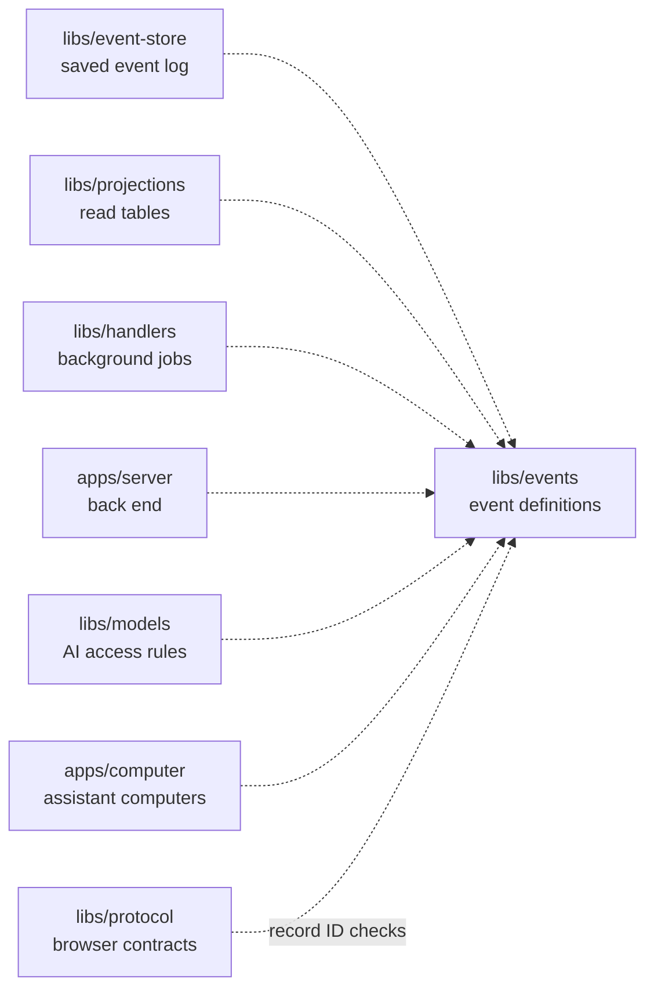

# Events

## What this is

The list of every kind of event OpenCrane records, and the exact data each one carries.
An [event](../../GLOSSARY.md#event) is a saved record of something that happened.
This library checks those records and keeps older records readable.
It does not save events or decide who may act.

## Where it fits

This package belongs to the event core. [libs/event-store](../event-store/README.md)
checks events with it before saving or returning them.
Other libraries and apps use the same definitions to read saved changes and check record IDs.



## What it is responsible for

- Define each event's type, data and shared details, such as its id and time.
- Share record ID checks with the apps and libraries that accept the same format.
- Reject unknown event types and badly formed records.
- Keep older records readable during [replay](../../GLOSSARY.md#replay).
- Name the background jobs that follow each kind of saved change.
- Rebuild routine definitions and preview their scheduled dates without starting work.
- Derive session settings and tool choices from saved facts.
- Keep private text encrypted and credentials out of event data.

## Processes it handles

1. **A caller checks an event.** The library checks its type and data.
   The caller gets either a checked record or a reason for refusal.
2. **A developer adds an event type.** They update the registry and event catalogue
   together. The catalogue check reports any difference between their event lists.
3. **A caller rebuilds a routine.** The library reads its saved changes and returns
   its definition and run facts. It grants no access and starts no work.
4. **A caller previews a schedule.** The library returns future dates and warnings
   about clock changes. It saves nothing.

## How to run or test it

Run these commands from the repository root:

```sh
nice -n 10 npm run typecheck -w libs/events
nice -n 10 npx vitest run libs/events/test --maxWorkers=2
nice -n 10 npm run check:events
```

For example, an unknown event type is refused:

```ts
import { parseEventByType } from '@opencrane/events';

const result = parseEventByType({ type: 'not.registered' });
// Expect result.success to be false.
```

## Where to read more

- [README.robot.md](README.robot.md): exact contracts, limits and test details.
- [Event catalogue](../../docs/architecture/events.md): what each event means and triggers.
- [Event store](../event-store/README.md): where events are saved.
- [Why NATS JetStream holds the event log](../../docs/adr/0001-event-store-nats-jetstream.md).
- [Glossary](../../GLOSSARY.md): plain meanings of shared terms.
