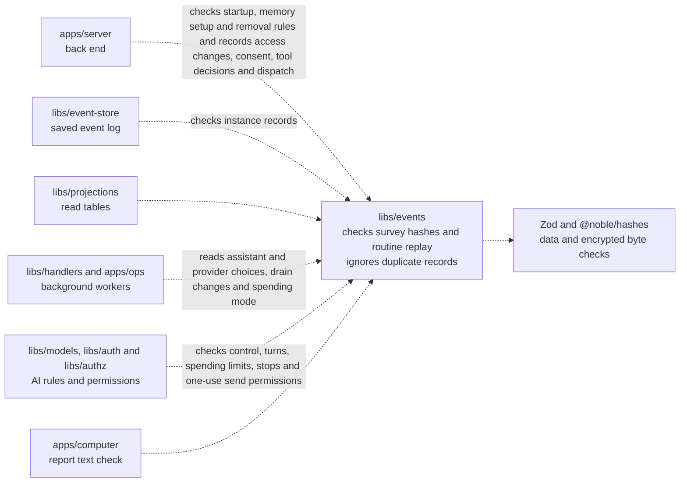

# libs/events

## What this is

The list of every kind of event OpenCrane records, and the exact data each one carries.
An [event](../../GLOSSARY.md#event) is a saved record of one thing that happened.
This package says which event types exist and what information each one carries.
It checks new memory text and still accepts older encrypted events for replay.
It checks event data, but it does not save events or decide whether a person may act.

## Where it fits

OpenCrane saves every change as an [event](../../GLOSSARY.md#event) in a log
that is never changed. Everything else, such as read tables and permissions, is
built from that log and can be rebuilt from it. This package defines what each
event looks like.
This is shared code in the event core. The event store, background reactions,
read-table builders and `apps/server` use its event definitions and checks.
`libs/models`, `libs/auth` and `libs/authz` also use these definitions for AI rules and
permissions. `apps/ops` uses them in its background workers. The event registry
also uses Zod, a library that checks data shapes, and `@noble/hashes` to check
the hash of encrypted survey bytes.



Tool catalogue records keep exact definitions and the dates of successful or failed checks.
The back end checks tool hashes against their saved definitions. A hash is a fixed-length
value calculated from those definitions. Older records remain readable for replay.

## What it is responsible for

- Check encrypted survey records and the bounded answers for all four steps.
  Check each saved answer’s hash without reading a private key. A hash is a
  fixed-length value calculated from the encrypted bytes.

- Define private tool-instance starts, observations and owner stop requests.
  These records contain identity and timing details, with no credentials or callable status.
  A counter names the version of startup access material, separately from process starts.
- Define exact HTTPS destination rules for the silo, a person or an assistant.
  Refuse reserved internal names, including `home.arpa` and names beneath it.

- Defines hosted startup credential requirements and review references without secret values.
- Records nightly memory setup with the consenting member, assistant, paying group
  and accepted cap of 100 euro cents. This record starts no work and spends no money.
- Define computer-wide control intent with the reviewed requester and affected turn ids.
- Describe an owner or admin’s exact tool review separately from tool discovery.

- Defines shared child records with a parent message, fixed payer and named people.
- Define strict routine records and rebuild their saved facts without starting work.
  Older routines stay readable and need migration before use.
- Defines delegated task relationships and outcomes, including cancellation. Older records
  remain readable. These records grant no permission to run a task.

- Defines tool dispatch records, unsupported consent refusals, requester retries and safe invitation refusal records.
- Records the departure review used for a member removal. Older removals still replay.
- Defines owner appointment requests and confirmations on member records.

- Define records for pausing new model turns, cancelling that pause and switching on managed calls.
  Keep switch-on in the silo’s spending stream.
  Stop new holds while allowing existing holds to settle or be released.
- Define spending stop reasons with their limit and UTC reset time.
  Keep older records with only a spending scope readable.
  Link each later refused turn to the saved stop that blocked it.
- Define the final model send permission with its call, body hash and spending hold.
  Saving this record means the call may have been sent, even if its reply is lost.
- Define optional provider and binding positions on turn records and spending holds.
- Defines saved provider choices and pauses without granting model access.
- Define the wrapper every event shares (its id, its type, what it is about,
  who caused it and when), and the data each event type carries.
- Check unknown values against the right event shape.
- List which named background reactions subscribe to each event type.
- Keep its event type list in step with the [event catalogue](../../docs/architecture/events.md).

It checks recorded memory ownership fields and keeps old encrypted memory events readable for replay.
Old events without recorded ownership do not grant access. New memory writes refuse
repeated dependencies, so a bad write cannot stop table updates for other scopes.

It defines tool start and finish records that exclude arguments, results and error text.
The computer and server share its check for call ids and tool names.
Tool access decisions can carry a call id. The shared text check refuses hidden
control characters before saving the id.
It also records when part of a private reply was lost before the server could save it.
Refusal records keep a hash of the caller's command id, so that id cannot appear
as private text in the record. A hash is a fixed-length value calculated from the id.
Invitation and join events can record whether a personal assistant was requested.
Older events without that choice still parse. Email-only join events also record
the account issuer and subject. Older joins without those fields remain valid.

Group chat records name each participant explicitly. Participant changes use a
separate event stream so ordinary messages do not change access. New closing
events use that stream too. Older callers can still save a close on the conversation
stream, and both forms replay.

New group chats record at most 97 people, including their creator. Older saved
events keep their original reading rules.

Archive and read choices name one person and their join. They contain no chat text.

## Processes it handles

A memory tombstone records a fact id and its next revision without any private text.
The projection uses it to hide the fact and dependent copies before reading their keys.
The HTTP forget command and key cleanup are not built yet.

1. **The event store checks an event before saving it.** It passes the event to
   `parseEventByType`. A badly formed event or an unknown type is refused and
   never saved.
2. **A developer adds an event type.** The registry and event catalogue are
   updated together. `npm run check:events` checks that this list and the event
   catalogue match.

3. **Saved routine records are read again.** `foldRoutine` rebuilds their definition
   and run facts. It remembers each modern event's id and ignores that event if it
   arrives again, even after later changes. It grants no access and starts no work.

## How to run or test it

Run the type check and focused tests with these commands. A small real call is:

```sh
npm run typecheck -w libs/events
npx vitest run libs/events/test
npm run check:events
```

```ts
import { parseEventByType } from '@opencrane/events';

const result = parseEventByType({ type: 'not.registered' });
// result.success is false and result.reason is 'unknown_event_type'.
```

## Where to read more

- [README.robot.md](README.robot.md): full contracts, examples and test details.
- [Event catalogue](../../docs/architecture/events.md): what each saved event means.
- [Event store](../event-store/README.md): where events are saved.
- [Why NATS JetStream holds the event log](../../docs/adr/0001-event-store-nats-jetstream.md).
- [Glossary](../../GLOSSARY.md): plain meanings of shared terms.
