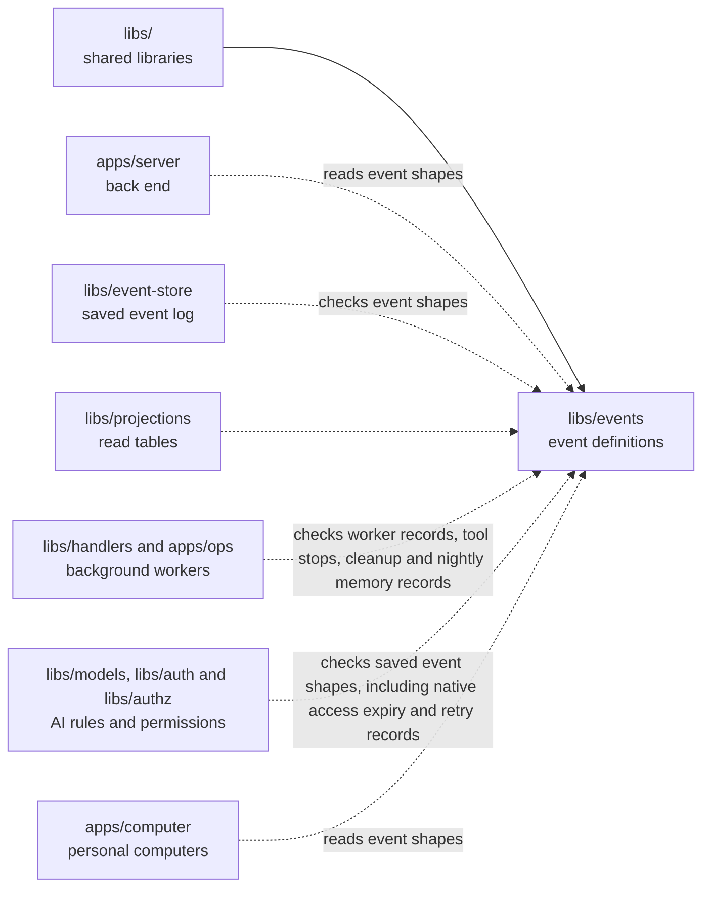

# Events

## What this is

The list of every kind of event OpenCrane records, and the exact data each one carries.
An [event](../../GLOSSARY.md#event) is a saved record of one thing that happened, such as a member joining or a message being sent. This package says which event types exist and what information each one carries. It checks event data, including new memory text, and still accepts older encrypted events for replay. It does not save events or decide whether a person may act. It also defines private turn records that contain memory reference ids, counts and fixed reasons, without saved fact text. Native spending holds can keep their original access expiry after a restart. The package can preview routine dates without starting work.

## Where it fits

This is one of the packages that build everything from the
[event log](../../GLOSSARY.md#event-log-event-store), the permanent record of changes.
[libs/event-store](../event-store/README.md) uses it to check events before saving
or returning them. [libs/projections](../projections/README.md) builds read tables,
and [libs/handlers](../handlers/README.md) queues background work using its definitions.
The server and the AI access library use the same definitions.



## What it is responsible for

- List every event type and the data it holds, from membership and chat to tools,
  spending and memory.
- Define the details shared by events: an id, type, subject, source and time,
  plus who caused the change when recorded. The subject names what changed.
- Refuse unknown event types and badly formed data. Checking a record does not
  give its writer permission or save it.
- Keep older saved records readable during [replay](../../GLOSSARY.md#replay),
  reading the log again to rebuild data.
- List which named [reactions](../../GLOSSARY.md#reaction-handler), background jobs
  following a saved change, subscribe to each event type.
- Rebuild routine definitions and preview future dates for scheduled work, including
  clock changes, without starting that work.

## Processes it handles

1. **The event store checks a record.** It calls `parseEventByType` before saving
   an event. An unknown type or invalid record is refused; valid data still needs
   the caller's access and write checks.
2. **A developer adds an event type.** They update the registry and the
   [event catalogue](../../docs/architecture/events.md) together.
   `npm run check:events` checks that both lists name the same types.
3. **Saved routines are read again.** The library rebuilds their definitions and
   past runs. Repeated records do not start work or grant permission.
4. **A caller previews a routine.** It supplies a time and the last used local
   date, when known. The library returns future dates and clock-change warnings
   without saving anything.

## How to run or test it

Run the type check and focused tests with these commands. A small real call is:

```sh
nice -n 10 npm run typecheck -w libs/events
nice -n 10 npm test -- libs/events/test
npm run check:events
```

```ts
import { parseEventByType } from '@opencrane/events';

const result = parseEventByType({ type: 'not.registered' });
// Expect result.success to be false and result.reason to be 'unknown_event_type'.
```

## Where to read more

- [README.robot.md](README.robot.md): full contracts, examples and test details.
- [Event catalogue](../../docs/architecture/events.md): what each saved event means.
- [Event store](../event-store/README.md): where events are saved.
- [Why NATS JetStream holds the event log](../../docs/adr/0001-event-store-nats-jetstream.md).
- [Glossary](../../GLOSSARY.md): plain meanings of shared terms.
