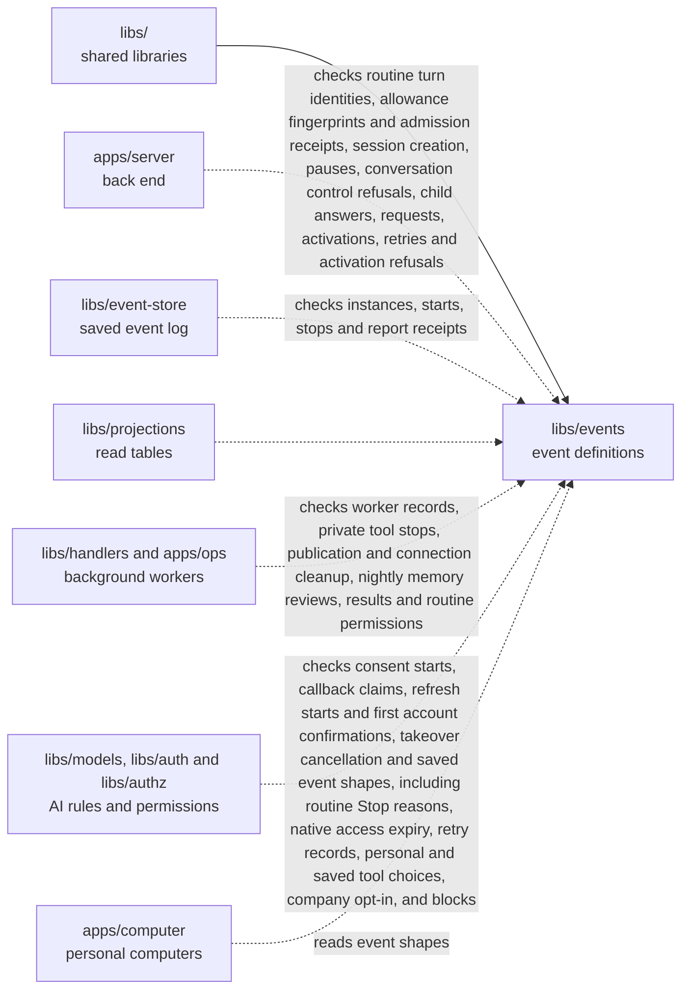

# Events

## What this is

The list of every kind of event OpenCrane records, and the exact data each one carries.
An [event](../../GLOSSARY.md#event) is a saved record of one thing that happened, such as a member joining or a message being sent. This package says which event types exist and what information each one carries. It checks event data, including new memory text, and still accepts older encrypted events for replay. It does not save events or decide whether a person may act. It also defines private turn records that contain memory reference ids, counts and fixed reasons, without saved fact text. Native spending holds can keep their original access expiry after a restart. The package can preview routine dates without starting work.

A routine spending allowance can keep a fingerprint of its checked preparation.
Retries must match it before they can recover that allowance. A routine activation
receipt names that allocation and one sender attempt. Reading or replaying it starts no work.

Control refusals record the attempt, the person who made it, its conversation, a
fingerprint of the checked request and a fixed reason. They contain no computer or private turn details.

Approval cancellation can record takeover as its fixed cause. It ends unused
consent for a matching saved control request and carries no private review details.

Computer turn records can keep a routine's input id separate from its turn id,
alongside the allocated spending root. These identifiers grant no permission to send.

Account refresh starts record one attempt for a saved generation. Rebuilding these
records keeps the account and attempt without contacting its provider.

## Where it fits

This is one of the packages that build everything from the
[event log](../../GLOSSARY.md#event-log-event-store), the permanent record of changes.
[libs/event-store](../event-store/README.md) uses it to check events before saving
or returning them. [libs/projections](../projections/README.md) builds read tables,
and [libs/handlers](../handlers/README.md) queues background work using its definitions.
The server and the AI access library use the same definitions, including the saved
Allow, Ask or Block choice for a tool.



## What it is responsible for

- List every event type and the data it holds, from membership and chat to tools,
  spending and memory.
- Define the details shared by events: an id, type, subject, source and time,
  plus who caused the change when recorded. The subject names what changed.
- Refuse unknown event types and badly formed data. Checking a record does not
  give its writer permission or save it.
- Keep older saved records readable during [replay](../../GLOSSARY.md#replay),
  reading the log again to rebuild data.
- List which named [reactions](../../GLOSSARY.md#reaction-handler), background jobs
  following a saved change, subscribe to each event type.
- Rebuild routine definitions and preview future dates for scheduled work, including
  clock changes, without starting that work.
  Share the same pause record checks with the server's internal owner operation.

## Processes it handles

A first account confirmation records the verified issuer and account, granted scopes,
expiry and exact private storage reference. It follows the consent and callback records.
Replaying those three records starts no work and grants no tool access.

A personal callback claim records the one worker allowed to continue the attempt.
It contains only references. It does not confirm a provider request or activate an account.
Replaying it reads no credentials and starts no work.

Routine session creation can name its saved claim, occurrence and worker. These details
keep retries apart from ordinary human chats and grant no permission to start work.

Company opt-in records an admin’s explicit choice for one server installation.
It grants no access and starts no background work.

A saved reply can include receipts for several small pieces of text. Each receipt
keeps its original number and digest so a repeated piece can be checked.

A personal account choice records either one checked profile revision or an explicit clear.
These records grant no access and contain no account label or credential.

Saved personal connection revocations and replacements name the background cleanup
reaction. Replaying those records never deletes stored credentials.

Memory correction records name the replacement revision and the revision it replaces.
The replacement stays encrypted. Older records still parse for recovery, but cannot
supply the ownership and revision needed to read a fact.

Hosted image check requests record the exact image, registration and attempt number.
They contain no report bytes or credentials and say nothing about passing checks.

Before sending a published tool call, the models process saves a start record with
the request, server, connection, reviewed revision and acknowledged gateway configuration.
It contains no request bytes or credentials. It records that the pass was spent;
it does not prove that the call reached the tool. Replaying it never sends a call.
If a later check refuses the call before sending, the models process saves a not-sent
outcome on the same stream.

Routine creation, reassignment and retirement name the permission worker. It records
who may read metadata or manage a routine. These subscriptions start no routine work.

The publication subscription names the worker that prepares complete gateway
configurations. Withdrawal has no preparation subscription.

A routine Stop has its own fixed budget reason and keeps the saved source reference.
It does not describe an admin intervention as a requester Stop or start routine work.

Budget turn stops carry only their reason kind and a reference to the saved spending
stop. Participants can read them without seeing amounts or payer ids. Member stops
keep their original shape. The bridge uses the same data checks as the event log
before delivering these Stops to a computer.

A child-chat request records the source id, chosen people, assistant and spending
upper bound. It contains no message text and must name the requesting person.
A saved child start failure names the attempt, stage and a fixed refusal reason.
The stage is creation, first input or activation; the record contains no credentials.
A retry names that failure and the next attempt without changing the original request.
It contains no source text and cannot authorise work.
A child activation records the checked intent, creation, first input and attempt.
It contains no message text and does not release the hold on execution.

Hosted image requests name one platform, a public upstream and the first check attempt.
These records contain no check result or report bytes.

Personal connection records can name an exact stored generation and the person who
saved it. A replacement names the expected stream version. Old records still replay,
but missing generation details never make a profile available for tool calls.
Consent starts record private storage references and expiry. They contain no consent link
or private sign-in values, and replay never contacts the provider or activates an account.
Owner revocation records invalidate one profile. Admin disable records block all personal
profiles for one member and server. Neither record claims the stored token was deleted.

Nightly memory records name one scope and date, its selected fact revisions and why work stopped.
They contain no memory text and grant no spending or computer access.

A memory tombstone records a fact id and its next revision without any private text.
The projection uses it to hide the fact and dependent copies before reading their keys.
The cleanup record reports completed deletion or unavailable cleanup after retries run out.
It names the original change without private text. An operator can retry the failed job;
a later completion then confirms key destruction and removal of searchable text.
The HTTP forget command is not built yet.

1. **The event store checks an event before saving it.** It passes the event to
   `parseEventByType`. A badly formed event or an unknown type is refused and
   never saved.
2. **A developer adds an event type.** The registry and event catalogue are
   updated together. `npm run check:events` checks that this list and the event
   catalogue match.

3. **Saved routine records are read again.** `foldRoutine` rebuilds their definition
   and run facts. It remembers each modern event's id and ignores that event if it
   arrives again, even after later changes. Definitions still match when a database
   returns their fields in a different order. It grants no access and starts no work.

4. **A caller previews a routine schedule.** It supplies the time and the last used
   local date, if there is one. The library returns future dates and clock-change
   warnings. It saves nothing and starts no work.

## How to run or test it

Run the type check and focused tests with these commands. A small real call is:

```sh
nice -n 10 npm run typecheck -w libs/events
nice -n 10 npm test -- libs/events/test
npm run check:events
```

```ts
import { parseEventByType } from '@opencrane/events';

const result = parseEventByType({ type: 'not.registered' });
// Expect result.success to be false and result.reason to be 'unknown_event_type'.
```

## Where to read more

- [README.robot.md](README.robot.md): full contracts, examples and test details.
- [Event catalogue](../../docs/architecture/events.md): what each saved event means.
- [Event store](../event-store/README.md): where events are saved.
- [Why NATS JetStream holds the event log](../../docs/adr/0001-event-store-nats-jetstream.md).
- [Glossary](../../GLOSSARY.md): plain meanings of shared terms.
