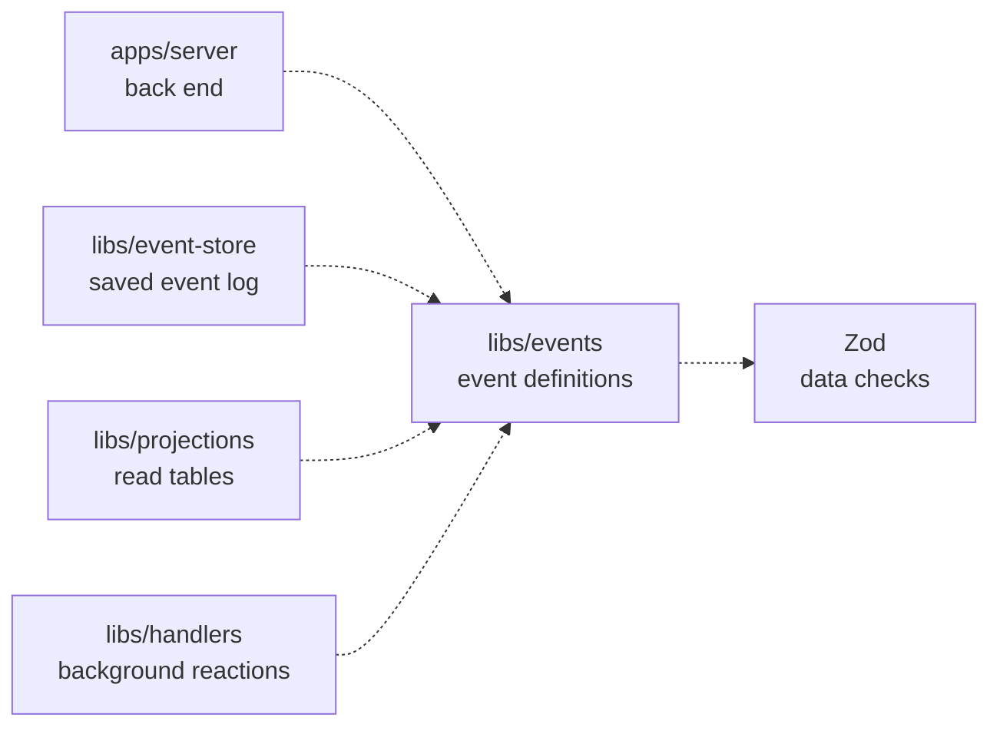

# libs/events

## What this is

The typed event envelope and event-type registry: the contract from docs/architecture/events.md, in code.
An [event](../../GLOSSARY.md#event) is a saved record of one thing that happened.
This package says which event types exist and what information each one carries.
It checks event data, but it does not save events or decide whether a person may act.

## Where it fits

This is shared code in the event core. The event store, background reactions,
read-table builders and `apps/server` use its event definitions and checks.
The event registry also uses Zod, a library that checks data shapes.



## What it is responsible for

- Define the shared event envelope and the data shape for each registered type.
- Check unknown values against the right event shape.
- List which named background reactions subscribe to each event type.
- Keep its event type list in step with the [event catalogue](../../docs/architecture/events.md).

## Processes it handles

1. **The server checks an incoming event.** It passes the unknown value to
   `parseEventByType`. The result says whether the type is unknown, the event is
   invalid, or the event has a valid shape.
2. **A developer adds an event type.** The registry and event catalogue are
   updated together. The repository check reports if their lists disagree.

## How to run or test it

Run the type check and focused tests with these commands. A small real call is:

```sh
npm run typecheck -w libs/events
npx vitest run libs/events/test
```

```ts
import { parseEventByType } from '@opencrane/events';

const result = parseEventByType({ type: 'not.registered' });
```

## Where to read more

- [README.robot.md](README.robot.md): full contracts, examples and test details.
- [Event catalogue](../../docs/architecture/events.md): what each saved event means.
- [Event store](../event-store/README.md): where events are saved.
- [Why events use a shared NATS log](../../docs/adr/0001-event-store-nats-jetstream.md).
- [Glossary](../../GLOSSARY.md): plain meanings of shared terms.
