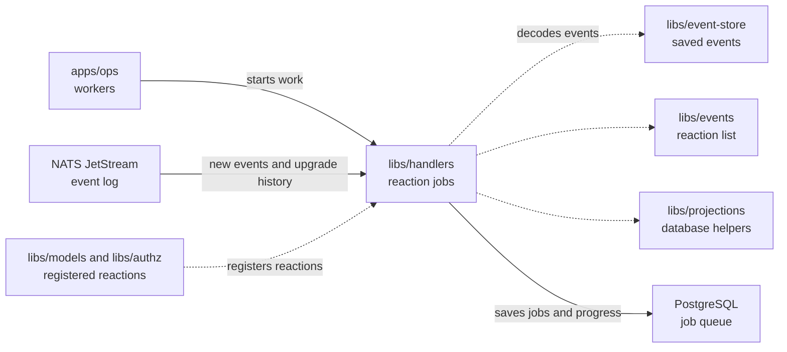

# libs/handlers

## What this is

Queue and run background reactions to events.
A [reaction](../../GLOSSARY.md#reaction-handler) is work that follows a saved
event, such as creating an assistant after a member joins. This package sends
each reaction to a job queue in PostgreSQL and runs the jobs. `apps/ops` starts
the [dispatcher](../../GLOSSARY.md#dispatcher), the background program that
sends events to registered reactions, and the workers that run them.

## Where it fits

OpenCrane saves every change as an [event](../../GLOSSARY.md#event) in a log
that is never changed. Everything else, such as read tables and permissions, is
built from that log and can be rebuilt from it. This package runs the background
work that follows each event.
This package belongs to the event core. `apps/ops` runs it. The dispatcher reads
new events straight from NATS JetStream, the service that holds the event log,
using the connection and decoding helpers in `libs/event-store`. `libs/events`
names each reaction's event types;
`libs/projections` supplies the database helpers reactions can use. The queue
uses pg-boss, a job queue stored in PostgreSQL.
The reactions themselves live elsewhere. `libs/authz` updates permissions.
`libs/models` handles budgets, model access and ownership. `apps/ops` creates
assistants and claims computers.



## What it is responsible for

- Read new events and queue the reactions that subscribe to them.
- Run jobs about the same thing, such as one member, one after another, while
  jobs about different things run side by side.
- Retry failed jobs and keep failed jobs from being skipped silently.
- Save a note that the job is done in the same database step as the reaction's
  changes, so its database changes are never applied twice.
- Let an operator retry a failed job after fixing its cause.
- Add historical jobs for new subscriptions during a stopped-service upgrade.

Chat creation and participant permission jobs run in the same conversation order,
even though their events use separate streams. Both new jobs and historical jobs
queued during an upgrade use that order.

## Processes it handles

1. **A member joins.** The dispatcher reads the "member joined" event and
   queues three jobs: give the member their permissions (`update-openfga`),
   create their assistant (`create-assistant`) and allow the default AI models
   (`seed-model-grants`).
2. **A reaction fails.** Later jobs about the same thing wait, while jobs about
   other things carry on. An operator can repair the cause and retry the failed
   job, or deliberately cancel a failed original with the ops command.

3. **A release changes subscriptions.** The dispatcher reports which reactions and
   event types changed and waits for shutdown. With writers and workers stopped,
   `npm run ops -- upgrade-handlers` adds historical jobs for new subscriptions.
   An interrupted scan continues from its saved progress. Computers stay in
   their current state while the dispatcher waits. Finished reactions keep their
   receipts, so they do not run again. The
   [operator procedure](../../apps/ops/README.robot.md#handler-subscription-upgrade)
   lists the stop, dry-run, upgrade and restart steps.

## How to run or test it

Run the type check and focused tests with these commands. The tests need the
local NATS test server. Set `PG_TEST_URL` to a PostgreSQL admin connection whose
role can create databases to include the PostgreSQL tests:

```sh
npm run typecheck -w libs/handlers
sh scripts/fetch-nats.sh
npx vitest run libs/handlers/test
```

Each reaction receives the saved event and a database transaction. This example
registers a reaction that only runs a harmless query. A real reaction changes
its own tables through the same transaction. The name must come from the reaction
list in `libs/events`:

```ts
import type { EventEnvelope } from '@opencrane/events';
import { registerHandler } from '@opencrane/handlers';
import type { Query } from '@opencrane/projections';

async function checkEvent(event: EventEnvelope, transaction: Query): Promise<void> {
  await transaction.query('SELECT $1::text', [event.id]);
}

const handler = registerHandler('claim-computer', checkEvent);
```

## Where to read more

- [README.robot.md](README.robot.md): queue rules, settings, recovery and tests.
- [Events](../events/README.md): the list of reaction names and event types.
- [Projections](../projections/README.md): database helpers used by reactions.
- [Why handlers run as queued jobs](../../docs/adr/0004-handler-runtime.md).
- [Glossary](../../GLOSSARY.md): plain meanings of shared terms.
