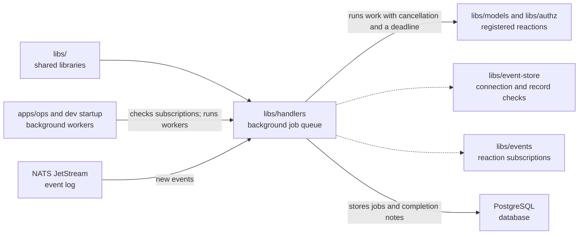

# Handlers

## What this is

This package queues and runs background work after OpenCrane saves a change.
That work is called a [reaction](../../GLOSSARY.md#reaction-handler), such as
creating an assistant after a member joins. A saved job list lets the workers
continue after a restart and retry work that fails.

## Where it fits

This is one of the packages that build everything from the
[event log](../../GLOSSARY.md#event-log-event-store).
[apps/ops](../../apps/ops/README.md), the background workers, starts the
[dispatcher](../../GLOSSARY.md#dispatcher), which reads new events and puts jobs
on the list. The reactions live in other packages: `libs/authz` updates permissions,
`libs/models` handles AI access and spending, and `apps/ops` manages assistants and computers.
The list is stored in PostgreSQL using pg-boss, a job queue library.



## What it is responsible for

- Read new events and queue the reactions that subscribe to them.
- Run related jobs in order, such as changes for one member. Let unrelated jobs
  run alongside them.
- Keep queued jobs safe across restarts, so none are lost.
- Retry failed work. Keep a job that exhausts its retries on the list and put a
  copy on a separate failure list for operators.
- Save completion in the same database step as a reaction's table changes,
  so a repeated job does not apply those changes twice.
- Let operators retry or deliberately cancel a failed job after checking its cause.
- Add jobs for older events when a release introduces a new subscription.

## Processes it handles

1. **A member joins.** The dispatcher reads the saved event and queues work to
   update permissions, create an assistant when requested and allow the default
   AI models. Each reaction checks the current saved state before acting.
2. **A reaction fails.** Later jobs for the same item wait while unrelated jobs
   continue. The failed job remains available for an operator to repair and retry.
   Memory cleanup also records when cleanup is unavailable after retries run out.
   On restart, the dispatcher retries those original cleanup jobs in order with the
   normal retry allowance. A saved completion prevents the work from happening twice.
3. **A release changes subscriptions.** Startup can check subscriptions before admitting members. The dispatcher reports a
   change and waits for shutdown. The upgrade adds jobs for relevant older events only once
   every other program using the database has stopped. Completed work stays completed.

## How to run or test it

The setup command waits up to five seconds for each NATS stream lookup or creation
request. This gives a busy server time to create the event log before workers start.

These commands run from the repository root. The test command fetches the required
tools before running the tests. PostgreSQL tests also need `PG_TEST_URL`, a
PostgreSQL admin connection whose role can create databases:

```sh
nice -n 10 npm run typecheck -w libs/handlers
nice -n 10 npm test -- libs/handlers/test
```

Each reaction receives the saved event, a database transaction and the attempt’s
cancellation signal and deadline. Gateway preparation uses these limits to stop work
and release its database lock when the attempt expires. This example
registers a reaction that only runs a harmless query. A real reaction changes
its own tables through the same transaction. The name must come from the reaction
list in `libs/events`:

```ts
import type { EventEnvelope } from '@opencrane/events';
import { registerHandler } from '@opencrane/handlers';
import type { Query } from '@opencrane/projections';

async function checkEvent(event: EventEnvelope, transaction: Query): Promise<void> {
  await transaction.query('SELECT $1::text', [event.id]);
}

const handler = registerHandler('claim-computer', checkEvent);
```

## Where to read more

- [Event recovery checks](../../infra/package/README.md): restores an earlier event copy
  after an interrupted subscription change, with reactions stopped.
- [README.robot.md](README.robot.md): queue rules, settings, recovery and tests.
- [Events](../events/README.md): the list of reaction names and event types.
- [Projections](../projections/README.md): database helpers used by reactions.
- [Why handlers run as queued jobs](../../docs/adr/0004-handler-runtime.md).
- [Glossary](../../GLOSSARY.md): plain meanings of shared terms.
