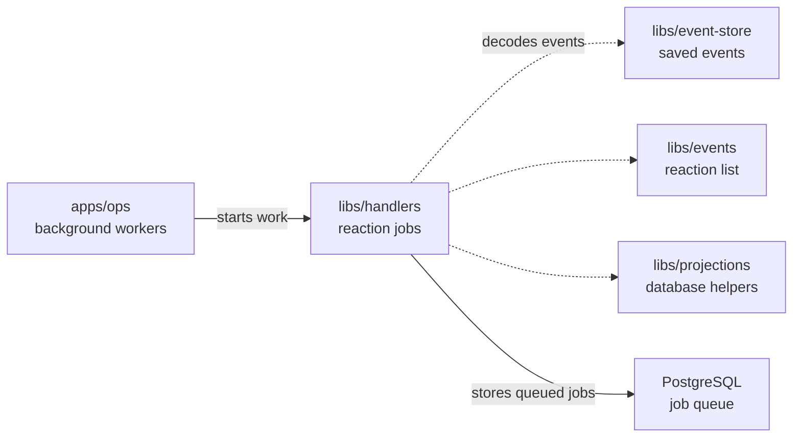

# libs/handlers

## What this is

Queue and run background reactions to events.
A [reaction](../../GLOSSARY.md#reaction-handler) is work that follows a saved
event, such as creating an assistant after a member joins. This package sends
each reaction to a job queue in PostgreSQL and runs the jobs. `apps/ops` starts
the dispatcher and workers.

## Where it fits

This package belongs to the event core. `apps/ops` runs it, and the event store
provides the events it reads. `libs/events` names each reaction's event types;
`libs/projections` supplies the database helpers reactions can use. The queue
uses pg-boss, a job queue stored in PostgreSQL.



## What it is responsible for

- Read new events and queue the reactions that subscribe to them.
- Run jobs for the same event stream in order while other streams can progress.
- Retry failed jobs and keep failed jobs from being skipped silently.
- Save a completed-job receipt with the reaction's database changes.
- Let an operator retry a failed job after fixing its cause.

## Processes it handles

1. **A member joins.** The dispatcher reads the event and queues the registered
   reactions, such as updating member tables and creating an assistant.
2. **A reaction fails.** Later jobs for the same stream wait, while other streams
   continue. An operator can repair the cause and retry the failed job.

## How to run or test it

Run the package type check with `npm run typecheck -w libs/handlers`.
The host defines `claimComputer` as a function that takes an event and a database
transaction. It registers that reaction by its name from the shared event list:

```ts
import { registerHandler } from '@opencrane/handlers';

const handler = registerHandler('claim-computer', claimComputer);
```

## Where to read more

- [README.robot.md](README.robot.md): queue rules, settings, recovery and tests.
- [Events](../events/README.md): the list of reaction names and event types.
- [Projections](../projections/README.md): database helpers used by reactions.
- [Why handlers run as queued jobs](../../docs/adr/0004-handler-runtime.md).
- [Glossary](../../GLOSSARY.md): plain meanings of shared terms.
