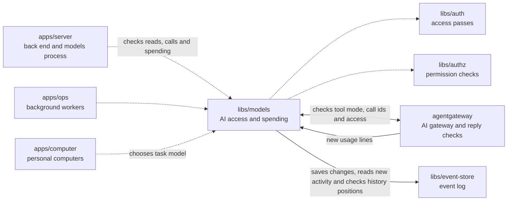

# Models

## What this is

The AI access and spending library for OpenCrane. Its running part is the models process, a separate program whose start file lives in `apps/server` (`src/models-main.ts`). It runs beside [agentgateway](../../GLOSSARY.md#agentgateway-ai-gateway), which forwards AI requests. The library also picks the model for each task, keeps the price list and [budgets](../../GLOSSARY.md#budget), holds the [tool rules](../../GLOSSARY.md#tool-rule-allow-ask-block) and the one-time approvals for Ask tools, and records who owns the silo.

## Where it fits

This shared library is used by the server, background workers and personal computers. It checks passes with `libs/auth`, permissions with `libs/authz`, and starts agentgateway to handle AI calls.



## What it is responsible for

- Choose an AI model for each task from a fixed routing table.
- Keep model prices and estimate each request's cost before sending it.
- Keep the spending limits that admins set: a daily and a monthly limit for the silo, and a monthly limit for each paying group and each assistant.
- Hold money before an AI call and settle the charge when usage is reported.
  Keep the budget state in memory after replay, so saving each change does not
  read all the old spending events again.
- Read a spending hold before starting the access check for its resolution.
  Read any new budget events before deciding whether it can be resolved.
  Check current access again before saving the resolution.
- List spending from the saved budget and call records, without reading chat history.
  Keep calls with an unknown outcome in the list alongside settled calls.
- Release an expired hold at zero cents when it was never allowed or sent.
- Read each new usage line once and leave old lines alone while idle. Retry a line
  if its event could not be saved.
- Check access passes, current permissions, tool rules, approvals and budgets before calls proceed.
- Check member or admin access for reads using saved membership and current permissions.
  Let one request reuse checks for the same saved access event.
- Check that an invitation's sender still has authority before it is accepted.
- Keep chat and computer facts in memory and read new events before each call.
  Check those facts before watching the streams that decide access. These checks
  share two seconds because the gateway waits only that long. Older summaries
  are dropped when their memory budget is reached and rebuilt on their next use.
  A summary that is too large is dropped on its own. Calls also refuse saved
  facts beyond the current history, which can happen after a backup restore.
- Mark refused tool calls so the computer can say when nothing was sent.
  Remove that marker from tool-server replies, which cannot prove this.
- Refuse unsafe tool call ids before saving a decision.
- Refuse callers who have disconnected before holding money.
- Keep calls working when another chat, a file or someone else's access changes during the check.
- Treat tool start and finish reports as activity that grants no access.
- Check that each Codex tool call belongs to the chat turn that received its access pass.
  Keep its call id, which links the tool's attempts and progress reports.
  Accept the model request that follows a tool result under the same spending limits.
- Start agentgateway without giving its provider key to the server or computer.
- Record what the AI provider used. When the result of a call is unknown, keep the held money in place until an owner or admin settles it.
- Give new members and assistants access to the active models ([grants](../../GLOSSARY.md#grant)), record the silo's first owner, store the AI provider settings that admins enter, and show spending history without private details.

A tool offered in Allow mode is refused if its policy changes to Ask during that
turn. A waiting Ask call can use only its own approval, once. Approvals opened by
a waiting computer expire after 15 minutes, even while the chat turn stays open.

## Processes it handles

1. **A person sends a chat message.** The server and the computer pick the model for the task. The computer sends the AI call to agentgateway. agentgateway asks the models process, which checks the passes, permissions and budget and holds the money. If the call is allowed, agentgateway sends it to the AI provider.
2. **An AI call finishes.** The gateway reports its use and the library settles the held amount. If the result cannot be confirmed, the full amount stays held for review. A later report of an unknown result restores money released before an allowed call was sent.
3. **An admin or owner changes access or spending.** The change is saved as an [event](../../GLOSSARY.md#event): the server saves tool rules and grants, and the models process saves spending limits. Background workers then update OpenFGA and the spending tables.

## How to run or test it

```sh
npm test -- libs/models
npm run typecheck -w libs/models
```

Some tests use Docker and a PostgreSQL test database. README.robot.md lists what they need.

A small example selects the model for a chat turn:

```ts
import { modelForTask } from '@opencrane/models/routing';

const model = modelForTask('chat_turn');
```

## Where to read more

- [README.robot.md](README.robot.md): exact prices, limits, settings, event rules and test detail.
- [The server](../../apps/server/README.md) holds the start file for the models process.
- [The glossary](../../GLOSSARY.md#models-process) explains the running process and AI gateway.
