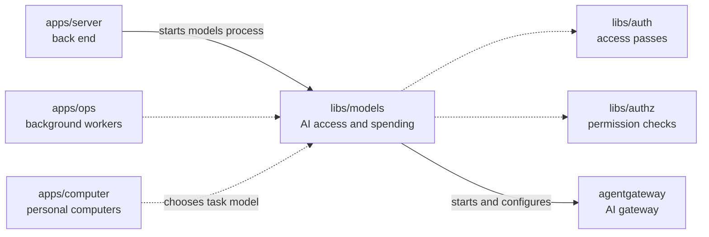

# Models

## What this is

The AI access and spending library for OpenCrane. Its running part is the models process, started by `apps/server`; it sits beside [agentgateway](../../GLOSSARY.md#agentgateway-ai-gateway), which forwards AI requests. The library also owns model choice, prices, [budgets](../../GLOSSARY.md#budget), tool rules, approvals, provider settings, grants, ownership and spending records.

## Where it fits

This shared library is used by the server, background workers and personal computers. It checks passes with `libs/auth`, permissions with `libs/authz`, and starts agentgateway to handle AI calls.



## What it is responsible for

- Choose an AI model for each task from a fixed routing table.
- Keep model prices and estimate each request's cost before sending it.
- Set daily and monthly spending limits for the silo, groups and assistants.
- Hold money before an AI call and settle the charge when usage is reported.
- Check access passes, current permissions, tool rules, approvals and budgets before calls proceed.
- Start agentgateway without giving its provider key to the server or computer.
- Record provider use and keep the reservation when a call's result is unknown.
- Manage model and tool grants, group spending, ownership, provider settings and safe spending history.

## Processes it handles

1. **A person sends a chat message.** The server and computer choose a model for the task. The models process checks the passes, permissions and budget, then agentgateway sends an allowed call to the provider.
2. **An AI call finishes.** The gateway reports its use and the library settles the held amount. If the result cannot be confirmed, the full reservation stays in place for review.
3. **An owner changes access or spending.** The server records the change, and background work updates the permission store or spending tables from the event history.

## How to run or test it

```sh
npm test -- libs/models
npm run typecheck -w libs/models
```

A small example selects the model for a chat turn:

```ts
import { modelForTask } from '@opencrane/models/routing';

const model = modelForTask('chat_turn');
```

## Where to read more

- [README.robot.md](README.robot.md): exact prices, limits, settings, event rules and test detail.
- [The server](../../apps/server/README.md) starts the models process.
- [The glossary](../../GLOSSARY.md#models-process) explains the running process and AI gateway.
