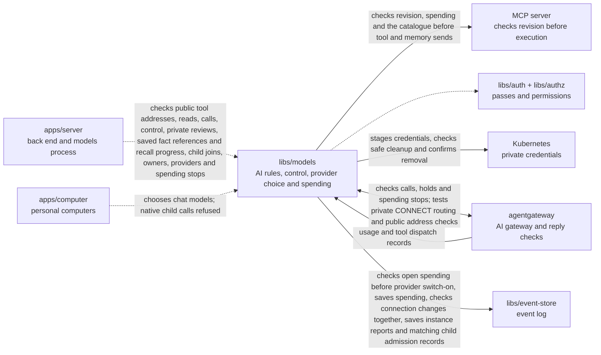

# Models

## What this is

The AI access and spending library for OpenCrane. Its running part is the models process, a separate program whose start file lives in `apps/server` (`src/models-main.ts`). It runs beside [agentgateway](../../GLOSSARY.md#agentgateway-ai-gateway), which forwards AI requests. The library also picks the model for each task, keeps the price list and [budgets](../../GLOSSARY.md#budget), holds the [tool rules](../../GLOSSARY.md#tool-rule-allow-ask-block) and the one-time approvals for Ask tools, and records who owns the silo.

## Where it fits

This shared library is used by the server, background workers and personal computers.
Its private credential adapter talks to Kubernetes through the server’s local proxy.
It checks passes with `libs/auth`, permissions with `libs/authz`, and starts agentgateway
to handle AI calls.



apps/ops confirms owner appointments for this package.

Tool calls need a fresh saved tool list whose hashes match its definitions. An unchanged check keeps a waiting approval valid.
A change to the tools or their rules ends that approval.
Configured tool servers need an atomic revision check: they compare the approved tool
list and running instance before executing a call. The models process checks a one-use
pass before sending the original request. Servers without this contract are refused.
Before sending, it obtains one budget permission without holding money for a free tool.
It then saves one admission record on the server's tool-rule stream.
Block saved first refuses admission. Admission saved first allows that call;
Block applies to later calls. It checks the small access streams within two seconds.
Built-in memory uses the same send check. Its signed context also identifies the one-use
pass, running backend and reviewed tool list. Saving recall references does not
interrupt the current call. Ending or invalidating that turn’s memory context does. The memory backend checks access again
and refuses a context it has already received. It repeats the final access check when
other calls arrive, so a saved revocation still stops the write within the same deadline.
Other hosted images still need image admission.

## What it is responsible for

- Share public address checks with the server’s remote tool discovery. Test a socket
  check that accepts one visible TLS hostname and public DNS answers before connecting.
  Relay registration and lifetime controls are still needed.
- Provide an optional gateway route for testing CONNECT, the HTTP request that
  opens a byte tunnel. It uses only the private relay address returned by the
  decision service. Normal startup keeps this route off. Computers cannot use it
  until destination checks and guarded sockets are ready.
- Read private tool-instance status and original changes for their current member owner.
  Save an owner stop request with one event. Wake stays refused until hosted admission
  and personal profiles are available. No instance starts or credentials are released.
  Derive the run for browser commands and keep retries tied to their original run.
  Check the saved stop before returning its receipt, so a concurrent retry cannot
  claim success for different details under the same request id.
- Check a worker against one saved private tool run and record its observations.
  Stop retrying a report when the worker pass expires or is replaced.
  Refuse old runs, different Pods and changed retries. Missing workloads stay unknown.
- Stage private credentials in immutable Kubernetes Secrets. Check their owner, profile,
  operation, contents, unique identity (UID) and version before recovery or deletion.
  Keep private repair records so a restart cannot accept a replacement Secret.
  Confirm that the Secret is absent before reporting deletion.
- Read each saved tool history once for its rules and review details.
  Memory discovery can still list recall when remember is blocked.

- Refuse model, tool and memory calls while computer control is pending.
  Recheck turn and control changes before saving a human approval decision.

- Check an owner or admin’s review against the exact saved tool definitions.
  Apply stricter rules straight away and disable publication when a rule becomes wider.

- Build recorded child participation and keep its history start separate from each join.
- Recheck saved grants and permissions for a private turn memory preview without reading chat history again.
- Check that each preview fact and the facts used by a new fact are still usable.

- Records verified tool dispatch outcomes and link attempts of the same call.
  Allows one unchanged retry after a recorded failure before dispatch.
- Counts new owners only after their member record confirms the appointment.
  A person’s access check reads their own member record and the ownership record.
  Ownership commands read other members’ confirmations when they need the full owner list.
- Records provider choices and pauses for assistants and the silo default.
  An administrator can choose any eligible provider. The first verified provider
  supplies the automatic default when nobody has chosen one. Each reply confirms
  the change that was saved. Reusing a request id for another change is refused.
  Ordinary calls still use the existing gateway setup.
- Signs short passes for memory calls through the gateway.
  A thread can read the person's own facts, its assistant's notes and that assistant's group facts.
  It can save facts only in the requester’s own memory, with a separate write grant.
  These calls need saved grants, current permissions and an explicitly recorded private turn.
- Checks a shared child turn's signed context class against its saved start. It allows
  model calls but refuses MCP and memory calls for that turn.
- After managed calls are switched on, uses the assistant's saved provider choice or the
  silo default for each new turn. A running turn keeps its original choice. An assistant's
  own pause stops new model work. An owner or admin can switch this on after
  choosing an explicit default and draining legacy turns. Every saved hold and send
  must have a settlement or release, even if its computer was lost or its turn closed.
  Calls then stay refused
  until the managed gateway is available.
  Reads the personal paying group and switch-on state together, once per new spending event.
- Pause new model turns with a saved drain command while running turns finish.
  An administrator can cancel the drain with another saved command.
- Choose an AI model from a fixed task table before switch-on.
- Keep model prices and estimate each request's cost before sending it.
- Keep the spending limits that admins set: a daily and a monthly limit for the silo, and a monthly limit for each paying group and each assistant.
  Keep the revision shown to admins valid after switch-on when no spending change
  was saved, so they can retry a refused edit without releasing a hold first.
- Keep a saved stop when a spending limit is exhausted. A changed limit or new
  budget period can allow new work, while previously stopped work stays stopped.
  Name the cap that stopped the turn in its refusal, using the saved reasons.
  Save each refused turn before replying, including turns refused by an existing
  stop. Tool and memory calls use the same budget check. Stopping running computers
  is still planned.
  Check when the turn first started before holding money for a model call. A free
  turn stopped by an earlier limit cannot switch to paid calls after that limit rises.
- Hold money before an AI call and settle the charge when usage is reported.
  Keep the budget state in memory after replay, so saving each change does not
  read all the old spending events again.
- Read a spending hold before starting the access check for its resolution.
  Read any new budget events before deciding whether it can be resolved.
  Check current access again before saving the resolution.
- List spending from the saved budget and call records, without reading chat history.
  Keep calls with an unknown outcome in the list alongside settled calls.
- Save one budget permission before each model, tool or memory send or provider check.
  Check spending stops and access again after the call waits in the queue.
  Return permission only once. Keep the money held if the reply is lost.
  Refuse stopped Ask calls before opening or using an approval. A saved turn stays
  stopped after a limit increase, including when its access pass is renewed.
- Release an expired new hold only when no send permission or other call evidence
  was saved. Keep older holds for review because their senders used older rules.
- Stop new holds after provider switch-on while settling or releasing existing holds.
  Keep those holds moving without restarting the models process.
- Read each new usage line once and leave old lines alone while idle. Retry a line
  if its event could not be saved.
- Check access passes, current permissions, tool rules, approvals and budgets before calls proceed.
  Keep approval lists within the caller’s current period of participation.
  Show shared child approval reviews only to the person who requested the action.
  Reuse checked approval facts and read only later messages and access changes
  before a decision.
- Refuse provider-bound model passes on the deployment-key gateway before holding money.
  Read switch-on from the silo’s spending stream before checking access.
  Calls through saved provider choices are not available yet.
- Save internal child admissions for private turns with a fixed model and provider.
  Check the signed decision, parent, narrowed model access and server limits first.
  Save a separate delegation start from the computer record and require both to agree.
  These records cannot start native tasks, issue their passes or hold money.
- Refuse native child model calls before holding money. Older delegation records
  grant no call authority either.
- Check member or admin access for reads using saved membership and current permissions.
  Let one request reuse checks for the same saved access event.
  Keep membership checks for writes within the caller’s original deadline.
- Check that an invitation's sender still has authority before it is accepted.
- Keep chat, computer and model grant facts in memory and read new events before each call.
  Include both closing formats in the existing chat activity read.
  Keep only the latest grant facts for each person, assistant or group.
  Check those facts before watching the streams that decide access. These checks
  share two seconds because the gateway waits only that long. Older summaries
  are dropped when their memory budget is reached and rebuilt on their next use.
  A summary that is too large is dropped on its own. Calls also refuse saved
  facts beyond the current history, which can happen after a backup restore.
- Mark refused tool calls so the computer can say when nothing was sent.
  Remove that marker from tool-server replies, which cannot prove this.
- Refuse unsafe tool call ids before saving a decision.
- Refuse callers who have disconnected before holding money.
- Keep calls working when another chat, a file or someone else's access changes during the check.
- Treat tool start and finish reports as activity that grants no access.
- Check that each Codex tool call belongs to the chat turn that received its access pass.
  Keep its call id, which links the tool's attempts and progress reports.
  Accept the model request that follows a tool result under the same spending limits.
- Start agentgateway without giving its provider key to the server or computer.
- Record what the AI provider used. When the result of a call is unknown, keep the held money in place until an owner or admin settles it.
- Give new members and assistants access to the active models ([grants](../../GLOSSARY.md#grant)), record the silo's first owner, store the AI provider settings that admins enter, and show spending history without private details.

A tool offered in Allow mode is refused if its policy changes to Ask during that
turn. A waiting Ask call can use only its own approval, once. Approvals opened by
a waiting computer expire after 15 minutes, even while the chat turn stays open.

Expired holds cannot receive a new send permission, including after a restart.
Older holds keep their money because their senders used older rules.
Later confirmed usage can still settle their cost.

## Processes it handles

The catalogue watch starts with calls paused and reads the tool list again. The models
process uses its result before issuing a pass and immediately before sending a call.
Failed checks and expired evidence end old approvals. Changed definitions keep the server paused,
even if saving the change fails. Descriptions remain untrusted tool data.

A saved catalogue change holds every tool on that server. New reviews and legacy
publication cannot restore calls yet. A failed catalogue check ends old approvals,
even if a later check succeeds before the approval is read.

An internal child admission saves a checked parent and model scope. Competing servers
share the same saved limits. Each reply returns the saved admission. A retry with
changed details is refused, including when two servers submit it together.
Each admission has a separate delegation start that copies the saved computer record.
Retries add only a missing start. A read checks that both records agree and that the
computer admission is still open. Missing, older or conflicting records refuse the check.
Native execution remains disabled.

An isolated gateway test opens a CONNECT tunnel after the decision is saved and
the spending process grants one send. A saved stop or access change prevents that
send. A separate test adds TLS hostname and public address checks before connecting.
The full relay still needs one-use registration and lifetime controls.

A private credential stage saves one generation and returns its reference, UID and version.
Recovery needs its saved identity or an exact identity supplied by the caller.
A lost create reply without that evidence is refused, and the create is never sent again.
Deletion stays unresolved while the Secret exists. A later check can confirm its removal.
This adapter grants no tool access.
Personal bearer commands save a staged reference or replace it at the expected version.
The stream keeps only references and exact storage identities. Saved profiles remain
unavailable for tool calls until their upstream account identity can be checked.
Owners can revoke their own profiles. Admins can block a member's personal connections
to one server, including later reconnects with a new profile. Both changes keep the
stored token until cleanup can prove deletion is safe.
A live maintenance function checks one staged secret while holding the same lock as
staging and saving. It keeps current references and uncertain saves. After the save
deadline, a conflicting event can prove the old save cannot succeed; only then can
cleanup delete that exact stored version. Automatic scanning is still planned.
The event store checks profile changes and admin blocks together when it saves a profile.
If the block is saved first, the profile save is refused, even if its access check has finished.
A simultaneous change to another connection can also refuse the save; the caller can retry.

1. **A person sends a chat message.** The server and the computer pick the model for the task. The computer sends the AI call to agentgateway. agentgateway asks the models process, which checks the passes, permissions and budget and holds the money. The models process saves one final send permission. agentgateway then sends the call once to the AI provider.
2. **An AI call finishes.** The gateway reports its use and the library settles the held amount. If the result cannot be confirmed, the full amount stays held for review. A later report of an unknown result restores money released before an allowed call was sent.
3. **An admin or owner changes access or spending.** The change is saved as an [event](../../GLOSSARY.md#event): the server saves tool rules and grants, and the models process saves spending limits. Background workers then update OpenFGA and the spending tables.

## How to run or test it

```sh
npm test -- libs/models
npm run typecheck -w libs/models
```

Some tests use Docker and a PostgreSQL test database. README.robot.md lists what they need.

A small example selects the model for a chat turn:

```ts
import { modelForTask } from '@opencrane/models/routing';

const model = modelForTask('chat_turn');
```

## Where to read more

- [README.robot.md](README.robot.md): exact prices, limits, settings, event rules and test detail.
- [The server](../../apps/server/README.md) holds the start file for the models process.
- [The glossary](../../GLOSSARY.md#models-process) explains the running process and AI gateway.
