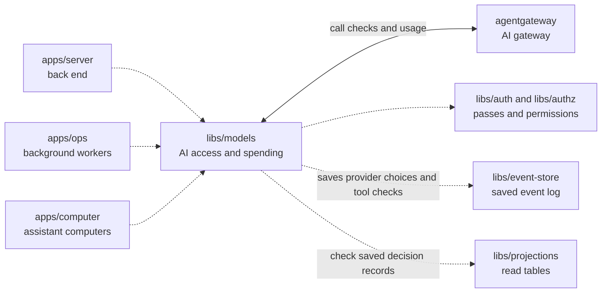

# Models

## What this is

The AI access and spending library for OpenCrane.
It checks whether an assistant may use an AI model or tool and whether there is enough
money for the call. It keeps spending limits, tool rules and approvals.
Its running part is the [models process](../../GLOSSARY.md#models-process),
a separate program started from `apps/server`.

## Where it fits

This library belongs to the back-end layer. [apps/server](../../apps/server/README.md)
uses it for requests from the website, and [apps/ops](../../apps/ops/README.md)
uses it in background workers. [apps/computer](../../apps/computer/README.md)
uses its model choices and private caller checks.
The models process runs beside [agentgateway](../../GLOSSARY.md#agentgateway-ai-gateway),
which forwards AI calls. Saved events decide access and spending;
read tables locate the saved records needed for each tool decision without replaying earlier chat messages.
A missing record or history still catching up prevents a new send.



## What it is responsible for

- Choose models for tasks, save the chat default and check provider choices for new turns.
- Check current membership, grants and permissions before allowing calls.
- Keep spending limits and prices as integer euro cents.
- Set money aside before a paid call, then record its cost or keep it held for review.
- Stop further spending when a turn's allowance or a spending limit is exhausted.
- Check tool rules, approvals and the current reviewed tool list before sending a call.
- Check selected personal accounts and record credential releases before tool calls.
- Check access to saved memory and refuse calls that rely on facts no longer usable.
- Prepare gateway settings while unchanged tool checks run, and check that the running
  gateway has accepted them.
- Record ownership and model grants, and provide safe spending and account records.
- Check private image scan results and support cleanup of stored credentials.

Not built yet:

- Run automatic routines or native child tasks.
- Use company accounts in live tool calls or offer public account sign-in routes.
- Start hosted tool images or wake private tool instances.
- Deliver private memory tools in live turns or let assistants correct or forget facts.
- Stop running computers when a spending limit is exhausted.
- Enable outside network connections for assistant commands.

## Processes it handles

1. **An assistant makes an AI call.** The gateway asks the models process to check
   its passes, access and spending. The process sets money aside and saves permission
   for one send before the gateway forwards the call.
2. **A call finishes.** The library records the reported cost and releases unused money.
   If the outcome is unknown, it keeps the money held until there is enough evidence
   to settle it safely. Reading a saved outcome never repeats the call.
3. **An admin changes access or spending.** The library checks their rights and saves
   the change as an [event](../../GLOSSARY.md#event). Background workers update
   the permission service and spending read tables from those saved changes.
4. **An assistant uses a tool.** The library checks the reviewed tool and its rule.
   A tool that needs approval saves a readable review and can use only its own approval, once.
   Changed access or a blocked tool prevents a new send.
5. **A person chooses a personal account.** The library checks the saved account and
   which assistants may use it. Each call checks access again before releasing its key;
   revoking the account prevents later releases.
6. **An assistant uses saved memory.** The library checks the facts loaded by its turn.
   A correction, expiry or loss of access prevents a later call using those facts.

## How to run or test it

Access timing tests can use the event store’s manual clock to control the two-second limit.
Tests can join people with `joinMembers` from `@opencrane/models/testing/members`.
Named options can also apply permissions and read tables after each saved event.

Run these commands from the repository root:

```sh
nice -n 10 npm run typecheck -w libs/models
nice -n 10 npx vitest run libs/models/test/routing.test.ts --maxWorkers=2
```

A small example selects the model for a chat turn:

```ts
import { modelForTask } from '@opencrane/models/routing';

const model = modelForTask('chat_turn');
```

The result is the model name for that task. An unknown task is refused.
Start the running process through the [dev stack](../../infra/dev-stack/README.md).
[README.robot.md](README.robot.md#run-and-test) lists its settings and service tests.
Some tests need disposable databases, a real event broker and the pinned gateway.

## Where to read more

- [README.robot.md](README.robot.md): exact contracts, prices, settings and test details.
- [apps/server](../../apps/server/README.md): requests and the models process entrypoint.
- [apps/ops](../../apps/ops/README.md): workers that apply saved changes.
- [libs/events](../events/README.md): definitions of the changes this library records.
- [libs/authz](../authz/README.md): permissions and access checks.
- [Why NATS holds the event log](../../docs/adr/0001-event-store-nats-jetstream.md).
- [Glossary](../../GLOSSARY.md): shared words used in these guides.
