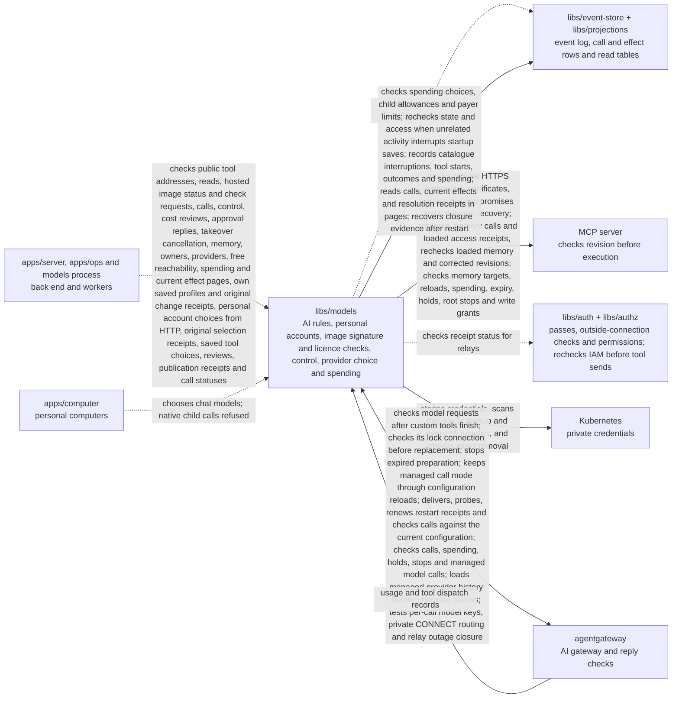

# Models

## What this is

Gateway replacement checks the connection holding its database lock immediately before
changing the file. A lost connection leaves the old file in place. Expired preparation
stops before saving a later configuration and releases the lock.
The lost-connection test waits until another database session holds that lock
before checking that delivery was refused.

After recorded switch-on, the gateway uses each checked call's provider key.
It needs no fallback key file, and configuration reloads preserve that choice.
Switch-on waits for spending to settle. A free provider reachability check needs no
settlement; paid tests and other sends still do.

The AI access and spending library for OpenCrane. Its running part is the models process, a separate program whose start file lives in `apps/server` (`src/models-main.ts`). It runs beside [agentgateway](../../GLOSSARY.md#agentgateway-ai-gateway), which forwards AI requests. The library also picks the model for each task, keeps the price list and [budgets](../../GLOSSARY.md#budget), holds the [tool rules](../../GLOSSARY.md#tool-rule-allow-ask-block) and the one-time approvals for Ask tools, and records who owns the silo.

A saved takeover ends unused approvals for the same computer generation and turn.
Reading saves each cancellation once. HTTP decisions defer that save until the server
checks ownership and current write access. Used approvals keep their dispatch evidence,
and saved denial or expiry stays final. Failed saves leave cancellation unconfirmed.

Recall, Correct and Forget load chat history, saved memory and access receipts before
the gateway starts its short access check. This includes every scope already loaded
by the turn. Current permissions are still checked before use. Correct and Forget remain disabled.

Approval reads report whether the tool replied to the last consumed permit.
A reply does not change retry permission or prove that an outside business change succeeded.

## Where it fits

This shared library is used by the server, background workers and personal computers.
Its private credential adapter talks to Kubernetes through the server’s local proxy.
It checks passes with `libs/auth`, permissions with `libs/authz`, and starts agentgateway
to handle AI calls.



apps/ops confirms owner appointments for this package. Its nightly memory scan also
uses this library to check saved dependencies at the intended nightly time.

A lost resolution reply can be checked against the original saved event. The receipt
names the original event, date, resolver, outcome and recorded amount. It stays separate
from current spending and any retained hold. It proves only that the resolution was
saved; reading it never charges money, releases a hold or repeats an outside action.

An internal current-effect index keeps each call's state, original payer and held or
settled cents. Small pages retain the original reservation order. A saved resolution
stays pending until accounting records settlement. Missing or delayed data is unavailable.
Rebuilding these rows never sends a call or changes money.

The budget actor keeps a child's original access check while allocation waits in
its queue. Each attempt to save the allowance checks access again and keeps the
original time limit, including retries after a connection failure. A saved allowance holds
no money, and repeating allocation never enlarges or reopens a stopped allowance.

Approval cards retain the saved decision, use and end times after a restart.
They name a cancellation cause only when a saved event proves it. Retrying keeps
the first use time and adds another dated use; use alone never proves success.

Approval cards include the turn they belong to. The chat hides decisions after that turn stops.

The tool-list watcher allows 30 seconds for each check by default. Tests can use
a shorter timeout while checking the same failure and recovery behaviour.

Tool calls need a fresh saved tool list whose hashes match its definitions. An unchanged check keeps a waiting approval valid.
Remote calls also need the running catalogue watch at admission and just before sending.
A new hold refuses an already permitted call before it reaches the remote server.
Losing a watched server records the interruption before forgetting its last check.
Restoring that server cannot make its earlier approvals usable again.
A server that withdraws or changes its promise to check tool revisions stays held, even
when its tools are identical. Healthy tool lists with short lifetimes are refreshed early,
so a waiting approval can remain valid.
A change to the tools or their rules ends that approval. Saving a replacement publication
also ends waiting and unused approvals for that server. Reloading another server keeps
them valid. A gateway acknowledgement cannot revive an ended approval.
After a gateway restart, a new live check confirms the unchanged publication for that
process. Publication status shows that confirmation after the receipt is saved.
Every model, tool and recall call checks all memory facts already loaded by its turn.
The server uses the same check before releasing a renewed turn pass. A memory change
saved after the last memory read is checked at the next renewal or call.
A corrected, forgotten or expired fact, an invalid dependency, or removed memory access
refuses the next call. Other facts, messages and uploads do not refuse it.
Recall, Correct and Forget prepare history before the gateway signs their short pass.
Each call checks permissions again; prepared data never grants access.
Memory writes keep their original access check. Removing and restoring a grant while
the server reads memory references still refuses the write. The event store repeats
that same check before saving the fact.
Configured tool servers need an atomic revision check: they compare the approved tool
list and running instance before executing a call. The models process checks a one-use
pass before sending the original request. Servers without this contract are refused.
Before sending, it obtains one budget permission without holding money for a free tool.
It then saves one admission record on the server's tool-rule stream.
Block saved first refuses admission. For a publication with a saved configuration request,
it checks the saved gateway configuration and tool rules before saving one start record.
After saving, it queries IAM, the permissions service, again and rechecks access,
the gateway acknowledgement and both saved positions. An IAM outage refuses the
call before any remote bytes leave. After a confirmed saved start, a refusal records
proof that nothing was sent. The person can request one replacement approval use.
A successful retry cannot use that proof again, and these free calls hold no money.
A newer gateway configuration saved while a tool-rule read waits refuses the call,
even when that server's rules stay the same. A withdrawal or
an uncertain save reply refuses the call and spends its pass. The start record alone
does not prove that any bytes left. For an operator route, a later refusal records
that nothing was sent.
The last gateway-position read decides which saved configuration applies to the call.
A configuration saved afterwards does not stop a call using the still acknowledged one.
Published remote tools can use their saved HTTPS address when the server promises to
refuse calls for a changed tool list. DNS checks happen before saving a start; TLS opens
after the final send checks. Replies are bounded and carry no upstream cookies or redirects.
The dispatcher saves a checked remote reply against the pass that allowed the call before
returning it. This proves a reply arrived, even when that reply reports a tool error.
A remote failure after opening a connection leaves the outcome unknown. Gateway replies cannot
settle these calls. If saving the evidence cannot be confirmed, the reply is unavailable
and the call is never sent again.
Legacy publications keep their admission check.
It checks the small access streams within two seconds.
Built-in memory uses the same send check. Its signed context also identifies the one-use
pass, running backend and reviewed tool list. Saving recall references does not
interrupt the current call. Ending or invalidating that turn’s memory context does. The memory backend checks access again
and refuses a context it has already received. It repeats the final access check when
other calls arrive, so a saved revocation still stops the write within the same deadline.
Other hosted images still need image admission. A private verifier checks a publisher's
signature and each image file's hash against operator trust. The signature check uses
only the operator's local public key and makes no network requests. Unreadable files
make the verifier unavailable. A private licence checker then uses Syft, a tool that lists
image packages, on those same verified bytes. It requires a separate review of the image's
files and licence notices. Debian main exceptions apply only to reviewed OS layers.
Neither checker admits an image or starts it; malware and vulnerability checks remain pending.

The models process prepares private connection relays and records their closure.
It checks access and spending again while a relay is open. Removing access ends it.
Losing storage, permissions or current spending proof closes affected sockets within
two seconds, including time spent admitting the connection. A stalled check or late
reply cannot extend that time. Permission-service failures remain distinct from removed
access. Relay receipt checks ask for the permission-service status separately,
so other callers keep their existing receipt checks.
Spending proof reads do not delay money commands.
Changing another team member's membership leaves a valid relay open.
Pending closure records retry after storage recovers, without restarting. Restart
recovers saved closure records without reopening connections. Outside networking
remains switched off. Crash recovery and live qualification are still pending.

Tool mode changes require the server’s declared zero cost and approval details
for both Allow and Ask. Admin review locks those values before a tool can be enabled.

Background workers copy saved events into spending read tables. The server can
page through effect records for owners and admins without loading the whole history.
Rebuilding these tables leaves the original budget decisions intact and makes no outside calls.

A call first needs permission and enough budget. The model or tool outcome can then
settle its held money. A saved resolution stays separate from an observed outcome;
saving it does not prove an outside action happened.

Spending call records can be read in small pages, filtered by their saved payer and
assistant. They keep the original date, held money and recorded settlement after
rollover or replay. Reading these records never permits spending.

An agent's correction or forget request needs both read and write permission and that
tool's reviewed Allow rule. Ask returns a configuration refusal without opening an approval.
The backend checks the target proof, then refuses the operation because it is still disabled.

## What it is responsible for

When an AI request is refused, the models process writes a short reason to its
private log. The request id links that line to the saved decision. The log leaves
out credentials, request contents and raw errors.

A private decision handler checks a pass for one outside connection. The silo,
person and assistant must each allow the same host and port. It saves the decision
and checks spending stops before registering a single-use relay. Ordinary startup
keeps this route off, and command workers still have no network access.

The saved installation payer lets an admin change the global limit and that payer's own
limit, including setting either to zero and raising it again. It needs no group record.
Every other payer needs a group in this
installation. An unavailable choice returns a correction message; lost admin access
still refuses access.

Each spending-limit save checks the chosen group, shared assistant and new default payer.
It refuses personal, inactive or retired assistants. A refused choice leaves the saved limit
and default payer unchanged. Retrying an already saved change returns its original receipt.

A private relay receipt writer saves safe connection details after both sockets close.
It keeps a pending record when storage is unavailable and can retry the same record.
Byte counts describe socket writes; they do not prove an operation succeeded.
Command networking remains off.

The budget actor can save a fixed allowance for one turn, called a root. Calls share
that allowance through their existing holds. A spending refusal stops further holds
for that root permanently. A call that costs more than its hold also stops the root,
while its full cost and an alert are saved. Other roots can still use the payer.
An internal command also stops a root after its requester stops it, its turn ends,
or its requester loses access. It checks the saved event and keeps a reference to it.
An earlier removal cannot stop a new root after the requester has been re-invited.
The first stop stays permanent, and later usage still counts. No caller uses this
command yet.
Model calls find their root from the verified turn. Model, tool and memory calls
check that root before granting permission and again before admitting a send.
A stopped root refuses an old pass and releases a proven unsent hold at zero.
Already admitted calls may still send. They keep their holds until usage or other evidence arrives.
Retrying an unchanged model call can recover its original unsent hold and saved decision.

- Share public address checks with the server’s remote tool discovery. Test a socket
  check that accepts one visible TLS hostname and public DNS answers before connecting.
  Give each permit one private relay. Close its sockets on expiry or explicit closure,
  and report counts and times once. Production callers are still needed.
- Save publication requests and prepare ordered gateway records. These records do not enable calls.
- Turn a saved gateway record into repeatable configuration bytes. Keep the existing
  model and memory routes, and add rules for the reviewed tools. The models worker
  writes only the latest current configuration and records its exact reply from the running gateway.
  Hold a shared PostgreSQL lock during the final checks and file replacement, so
  the preparation worker cannot save a newer generation in between.
  It checks again before returning that reply, so a withdrawal or replacement makes it invalid.
  Each server gets one saved receipt for its publication request. Receipts and calls
  keep that request current unless the reviewed rules or intent change.
  A changed tool list stays held until a new review and publication receive a matching
  receipt while the checks are fresh. The watch then recaptures before reopening calls.
  If the old check expires during the last policy read, the watch keeps calls held and
  saves a failure that ends old approvals. A later check can recover safely.
  Old approvals stay cancelled. A restart begins held and cannot use saved receipts alone.
  Published routes need the exact configuration confirmed by the running gateway.
  Each short-lived call pass binds that configuration and is checked again before sending.
  Production calls remain unavailable until the guarded destination is connected.
- Provide an optional gateway route for testing CONNECT, the HTTP request that
  opens a byte tunnel. It uses only the private relay address returned by the
  decision service. Normal startup keeps this route off. Computers cannot use it
  until destination checks and guarded sockets are ready.
- Provide the managed AI gateway route, which uses the key in each decision reply.
  It keeps the provider's token counts and excludes caller credentials from the
  upstream request. The decision service reads provider history before starting its
  short access check, then checks the saved turn, provider and key before holding money.
  Startup selects this route after recorded switch-on. A leftover fallback key setting
  stops startup. Dev stacks still need shared custody wiring before they can use it.
- Read private tool-instance status and original changes for their current member owner.
  Save an owner stop request with one event. Wake stays refused until hosted admission
  and personal profiles are available. No instance starts or credentials are released.
  Derive the run for browser commands and keep retries tied to their original run.
  Check the saved stop before returning its receipt, so a concurrent retry cannot
  claim success for different details under the same request id.
- Let owners and admins stop another member's private tool instance. Check their role
  before reading that instance, then again before saving. Show each admin only their
  own original stop changes. Let an admin's stop continue when another person's
  ownership changes. Refuse it if the acting admin loses their role.
- Check a worker against one saved private tool run and record its observations.
  Stop retrying a report when the worker pass expires or is replaced.
  Refuse old runs, different Pods and changed retries. Missing workloads stay unknown.
- Stage private credentials in immutable Kubernetes Secrets. Check their owner, profile,
  operation, contents, unique identity (UID) and version before recovery or deletion.
  Keep private repair records so a restart cannot accept a replacement Secret.
  Confirm that the Secret is absent before reporting deletion.
- Read each saved tool history once for its rules and review details.
  Memory discovery can still list recall when remember is blocked.

- Refuse model, tool and memory calls while computer control is pending.
  Recheck turn and control changes before saving a human approval decision.

- Check an owner or admin’s review against the exact saved tool definitions.
  Apply stricter rules straight away and disable publication when a rule becomes wider.

- Build recorded child participation and keep its history start separate from each join.
- Recheck saved grants and permissions for a private turn memory preview without reading chat history again.
- Check that each preview fact and the facts used by a new fact are still usable.

- Records verified tool dispatch outcomes and link attempts of the same call.
  Allows one unchanged retry after a recorded failure before dispatch.
- Counts new owners only after their member record confirms the appointment.
  A person’s access check reads their own member record and the ownership record.
  Ownership commands read other members’ confirmations when they need the full owner list.
- Records provider choices and pauses for assistants and the silo default.
  An administrator can choose any eligible provider. The first verified provider
  supplies the automatic default when nobody has chosen one. Each reply confirms
  the change that was saved. Reusing a request id for another change is refused.
  Ordinary calls still use the existing gateway setup.
- Signs short passes for memory calls through the gateway.
  A thread can read the person's own facts, its assistant's notes and that assistant's group facts.
  It can save facts only in the requester’s own memory, with a separate write grant.
  These calls need saved grants, current permissions and an explicitly recorded private turn.
- Checks a shared child turn's signed context class against its saved start. It allows
  model calls but refuses MCP and memory calls for that turn.
- After managed calls are switched on, uses the assistant's saved provider choice or the
  silo default for each new turn. A running turn keeps its original choice. An assistant's
  own pause stops new model work. An owner or admin can switch this on after
  choosing an explicit default and draining legacy turns. Every saved hold and send
  must have a settlement or release, even if its computer was lost or its turn closed.
  A retry also refuses if late usage evidence has reopened a hold, including changes
  during the retry's reads. An accepted resolution with proof that the call was not
  sent releases the hold at zero. Conflicting costs keep the hold blocked. The saved
  switch-on stays in place. Replaying events keeps the original payer and charge
  without sending calls again. Sends without a money hold still block switch-on
  because their completion is not yet recorded.
  Reads the personal paying group and switch-on state together, once per new spending event.
- Pause new model turns with a saved drain command while running turns finish.
  An administrator can cancel the drain with another saved command.
  Drain, switch-on and gateway receipt saves can retry when unrelated activity interrupts
  them. Each retry checks the state it relies on again and keeps the original deadline.
  A changed provider, spending state or gateway configuration still refuses the relevant save.
- Choose an AI model from a fixed task table before switch-on.
- Keep model prices and estimate each request's cost before sending it.
- Keep the spending limits that admins set: a daily and a monthly limit for the silo, and a monthly limit for each paying group and each assistant.
  Keep the revision shown to admins valid after switch-on when no spending change
  was saved, so they can retry a refused edit without releasing a hold first.
- Keep a saved stop when a spending limit is exhausted. A changed limit or new
  budget period can allow new work, while previously stopped work stays stopped.
  Name the cap that stopped the turn in its refusal, using the saved reasons.
  Save each refused turn before replying, including turns refused by an existing
  stop. Tool and memory calls use the same budget check. Stopping running computers
  is still planned.
  Check when the turn first started before holding money for a model call. A free
  turn stopped by an earlier limit cannot switch to paid calls after that limit rises.
- Hold money before an AI call and settle the charge when usage is reported.
  Keep the budget state in memory after replay, so saving each change does not
  read all the old spending events again.
- Read a spending hold before starting the access check for its resolution.
  Read any new budget events before deciding whether it can be resolved.
  Check current access again before saving the resolution.
- List spending from the saved budget and call records, without reading chat history.
  Keep calls with an unknown outcome in the list alongside settled calls.
- Save one budget permission before each model, tool or memory send or provider check.
  Check spending stops and access again after the call waits in the queue.
  Return permission only once. Keep the money held if the reply is lost.
  Refuse stopped Ask calls before opening or using an approval. A saved turn stays
  stopped after a limit increase, including when its access pass is renewed.
- Release an expired new hold only when no send permission or other call evidence
  was saved. Keep older holds for review because their senders used older rules.
- After provider switch-on, allow holds only for checked calls with a saved provider choice.
  Keep settling or releasing existing holds.
  Keep those holds moving without restarting the models process.
- Read each new usage line once and leave old lines alone while idle. Retry a line
  if its event could not be saved.
- Check access passes, current permissions, tool rules, approvals and budgets before calls proceed.
  Keep approval lists within the caller’s current period of participation.
  Show shared child approval reviews only to the person who requested the action.
  Reuse checked approval facts and read only later messages and access changes
  before a decision.
- Refuse provider-bound model passes on the deployment-key gateway before holding money.
  Read switch-on from the silo’s spending stream before checking access.
  The managed decision checks that the chosen connection still enables the model, then
  reads its key before holding money. Removing the model before the final check refuses
  the call and releases any hold at zero. No running process starts this route yet.
- Save internal child admissions for private and shared child turns with a fixed model and provider.
  Check the signed decision, parent, narrowed model access and server limits first.
  Save a separate delegation start from the computer record and require both to agree.
  These records cannot start native tasks, issue their passes or hold money.
- Refuse native child model calls before holding money. Older delegation records
  grant no call authority either.
- Check member or admin access for reads using saved membership and current permissions.
  Let one request reuse checks for the same saved access event.
  Keep membership checks for writes within the caller’s original deadline.
- Check that an invitation's sender still has authority before it is accepted.
- Recheck saved memory after checking access, so a forget saved during that check stops the call.
  Repeat when memory changes, within the same two-second limit. Check access once more
  after the last memory read, so a revocation during that read also stops the call.
- Keep chat, computer and model grant facts in memory and read new events before each call.
  Include both closing formats in the existing chat activity read.
  Keep only the latest grant facts for each person, assistant or group.
  Check those facts before watching the streams that decide access. These checks
  share two seconds because the gateway waits only that long. Older summaries
  are dropped when their memory budget is reached and rebuilt on their next use.
  A summary that is too large is dropped on its own. Calls also refuse saved
  facts beyond the current history, which can happen after a backup restore.
- Mark refused tool calls so the computer can say when nothing was sent.
  Remove that marker from tool-server replies, which cannot prove this.
- Refuse unsafe tool call ids before saving a decision.
- Refuse callers who have disconnected before holding money.
- Keep calls working when another chat, a file or someone else's access changes during the check.
- Treat tool start and finish reports as activity that grants no access.
- Check that each Codex tool call belongs to the chat turn that received its access pass.
  Keep its call id, which links the tool's attempts and progress reports.
  Accept the model request that follows a tool result under the same spending limits.
- Start agentgateway without giving its provider key to the server or computer.
- Record what the AI provider used. When the result of a call is unknown, keep the held money in place until an owner or admin settles it.
- Keep separate read tables for calls and saved effect records. Include safe accounting details, without private work or provider receipt contents.
- Give new members and assistants access to the active models ([grants](../../GLOSSARY.md#grant)), record the silo's first owner, store the AI provider settings that admins enter, and show spending history without private details.

A tool offered in Allow mode is refused if its policy changes to Ask during that
turn. A waiting Ask call can use only its own approval, once. Approvals opened by
a waiting computer expire after 15 minutes, even while the chat turn stays open.

Expired holds cannot receive a new send permission, including after a restart.
Older holds keep their money because their senders used older rules.
Later confirmed usage can still settle their cost.

## Processes it handles

After a custom tool finishes, Codex sends its result back to the model. The gateway
checks that request too, including the namespace that identifies the tool group,
so the assistant can answer in the same turn.

An owner or admin can recover their own saved tool-mode choice, review or publication
by its original reference. The receipt keeps the original date and saved position even
after the tools change. A saved review does not mean the current catalogue is valid,
the tools are published or the gateway has accepted them. A saved publication confirms
only the request to publish. It does not confirm gateway acceptance or grant access.

The library saves or clears a person's explicit account choice for a tool server.
The choice grants no access and does not verify the account. A changed or blocked profile
becomes unavailable; connecting another account never selects it automatically.
A person can clear the saved choice while replacement discovery is unavailable.
Replaying older records cannot restore a cleared choice.
The server accepts these commands for the signed-in member and returns the original receipt.

Saved spending Stops include the calls for that conversation and turn, in saved
order. Rebuilding from events keeps uncertain sends separate from released money.
Reading these statuses sends no work and makes no new spending decision.

After a saved personal connection replacement or revocation, a background reaction
removes old stored copies by their exact identity. Uncertain copies stay private.

A repeated model call on a child root can reuse its open, unsent hold and original
permission record. The verified turn and exact request bytes must match. A call
already admitted for sending never receives another send permission, even when its
reply was lost. Its money stays held until settlement establishes the cost.

Spending-limit changes keep their original receipt after a restart or later edits.
The library loads history before checking write access. A reservation can also
change the budget revision, so a refused save does not identify another editor.

Saved memory corrections make older references unusable. The new revision remains
usable when its sources are still current. These checks read no private text.

Saved spending stops explain the limits that applied to one turn. The server
uses the same payer choice as admission and the stop handler.

The server uses this library to read call spending for current owners and admins.
Spending call history is read in small pages from saved rows. A page keeps the
original reservation order and does not load the whole budget record.

A saved spending stop makes the dispatcher record Stop for each affected unfinished
turn and queued message. It checks the conversation index has caught up first.
The record ends waiting approvals and survives a later limit increase. Queued messages
keep the payer selected when they were saved, even if the default payer changes.
Renewal and send checks use that message's position in the event log.

An owner or admin can register a hosted image pinned by its SHA-256 digest.
The library saves one request and recovers it by its original command id.
Registration grants no access and starts no image checks.

The catalogue watch starts with calls paused and reads the tool list again. The models
process uses its result before issuing a pass and immediately before sending a call.
An unchanged successful read keeps the reviewed publication and its acknowledgement.
A failed check pauses calls until fresh evidence arrives; it does not invent a tool change.
Failed checks and expired evidence end old approvals. Changed definitions keep the server paused,
even if saving the change fails. Descriptions remain untrusted tool data.

A saved catalogue change holds every tool on that server until its reviewed publication
is acknowledged by the running gateway. A failed catalogue check ends old approvals,
even if a later check succeeds before the approval is read.

An internal child admission saves a checked parent and model scope. Competing servers
share the same saved limits. Each reply returns the saved admission. A retry with
changed details is refused, including when two servers submit it together.
Each admission has a separate delegation start that copies the saved computer record.
Retries add only a missing start. A read checks that both records agree and that the
computer admission is still open. Missing, older or conflicting records refuse the check.
Shared admissions keep the root’s shared-only class and check current parent participation
and the chat’s and assistant’s paying group. Private admissions stay private.
A native child call checks both saved records, its parent chain and the root’s activity.
It requires the root’s saved spending allowance and rechecks access to the saved model
and paying group. Shared calls also check that
the requester still has access to the child chat. Leaving and rejoining its parent
does not restore inherited access; a new explicit child join can.
A revoked grant refuses even while the permissions service still allows it.
A call that passes these checks still returns a fixed refusal before reading the
request body or holding money.
An internal hold operation lets checked children share that allowance. It keeps each
child’s own turn on its hold and stops the root when a new hold cannot fit. It computes
the amount from the checked request body. An unchanged internal call recovers its
original hold and decision after a restart or lost save reply. Recovery keeps the original
two-second access deadline, including after a restart. Changed request bytes,
model, payer, prices, delegation or computer generation refuse recovery. Dispatch
checks the saved root turn and records one permission to send. A lost reply cannot
grant another send. A refused unsent call releases its hold at zero. Settling
a call returns its unused capacity; an uncertain call keeps its money held.
No request route uses this operation yet. Native execution remains disabled.

An isolated gateway test opens a CONNECT tunnel after the decision is saved and
the spending process grants one send. A saved stop or access change prevents that
send. A separate test adds TLS hostname and public address checks before connecting.
The private relay limits each pass to one connection and at most 60 seconds.

The private outside-connection handler checks access again after saving permission
to send. If access changed or its deadline passed during the save, it registers no
relay and records an error outcome. Normal startup keeps outside connections off.

A private credential stage saves one generation and returns its reference, UID and version.
Recovery needs its saved identity or an exact identity supplied by the caller.
A lost create reply without that evidence is refused, and the create is never sent again.
Deletion stays unresolved while the Secret exists. A later check can confirm its removal.
This adapter grants no tool access.
Personal bearer commands save a staged reference or replace it at the expected version.
The stream keeps only references and exact storage identities. Saved profiles remain
unavailable for tool calls until their upstream account identity can be checked.
Owners can revoke their own profiles. Admins can block a member's personal connections
to one server, including later reconnects with a new profile. Both changes keep the
stored token until cleanup can prove deletion is safe.
A live maintenance function checks one staged secret while holding the same lock as
staging and saving. It keeps current references. After the save deadline, it records
that the unsaved operation is closed, so a delayed save cannot succeed. Only a confirmed
closure or another saved conflict permits deletion of that exact stored version.
Closing a replacement keeps the previous token and records the closed generation number.
A later replacement uses the next number. A separate live maintenance call scans one
small page of private credentials. After restart, it can rebuild missing repair records
from confirmed saved identities. It keeps uncertain stages and changed storage identities.
Damaged credentials stay in storage while the scan checks healthy neighbours and later pages.
Older credentials without discovery details stay in storage for individual checks.
Configured workers clean old copies after a saved revoke or replacement.
The periodic scan can finish this cleanup after the reaction has used all its retries.
The failed job stays available for inspection after the scan removes the old copy.
The event store checks profile changes and admin blocks together when it saves a profile.
If the block is saved first, the profile save is refused, even if its access check has finished.
A simultaneous change to another connection can also refuse the save; the caller can retry.

1. **A person sends a chat message.** The server and the computer pick the model for the task. The computer sends the AI call to agentgateway. agentgateway asks the models process, which checks the passes, permissions and budget and holds the money. The models process saves one final send permission. agentgateway then sends the call once to the AI provider.
2. **An AI call finishes.** The gateway reports its use and the library settles the held amount. If the result cannot be confirmed, the full amount stays held for review. A later report of an unknown result restores money released before an allowed call was sent.
3. **An admin or owner changes access or spending.** The change is saved as an [event](../../GLOSSARY.md#event): the server saves tool rules and grants, and the models process saves spending limits. Background workers then update OpenFGA and the spending tables.

### Automatic checks for abandoned connection copies

Configured workers check private token copies at startup and every 15 minutes.
They remove only copies proven safe to delete, including abandoned saves and copies
left after failed cleanup jobs. Each pass checks one small page at a time.
Workers keep copies belonging to other silos without checking or changing them.

A member can read their own saved tool profile without using the private credential store.
The reader loads exact history before checking current membership. Disabled profiles stay
readable; incomplete records stay unavailable. A saved bearer is not a verified identity.

Members can recover the original receipt for a personal account save, rotation or revocation.
Later changes do not replace that receipt. It confirms a local change; whether the profile
can be used now is checked separately. Missing evidence never means it is safe to resend.

## How to run or test it

Tests share a port picker that keeps listeners away from outgoing connections
and the secondary dev stacks. It tries another port if one is already busy.
Gateway startup errors keep recent safe details, including port conflicts.
Gateway configuration checks do not count as model or tool calls. Their access logs
create no call observations and do not compete with saving a budget reservation.
Ordinary tool calls load conversation history before checking access. History and
access share the original two-second request budget and gateway timeout.
The admission timing tests wait for cold history and applied model grant receipts
before measuring a call. They issue a fresh turn token after preparation, with the
normal two-minute lifetime.
The long-grant cases first read the small ownership, member and assistant histories.
Their HTTP warm-up still checks current access within the normal two seconds.
They check that a cold refusal holds no money and that the measured call adds one hold.
Separate timeout checks require unsent holds to settle at zero euro cents.
The measured call must still finish within two seconds.
Tests here also check conversation and delegation read tables against model events.
The cleanup retry test waits for its database lock and for the queue to record failure
before checking that every attempt sent a delete request.
Connection command tests also wait for their locks, except when checking lock contention.
Scan tests wait for the scan to report each completed page.
Cleanup tests wait for each database lock, except when checking lock contention.
The paging test checks that all 53 saved credentials are listed and deleted exactly
once, including after a restart.
It loads the saved revocation before scanning. Separate cleanup tests keep using live history.

With a disposable test database configured through `PG_TEST_URL`, run the focused
accounting tests with:

```sh
nice -n 10 npx vitest run libs/models/test/accounting.test.ts --maxWorkers=1
```

The wider package checks are:

```sh
npm test -- libs/models
npm run typecheck -w libs/models
```

Some tests use Docker and a PostgreSQL test database. README.robot.md lists what they need.
The shared remote-tool fixture can serve real demo routes over local TLS. This lets
development checks test the demo without changing the public-address rules.
An optional Codex capture uses these disposable services to check that native consent
still reaches the gateway's requester approval. Capture output is private to that test
run and is removed when the run finishes.

A small example selects the model for a chat turn:

```ts
import { modelForTask } from '@opencrane/models/routing';

const model = modelForTask('chat_turn');
```

Call spending pages can select the UTC month when money was first held for a call.
Later charges stay with that month. Older open holds still reduce today's capacity,
even when a page leaves them out. Reading a page does not allow more spending.

## Where to read more

- [README.robot.md](README.robot.md): exact prices, limits, settings, event rules and test detail.
- [The server](../../apps/server/README.md) holds the start file for the models process.
- [The glossary](../../GLOSSARY.md#models-process) explains the running process and AI gateway.

Hosted image admission reports dated check results. All four checks must pass before
an image is admitted. Admission grants no tool access and starts no process.
The result writer stays inside this package. Server callers can read admission status,
but the public package exports do not expose the writer.

The projections package reads publication status from saved delivery receipts.
Reading status never asks this library to deliver or probe a configuration.

Spending choices and spending saves use the same group and assistant checks. Small summaries keep
those checks from rereading old work on every request.
