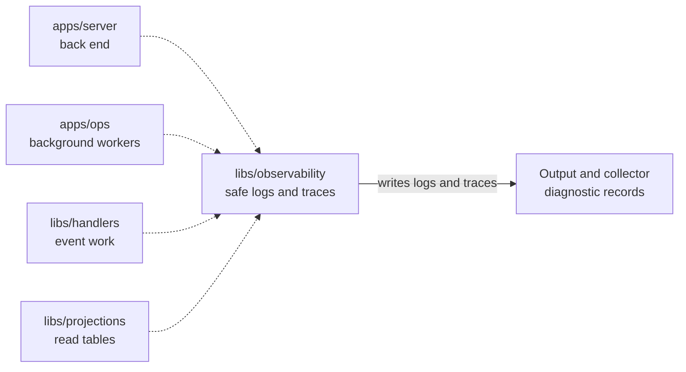

# Observability

## What this is

Shared logs and optional traces for OpenCrane services and background work. Logs are JSON lines with sensitive details removed. The server can also send traces, timing records that show how long each step took, when a trace collector is set up. The background workers do not send traces yet.

## Where it fits

This shared library is used by the server, background workers and event-processing libraries. It writes logs to standard output and can send traces to a collector, a service that receives timing records.



## What it is responsible for

- Write structured log lines and remove sensitive fields and web address queries.
- Carry request details, such as a request id, into later work, so that every log line for one request can be linked.
- Record when an event handler starts, finishes or fails, and how long it takes.
- Start optional OpenTelemetry traces, timing records that link work across services.
- Flush waiting traces during shutdown and report flush failures to the caller.

## Processes it handles

1. **The server starts.** It creates a logger, and turns on tracing only when a collector address is set. The background workers create a logger but do not start tracing yet.
2. **A request or background job runs.** The library carries its safe identifiers into log lines. For a [handler](../../GLOSSARY.md#reaction-handler), background work that responds to an event, it records the start, result and duration, then passes any failure back to the caller.
3. **The server shuts down.** It asks the tracing library to send any timing records still waiting. If that fails, it logs the error and still shuts down.

## How to run or test it

```sh
npm test -- libs/observability
npm run typecheck -w libs/observability
```

A small example writes a startup log line:

```ts
import { createLogger } from '@opencrane/observability';

const logger = createLogger('example');
logger.info({ operation: 'startup' }, 'ready');
```

## Where to read more

- [README.robot.md](README.robot.md): redaction rules, settings, shutdown behaviour and tests.
- [The background workers](../../apps/ops/README.md) and [event handlers](../handlers/README.md) use these logs.
- [The glossary](../../GLOSSARY.md) explains shared system terms.
