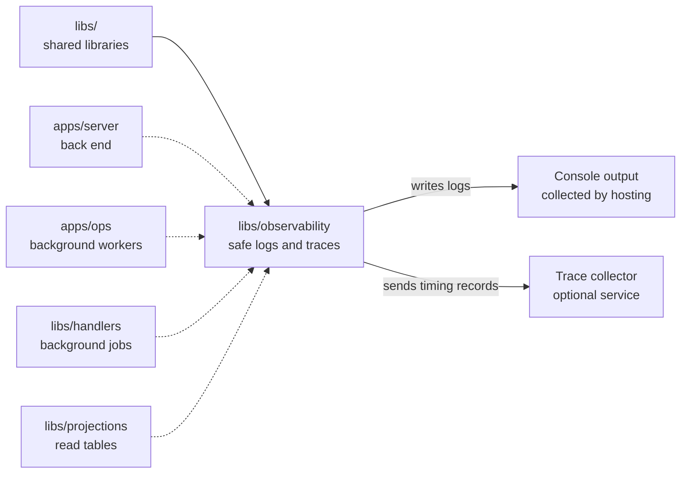

# Observability

## What this is

Shared logs and optional traces for OpenCrane services and background work.
It gives services the same log format and removes sensitive fields and private
ids from selected web addresses to protect people's details. Traces are timing
records that help explain how long each step of a request took.

## Where it fits

This shared library is used by the back end, background workers and libraries
that process saved changes. It writes logs to the program's console output,
where the hosting system collects them. Only the server currently starts tracing,
which sends timing records to a collector when one is configured.



## What it is responsible for

- Write logs in a consistent format and remove sensitive fields and web address queries.
- Hide member and conversation ids in selected web addresses, such as a
  conversation's history page.
- Carry safe request ids into later work so related log lines can be found together.
- Record when an event handler starts, finishes or fails, and how long it takes.
  A [handler](../../GLOSSARY.md#reaction-handler) runs work after a saved change.
- Start optional timing records using OpenTelemetry, a standard tracing toolkit.
- Send any waiting timing records before shutting down, and say if that fails.

## Processes it handles

1. **A service starts.** It creates a logger. The server also starts tracing when
   a collector address is configured; the background workers do not start it yet.
2. **A request or job runs.** Log lines carry safe identifiers for the work. The
   handler helper records its duration and result, then passes failures back to the
   caller to decide what happens next.
3. **The server shuts down.** It sends any waiting timing records. If sending
   fails, it reports the error and still shuts down.

## How to run or test it

```sh
nice -n 10 npx vitest run libs/observability
nice -n 10 npm run typecheck -w libs/observability
```

A small example writes a startup log line:

```ts
import { createLogger } from '@opencrane/observability';

const logger = createLogger('example');
logger.info({ operation: 'startup' }, 'ready');
```

## Where to read more

- [README.robot.md](README.robot.md): redaction rules, settings, shutdown behaviour and tests.
- [The background workers](../../apps/ops/README.md) and [event handlers](../handlers/README.md) use these logs.
- [The glossary](../../GLOSSARY.md) explains shared system terms.
