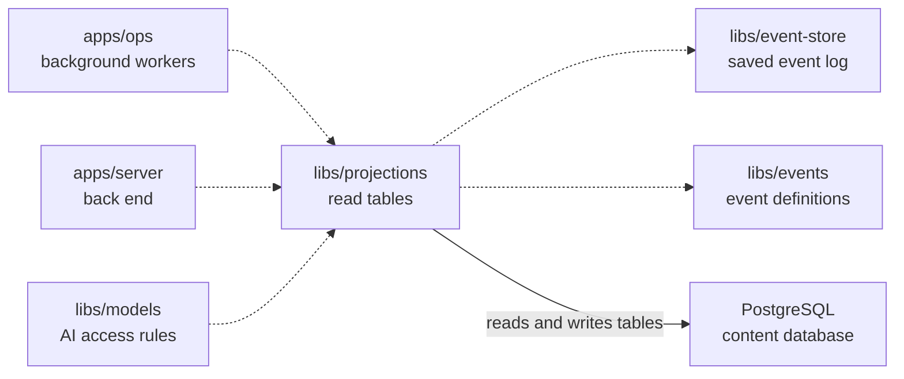

# libs/projections

## What this is

Build and read rebuildable PostgreSQL tables from events.
A [read table](../../GLOSSARY.md#read-table-projection) is a copy arranged so
screens can load data quickly. This library builds tables for people, chats,
files, computers, tools, spending and memory.
The saved event log remains the record of what happened.

## Where it fits

This library belongs to the event core.
[apps/ops](../../apps/ops/README.md) runs its workers;
[apps/server](../../apps/server/README.md) reads its tables.
It reads saved events, checks their definitions and stores the results in PostgreSQL.
Callers check access before returning private data.



## What it is responsible for

- Turn saved events into tables and keep each worker's saved position with its changes.
- Keep membership, participation and grant history for callers to check.
- Keep chat messages, activity, files and each person's private list choices.
- Keep tool reviews, publication records and provider choices separate from permission to act.
- Keep spending records as integer euro cents.
- Build a safe organisation history without copying private text or credentials.
- Project readable conversations and keep memory keys separate from searchable text.
- Hide forgotten memory facts and dependent copies before opening their text.
- Rebuild tables without sending messages, changing permissions or starting work.

Not built yet:

- Run the optional private tool-instance worker in the normal stack.

## Processes it handles

1. **A change is saved.** A worker reads the event and updates the matching tables.
   The table changes and worker position commit together, so a failed update leaves
   the event available to try again.
2. **A person opens a chat.** The server reads the newest visible messages and can
   request older pages. The tables preserve participation and closing records;
   the server checks current access before returning them.
3. **A memory fact is forgotten.** The worker hides it and its dependent copies from
   search. Rebuilding checks those saved deletion records before decrypting any text.
4. **An operator rebuilds data.** Replay reads saved events and restores the tables.
   Conversation, memory and routine rebuilds require readers and workers to stop first.
   Rebuilding never repeats outside actions.

## How to run or test it

Run these commands from the repository root. Focused tests need the local NATS test server;
[README.robot.md](README.robot.md#test-dependencies) explains database setup.

```sh
nice -n 10 npm run typecheck -w libs/projections
sh scripts/fetch-nats.sh
nice -n 10 npx vitest run libs/projections/test --maxWorkers=2
```

With an initialised `ProjectionRunner` named `runner`, fill the member tables:

```ts
import { members } from '@opencrane/projections';

await runner.initialise(members);
await runner.run(members);
```

The [complete example](README.robot.md) shows how to connect and close the services.

## Where to read more

- [README.robot.md](README.robot.md): table contracts, settings, recovery and tests.
- [Event store](../event-store/README.md): saved events used to build tables.
- [Background workers](../../apps/ops/README.md): running workers and replay commands.
- [Why NATS holds the event log](../../docs/adr/0001-event-store-nats-jetstream.md).
- [Glossary](../../GLOSSARY.md): plain meanings of shared terms.
