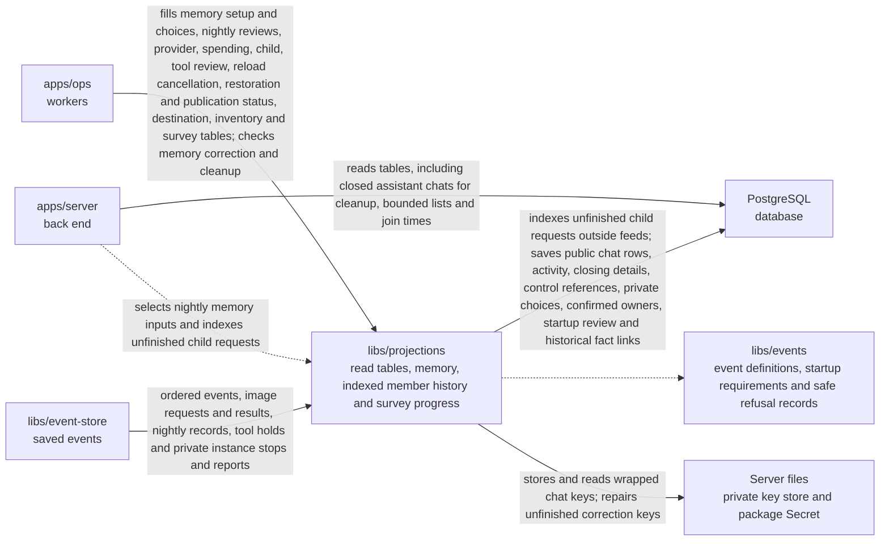

# libs/projections

## What this is

Build and read rebuildable PostgreSQL tables from events.
A [read table](../../GLOSSARY.md#read-table-projection) is a copy arranged so
screens can load data quickly. The package keeps tables for members, groups,
model providers, conversations, files, computers, memory, tool servers and a history of
who did what. The saved event log
remains the record of what happened, so these tables can be rebuilt.

## Where it fits

OpenCrane saves every change as an [event](../../GLOSSARY.md#event) in a log
that is never changed. Everything else, such as read tables and permissions, is
built from that log and can be rebuilt from it. This package builds the read
tables.
This package belongs to the event core. `apps/ops` runs the workers that fill its
tables, and `apps/server` reads those tables. It reads events from
`libs/event-store`, checks their shapes with `libs/events`, and writes to
PostgreSQL, the database for the read tables.



## What it is responsible for

The chat index keeps closed assistant chats available to the back end. The back
end uses their saved events to finish waiting and running work after a restart.
The index itself never sends a Stop or changes a turn.

Closed chat history stops showing assistant output, decisions, tool dispatches,
child publications and agent or system posts at the first saved close. Human posts
remain visible.
Later rows stay in the read table as evidence. History pages skip those rows
and keep scanning for visible human posts, using their original saved positions.

Keep publication requests and gateway receipts separate from permission to call tools.
New publication requests end that server’s waiting and unused approvals. Requests for
another server leave them unchanged. Receipts preserve the resulting approval revision.
A receipt can release a changed server's hold only for its current review and fresh checks.
It does not change the rules or revive an old approval. Publication status compares the
saved request, gateway observation and server receipt in one database snapshot. A missing
match stays Applying or Unknown. Rebuilding these tables repeats the checks without
sending configuration or probing the gateway.

Keep the first write at an equal memory revision, including its expiry and saved
position. The nightly scanner shares this rule. A nightly review covers expiry only
through its intended time, so a delayed selection cannot hide later expiry.

Private memory reference records stay in the saved event log. They do not enter
the chat read table, so history pages and live chat show only public rows.

The optional private tool-instance table keeps each recorded run and its status.
It checks each new observation against the preceding saved revision.
An admin stop shows its reason to the instance owner. An owner stop must come from
that owner.
Rebuilding it starts no process and releases no credentials. Its worker is not enabled yet.

The tool catalogue keeps exact tool definitions and their check and expiry dates.
It retains both lists after a change, so the earlier list can still be read.
A server without a fresh check is shown as unavailable. Saved definitions must
match their hashes before review choices are kept. A hash is a fixed-length value
calculated from the definitions. Checks renew only the same server in the same silo.
A fresh catalogue check does not approve startup credentials. Required startup review
keeps calls blocked.

A saved tool change holds the whole server, including tools whose definitions stayed
the same. Fresh checks, another review and restarting a worker cannot lift that hold.
A matching gateway receipt for the new review releases the saved hold. The running
watch still checks the tool list before calls resume. Rebuilding tables sends no calls.

- Keep dated tool snapshots and the earlier list after a change.

The members worker keeps an index of the saved streams used in access and departure
reviews. The index retains removed memberships and revoked grants, so an empty list
cannot hide permission updates that are still pending. Member replay rebuilds it
without changing permissions or making outside calls. An upgraded installation
keeps reviews incomplete until a full rebuild has finished. The index also records
which saved history changes affect each person. A small saved count of stream names
lets removal checks detect new history without reading unrelated events.

File reads return upload details and workspace paths. The private storage key
stays inside the projection.

- Keep current destination rules, including who revoked them and when.

- Keeps hosted tool policies unpublished, including older records and replay.
- Keeps startup tool policies unpublished through review and replay.
  Existing per-call connections, including memory, keep their reviewed status.

- Keeps each scope’s chosen member, assistant and paying group for nightly memory upkeep.
  Rebuilding this choice makes no outside calls.
- Keeps the time of that choice and each night's reviewed fact references, so the
  back end can show whether any facts are waiting.
- Keeps control references and affected-turn counts in history without private turn details.
- Keep tool discovery separate from an owner or admin’s recorded review.
  Require a new review when the connection or account mode changes.
  Keep blocked tools blocked when rebuilding the tables.

- Rebuild child participants and their recorded parent references from saved events.
- Keep an index for reading initial memory in a stable order.
- Keep each saved fact’s earlier links to the facts it came from.
- Hide forgotten facts and every dependent copy before reading their encrypted text.
- Keeps delegated task relationships and outcomes in read tables. Rebuilding these
  tables starts no tasks and changes no permissions or spending.
- Copies recorded tool dispatch evidence into conversation feeds without calling a tool.
- Rebuilds saved provider choices, drains and switch-on from the spending stream without calling a provider.
- Adds a new owner to the member tables only after confirmation is saved.
- Turn ordered events into tables that the server can read.
- Bind member accounts from bound invitations or accepted email invitations.
- Keep old conversation participant records separate from new participant changes.
- Keep the latest model grant for each person, group or assistant, including revoked history.
- Keep assistant names and personal owners' display names for access choices.
- Copy tool progress, dispatch records and tool access decisions into each conversation's feed.
  Keep the call id so the page can match a decision to its tool call.
  Index message ids so an authorised caller can find one source message quickly.
- Save table changes and each worker's position together in one database step.
- Rebuild tables from the event log. The replay command rebuilds members,
  groups, model grants, model providers, budgets, the tool catalogue, computers and the
  history table while the system runs.
- Store a separate encryption key for each conversation, so chat text is saved
  in encrypted form. A packaged install encrypts those keys with a Kubernetes
  Secret before saving them on its private volume.
- Build current memory rows and searchable text without copying text into change history.
  Keep newer revisions when an older or repeated write arrives.
- Read memory ids and search matches within one silo and scope. Callers check permission first.
- Keep each memory revision key separately, with a permanent marker when it is deleted.
  Remove unfinished correction key files so a later correction can proceed.
  Refuse a missing store or key, so a storage failure cannot look like deliberate deletion.
- Send member-change notices after the table update commits.
- Keep private conversation content out of the event-history table.
- Include invitation and refusal summaries without copying email addresses or names.
- Avoid outside actions while rebuilding tables.

Memory encryption and searchable text stay on the server. The memory rebuild command
runs with readers and workers stopped. Customer deployment and backup recovery still need testing.

Conversation lists select at most 100 candidates ordered by each person’s visible activity.
Late joins start without earlier activity; later visible messages advance their order.
Conversation lists can first select a person's current participation rows. The server
checks saved events and permissions before returning any candidate.
Conversation tables keep each person's join and removal positions, so replay can
restore their periods of participation. Conversation tables are rebuilt with readers
and workers stopped. The worker names the replay command when an upgrade needs it.

The conversation worker also saves each person's archive and read choices. Choices belong to
one period of participation; joining again starts fresh. Rebuild restores them without
adding them to the shared conversation feed or running background actions.
It keeps the last visible message's position and the first close's event, person and time.
Closing a chat keeps that message position. Later reports and repeated closes cannot replace
these details. The reports remain in the feed so their saved evidence is available.

## Processes it handles

The server builds an index of unfinished child requests from saved events. It keeps only
event references and ids. Rebuilding this index creates no child and copies no message.

Memory replay reads saved corrections before opening any text. It rebuilds only
the latest usable revision and hides facts derived from superseded revisions.
It creates no keys and starts no cleanup work.

Internal child-chat requests stay in the event log. They do not appear in parent
history or change its visible activity, including when the tables are rebuilt.

Nightly memory records become a small history table for the server to read.
Rebuilding it copies the saved records and starts no scheduled work.

A saved memory tombstone marks a fact as hidden permanently. The worker follows its saved
links and removes search text for every dependent copy in the same database step.
Rebuilding reads these links first, so hidden text is never decrypted, even while its
keys still exist. The dispatcher can then destroy the keys and record completion.
The projection checks that record without reading hidden text or changing keys.
The HTTP forget command is not built yet.

A saved survey event arrives. The worker checks the hash of its encrypted bytes, then keeps the answers, hash
and saved date.
Editing an earlier step clears later current answers; replay restores the same progress
without reading or creating a key. Survey routes and saves are not exposed yet.

A Member or Admin role change that reaches an Owner keeps the owner role. The worker
records its position and continues with later events.

1. **A member joins.** The worker reads the saved event and updates the member
   table. It saves its position with the table change, then sends a notice after
   the change commits.
2. **A computer starts, sleeps or recovers.** The worker saves its current state
   and the time of its last loss. Chat pages read this small record instead of reading
   all of the computer's past events.
3. **An admin reads model access.** The server reads grant facts and bounded
   member, group or assistant choices from these tables. Missing provider choices
   stay marked as not available yet.
4. **Memory text is encrypted.** The internal helper uses an existing private key
   directory on the server. An empty deletion marker means the text was forgotten;
   a missing key means storage failed. Replay checks every required key before replacing memory tables.
   It reads keys again before each database update.
   It saves normalised text for search, marks destroyed content unavailable and keeps
   older text with refused controls out of search. The live memory worker keeps these
   tables current when its key directory is configured. The server lists and searches
   facts after checking access.
5. **An operator rebuilds a table.** They run `npm run replay -- members`. The
   command reads the whole event log again, builds fresh tables on the side and
   swaps them in. It does not run reactions or make outside calls.
6. **A conversation closes.** The worker saves who closed it and when. Late reports
   still enter the feed, but leave its latest visible activity and first close unchanged.
   An offline conversation rebuild restores the same details from the saved events.

## How to run or test it

Run the type check and focused tests with these commands. The tests need the
local NATS test server fetched first:

```sh
npm run typecheck -w libs/projections
sh scripts/fetch-nats.sh
npx vitest run libs/projections/test
```

This example connects the event store and the database, then fills the member
tables. Before you run it, set `DATABASE_URL`, set the NATS settings described
in [the event-store details](../event-store/README.robot.md), and create the
event log once with `npm run provision`.

```ts
import { connectEventStore } from '@opencrane/event-store';
import { createLogger } from '@opencrane/observability';
import { connectProjectionDb, ProjectionRunner, members } from '@opencrane/projections';

const logger = createLogger('members');
function logDatabaseError(error: Error): void {
  logger.error({ err: error }, 'Projection database connection failed');
}

const eventStore = await connectEventStore();
const database = connectProjectionDb(process.env['DATABASE_URL']!, logDatabaseError);
const runner = new ProjectionRunner(database.db, eventStore.store, logger);
await runner.initialise(members);
await runner.run(members);
await database.close();
await eventStore.close();
```

## Where to read more

- [README.robot.md](README.robot.md): table details, settings, recovery and tests.
- [Event store](../event-store/README.md): the saved events used to build tables.
- [Handlers](../handlers/README.md): background reactions to saved events.
- [Why NATS JetStream holds the event log](../../docs/adr/0001-event-store-nats-jetstream.md).
- [Glossary](../../GLOSSARY.md): plain meanings of shared terms.

Tool admission records advance the catalogue's write position. They leave tool rules,
approval revisions and check dates unchanged. Rebuilding the tables never sends calls.

Hosted image admission reports dated check results. All four checks must pass before
an image is admitted. Admission grants no tool access and starts no process.
