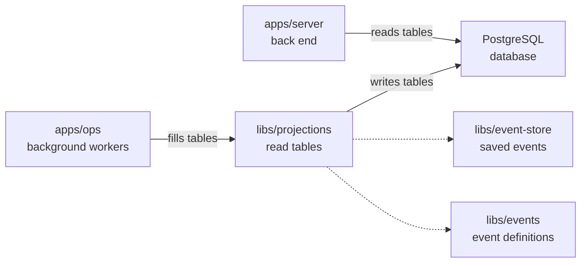

# libs/projections

## What this is

Build and read rebuildable PostgreSQL tables from events.
A [read table](../../GLOSSARY.md#read-table-projection) is a copy arranged so
screens can load data quickly. The package keeps tables for members, groups,
conversations, computers, tool servers and event history. The saved event log
remains the record of what happened, so these tables can be rebuilt.

## Where it fits

This package belongs to the event core. `apps/ops` runs the workers that fill its
tables, and `apps/server` reads those tables. It reads events from
`libs/event-store`, checks their shapes with `libs/events`, and writes to
PostgreSQL, the database for the read tables.



## What it is responsible for

- Turn ordered events into tables that the server can read.
- Save table changes and each worker's position together in one database step.
- Rebuild supported tables from the event log; some rebuilds can replace live tables.
- Send member-change notices after the table update commits.
- Keep private conversation content out of the event-history table.
- Avoid outside actions while rebuilding tables.

## Processes it handles

1. **A member joins.** The worker reads the saved event and updates the member
   table. It saves its position with the table change, then sends a notice after
   the change commits.
2. **An operator rebuilds a table.** The worker reads the event log again and
   replaces the old table contents. Replaying events does not run reactions or
   make outside calls.

## How to run or test it

Run the type check and focused tests with these commands. The tests need the
local NATS test server fetched first:

```sh
npm run typecheck -w libs/projections
sh scripts/fetch-nats.sh
npx vitest run libs/projections/test
```

This example connects the event store and database, then fills the member tables:

```ts
import { connectEventStore } from '@opencrane/event-store';
import { createLogger } from '@opencrane/observability';
import { connectProjectionDb, ProjectionRunner, members } from '@opencrane/projections';

const logger = createLogger('members');
function logDatabaseError(error: Error): void {
  logger.error({ err: error }, 'Projection database connection failed');
}

const eventStore = await connectEventStore();
const database = connectProjectionDb(process.env['DATABASE_URL']!, logDatabaseError);
const runner = new ProjectionRunner(database.db, eventStore.store, logger);
await runner.initialise(members);
await runner.run(members);
await database.close();
await eventStore.close();
```

## Where to read more

- [README.robot.md](README.robot.md): table details, settings, recovery and tests.
- [Event store](../event-store/README.md): the saved events used to build tables.
- [Handlers](../handlers/README.md): background reactions to saved events.
- [Why NATS JetStream holds the event log](../../docs/adr/0001-event-store-nats-jetstream.md).
- [Glossary](../../GLOSSARY.md): plain meanings of shared terms.
