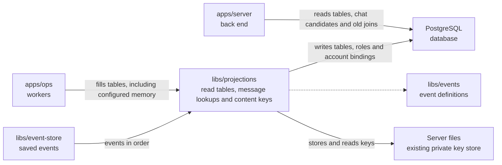

# libs/projections

## What this is

Build and read rebuildable PostgreSQL tables from events.
A [read table](../../GLOSSARY.md#read-table-projection) is a copy arranged so
screens can load data quickly. The package keeps tables for members, groups,
model providers, conversations, files, computers, memory, tool servers and a history of
who did what. The saved event log
remains the record of what happened, so these tables can be rebuilt.

## Where it fits

OpenCrane saves every change as an [event](../../GLOSSARY.md#event) in a log
that is never changed. Everything else, such as read tables and permissions, is
built from that log and can be rebuilt from it. This package builds the read
tables.
This package belongs to the event core. `apps/ops` runs the workers that fill its
tables, and `apps/server` reads those tables. It reads events from
`libs/event-store`, checks their shapes with `libs/events`, and writes to
PostgreSQL, the database for the read tables.



## What it is responsible for

- Turn ordered events into tables that the server can read.
- Bind member accounts from bound invitations or accepted email invitations.
- Keep old conversation participant records separate from new participant changes.
- Keep the latest model grant for each person, group or assistant, including revoked history.
- Keep assistant names and personal owners' display names for access choices.
- Copy tool progress and tool access decisions into each conversation's feed.
  Keep the call id so the page can match a decision to its tool call.
  Index message ids so an authorised caller can find one source message quickly.
- Save table changes and each worker's position together in one database step.
- Rebuild tables from the event log. The replay command rebuilds members,
  groups, model grants, model providers, budgets, the tool catalogue, computers and the
  history table while the system runs.
- Store the per-conversation encryption keys used on the dev stack, so chat text
  is only saved in encrypted form.
- Build current memory rows and searchable text without copying text into change history.
  Keep newer revisions when an older or repeated write arrives.
- Read memory ids and search matches within one silo and scope. Callers check permission first.
- Keep each memory revision key separately, with a permanent marker when it is deleted.
  Refuse a missing store or key, so a storage failure cannot look like deliberate deletion.
- Send member-change notices after the table update commits.
- Keep private conversation content out of the event-history table.
- Avoid outside actions while rebuilding tables.

Memory encryption and searchable text stay on the server. The memory rebuild command
runs with readers and workers stopped. Customer deployment and backup recovery still need testing.

Conversation lists can first select a person's current participation rows. The server
checks saved events and permissions before returning any candidate.
Conversation tables keep each person's join and removal positions, so replay can
restore their periods of participation. Conversation tables are rebuilt with readers
and workers stopped. The worker names the replay command when an upgrade needs it.

## Processes it handles

A Member or Admin role change that reaches an Owner keeps the owner role. The worker
records its position and continues with later events.

1. **A member joins.** The worker reads the saved event and updates the member
   table. It saves its position with the table change, then sends a notice after
   the change commits.
2. **A computer starts, sleeps or recovers.** The worker saves its current state
   and the time of its last loss. Chat pages read this small record instead of reading
   all of the computer's past events.
3. **An admin reads model access.** The server reads grant facts and bounded
   member, group or assistant choices from these tables. Missing provider choices
   stay marked as not available yet.
4. **Memory text is encrypted.** The internal helper uses an existing private key
   directory on the server. An empty deletion marker means the text was forgotten;
   a missing key means storage failed. Replay checks every required key before replacing memory tables.
   It reads keys again before each database update.
   It saves normalised text for search, marks destroyed content unavailable and keeps
   older text with refused controls out of search. The live memory worker keeps these
   tables current when its key directory is configured. The server lists and searches
   facts after checking access.
5. **An operator rebuilds a table.** They run `npm run replay -- members`. The
   command reads the whole event log again, builds fresh tables on the side and
   swaps them in. It does not run reactions or make outside calls.

## How to run or test it

Run the type check and focused tests with these commands. The tests need the
local NATS test server fetched first:

```sh
npm run typecheck -w libs/projections
sh scripts/fetch-nats.sh
npx vitest run libs/projections/test
```

This example connects the event store and the database, then fills the member
tables. Before you run it, set `DATABASE_URL`, set the NATS settings described
in [the event-store details](../event-store/README.robot.md), and create the
event log once with `npm run provision`.

```ts
import { connectEventStore } from '@opencrane/event-store';
import { createLogger } from '@opencrane/observability';
import { connectProjectionDb, ProjectionRunner, members } from '@opencrane/projections';

const logger = createLogger('members');
function logDatabaseError(error: Error): void {
  logger.error({ err: error }, 'Projection database connection failed');
}

const eventStore = await connectEventStore();
const database = connectProjectionDb(process.env['DATABASE_URL']!, logDatabaseError);
const runner = new ProjectionRunner(database.db, eventStore.store, logger);
await runner.initialise(members);
await runner.run(members);
await database.close();
await eventStore.close();
```

## Where to read more

- [README.robot.md](README.robot.md): table details, settings, recovery and tests.
- [Event store](../event-store/README.md): the saved events used to build tables.
- [Handlers](../handlers/README.md): background reactions to saved events.
- [Why NATS JetStream holds the event log](../../docs/adr/0001-event-store-nats-jetstream.md).
- [Glossary](../../GLOSSARY.md): plain meanings of shared terms.
