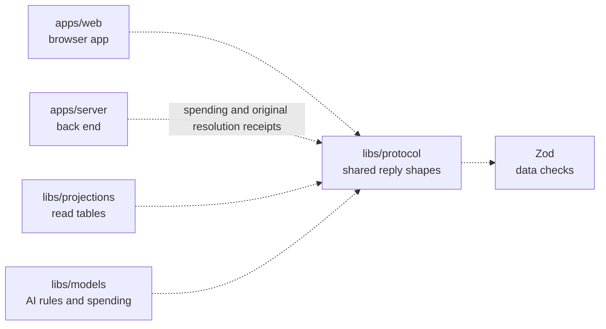

# Protocol

## What this is

Shared message shapes for the OpenCrane browser app and back end. Both sides use the same schemas, written rules for what each message must contain, to check messages before using them. The package also defines the shapes for chat, computers, integrations, budgets, held spend, approvals, model access and receipts for saved changes.

Control refusal history explains when someone was not the requester or their attempt
conflicted with saved control. It contains no private computer or turn details.

Removal, role and ownership history replies identify the affected person and saved operation.
Detail replies can also say whether read tables and permissions have applied that change.
These receipts do not say whether departure cleanup has finished.

Approval replies can name takeover as their cancellation cause and show the saved
end time. Used approvals retain their earlier use and dispatch evidence.

Effect detail replies keep the saved resolver, date and amount separate from current
spending. A receipt confirms a saved resolution, not completed settlement.

## Where it fits

This shared library is used by the browser app (`apps/web`), the back end (`apps/server`), the [read-table](../../GLOSSARY.md#read-table-projection) library (`libs/projections`) and the models library (`libs/models`). It depends on Zod, a library for checking data. It does not store [events](../../GLOSSARY.md#event) or decide who may act.

## What it is responsible for

- Define shared message and reply shapes.
- Reject unknown fields and invalid values before callers use a reply.
- Keep saved results separate from current state and access decisions.

## Processes it handles

The server returns a reply and the browser checks it against the same shape.
An effect detail can include an original resolution receipt, with integer euro cents.
Older replies without that field still work. Parsing a receipt grants no access.

## How to run or test it

Run `nice -n 10 npm run typecheck -w libs/protocol` from the repository root.
Run `nice -n 10 npx vitest run libs/protocol/test/effects.test.ts` for effect reply checks.
For example, `effectDetailResponseSchema.safeParse(reply)` checks an unknown detail reply.

## Where to read more

- [Package contracts](README.robot.md).
- [Server](../../apps/server/README.md): the HTTP service.
- [Why NATS holds the event log](../../docs/adr/0001-event-store-nats-jetstream.md).
