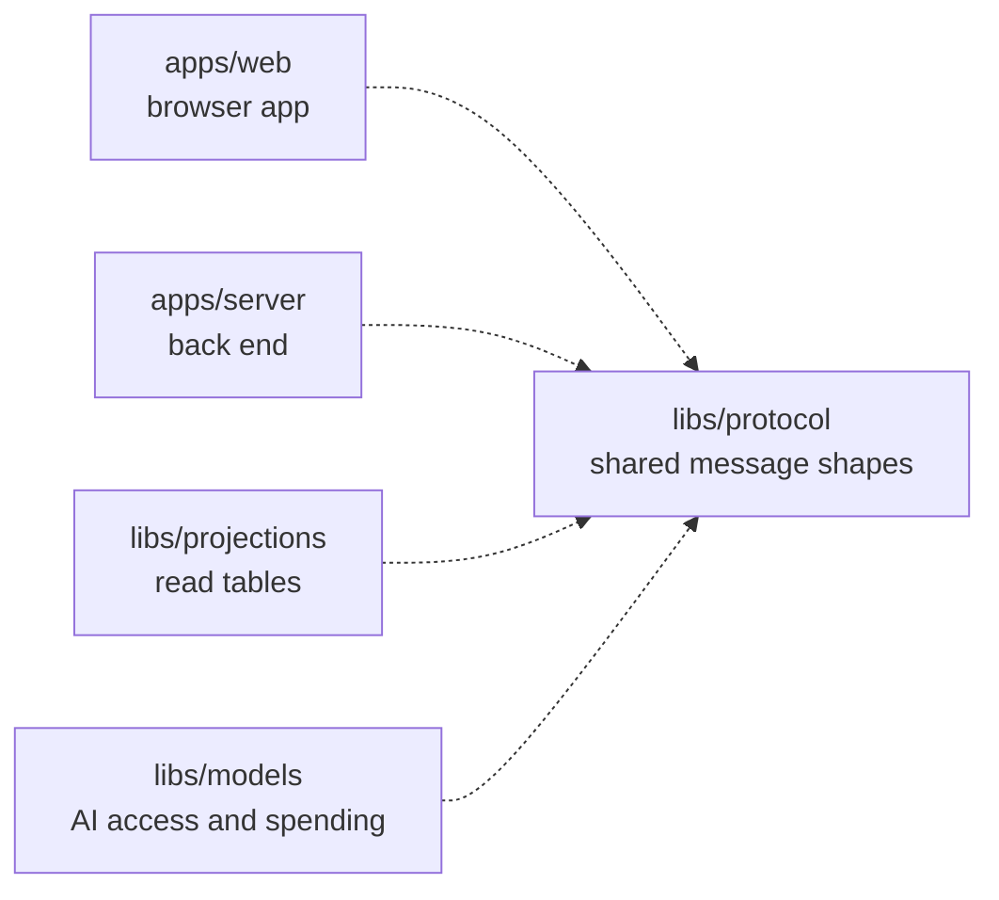

# Protocol

## What this is

Shared message shapes for the OpenCrane browser app and back end. Both sides use the same schemas to check messages before using them. The package also defines the shapes for chat, computers, integrations, budgets, approvals and audit history.

## Where it fits

This shared library is used by the browser app, back end, projections and models library. It depends on Zod, a data-checking library, and does not store [events](../../GLOSSARY.md#event) or decide who may act.



## What it is responsible for

- Define the messages exchanged over the live browser connection.
- Define the data returned for chat, computers, integrations, budgets, approvals and audit history.
- Reject messages with missing, extra or incorrectly typed fields.
- Provide the same schemas and types to browser and Node.js code.

## Processes it handles

1. **A browser sends a live message.** The server checks the message against the shared schema before handling it. The browser checks server replies before showing them.
2. **A person opens a conversation or settings page.** The server returns data in a shared shape, and the browser checks that shape before drawing the page.
3. **A person reviews change history.** The server filters the response, then both sides use the same shapes for the request and result.

## How to run or test it

```sh
npm test -- libs/protocol
npm run typecheck -w libs/protocol
```

A small example checks a greeting from the browser:

```ts
import { clientMessageSchema } from '@opencrane/protocol';

const message = clientMessageSchema.parse({ type: 'hello', text: 'Hello' });
```

## Where to read more

- [README.robot.md](README.robot.md): message contracts and test detail.
- [The browser app](../../apps/web/README.md) and [the back end](../../apps/server/README.md) share these shapes.
- [The glossary](../../GLOSSARY.md) explains shared system terms.
