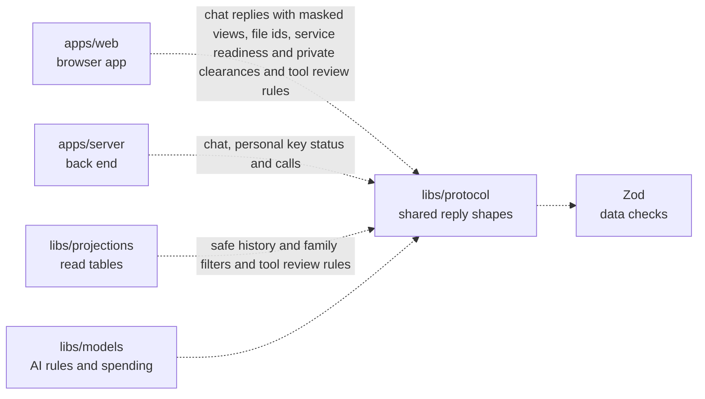

# Protocol

## What this is

Shared message shapes for the OpenCrane browser app and back end. Both sides use the same schemas, written rules for what each message must contain, to check messages before using them. The package also defines the shapes for chat, computers, integrations, budgets, held spend, approvals, model access and receipts for saved changes.

The tool policy can name the exact hosted workload whose tools were captured and
the read-only tool an admin chose to check personal key identities. Shared replies
show safe profile status and connection needs without returning a key. Shared review
rules distinguish ordinary tool definitions from servers declaring OpenCrane cost,
approval or revision details.

Chat replies can name the files attached to a saved message. Older replies still work.
Conversation lists can also carry one completed welcome with its own kind and route.
Command activity replies may carry a masked view for a current chat member.
Older activity keeps its plain label.

Control refusal history explains when someone was not the requester or their attempt
conflicted with saved control. It contains no private computer or turn details.

Removal, role and ownership history replies identify the affected person and saved operation.
History requests can select a named family covering related event types.
Publication history replies can name a permitted parent chat, a permitted child chat
and a saved result reference. A parent link is shown only to a parent reader.
Detail replies can also say whether read tables and permissions have applied that change.
Nightly memory history carries a safe action and random reference. Its personal link
is present only after the server checks the owner. A root allowance is not a charge.
These receipts do not say whether departure cleanup has finished.

Approval replies can name takeover as their cancellation cause and show the saved
end time. Used approvals retain their earlier use and dispatch evidence. A separate
reply flag says whether the tool replied; it grants no permission to repeat the action.
The original call status gives a dated list of attempts and says whether a live retry
is eligible, unknown or ended. It contains no tool arguments or replies.

 Effect and history detail replies keep the saved resolver, date and amount separate
 from current spending. History detail can include the current charge and hold, with
 the time they were checked. A receipt confirms a saved resolution, not completed
 settlement.
Change history also carries the saved settled or released choice and amount.
The amount may be zero; it does not report a completed payment or hold release.

Current effect pages carry original payer and assistant references, states and held or settled cents.
A saved resolution can stay pending while its hold remains. These states do not prove outside success.

Saved effect pages keep observations, uncertainty and resolutions separate. Amounts use integer euro cents, and a missing amount differs from zero.

Chat command activity accepts only fixed plain labels. An older row without a label
still reads, and the browser gives it a neutral one.

## Where it fits

This shared library is used by the browser app (`apps/web`), the back end (`apps/server`), the [read-table](../../GLOSSARY.md#read-table-projection) library (`libs/projections`) and the models library (`libs/models`). It depends on Zod, a library for checking data. It does not store [events](../../GLOSSARY.md#event) or decide who may act.

## What it is responsible for

- Define shared message and reply shapes.
- Check the optional close permission in authorised conversation list rows.
- Check the safe assistant service readiness field on chat history and live updates.
- Reject unknown fields and invalid values before callers use a reply.
- Keep saved results separate from current state and access decisions.

## Processes it handles

The server returns a reply and the browser checks it against the same shape.
Chat tool results use a separate display shape that excludes private adapter details.
Completed private reply notifications carry existing chat text fields without a saved cursor.
Both notifications are accepted by the socket message schema. Browsers deliver them
without retaining them in their recent-message cache.
A separate clearance carries only the matching chat, turn, thread and input identities.
An effect detail can include an original resolution receipt, with integer euro cents.
Older replies without that field still work. Parsing a receipt grants no access.

## How to run or test it

Run `nice -n 10 npm run typecheck -w libs/protocol` from the repository root.
Run `nice -n 10 npx vitest run libs/protocol/test/effects.test.ts` for effect reply checks.
For example, `effectDetailResponseSchema.safeParse(reply)` checks an unknown detail reply.

## Where to read more

- [Package contracts](README.robot.md).
- [Server](../../apps/server/README.md): the HTTP service.
- [Why NATS holds the event log](../../docs/adr/0001-event-store-nats-jetstream.md).
