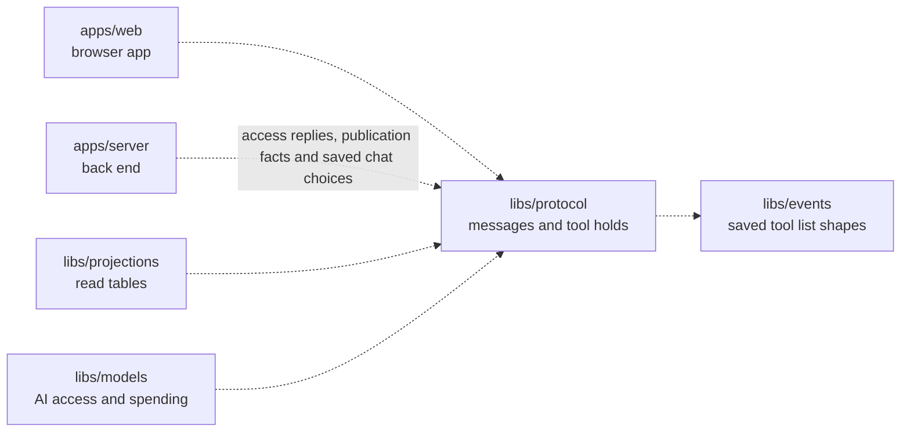

# Protocol

## What this is

Shared message shapes for the OpenCrane browser app and back end. Both sides use the same schemas, written rules for what each message must contain, to check messages before using them. The package also defines the shapes for chat, computers, integrations, budgets, held spend, approvals, model access and receipts for saved changes.

## Where it fits

This shared library is used by the browser app (`apps/web`), the back end (`apps/server`), the [read-table](../../GLOSSARY.md#read-table-projection) library (`libs/projections`) and the models library (`libs/models`). It depends on Zod, a library for checking data. It does not store [events](../../GLOSSARY.md#event) or decide who may act.



Tool rule messages include saved tool lists and their check and expiry dates.
They also identify the server and silo, and carry the rule revision used by waiting approvals.

## What it is responsible for

Describe saved publication requests separately from tool availability.

- Carries whether a hosted tool server needs startup review before calls can run.
- Check safe control references and affected-turn counts in history records.

- Checks linked dispatch records, native consent refusals and separate approval actions.

- Define the messages exchanged over the live browser connection.
- Define the data returned for chat, computers, integrations, budgets, held spend and the history of changes.
- Check tool call names and completion status in chat rows. Check access outcomes
  on decision rows, so delivered uploads keep their own outcome values.
- Reject messages with missing or wrongly typed fields. Live-connection messages also reject fields they do not know; some page data allows extra fields so that newer data still loads.
- Provide the same schemas and types to browser and Node.js code.
- Check invitation email requests, create and renew commands, status parameters and saved receipts.
- Check tool explanations with separate person, assistant and account results.
  Keep unavailable checks separate from missing grants. Check permission replies
  that omit private tool rules when a grant is missing.
- Check member access reasons and departure reviews without private content.
  Report when a complete departure review permits removal.
  Keep unknown history separate from a checked absence.
  Keep member headers separate from the admin directory.
- Check own-group picker pages, reviewed member snapshots and human group chat rows.
- Check group chat participant edits and the current people list.
- Check archive and read requests, and each person's saved choice in chat lists.
- Check flat group rows and create or remove commands for the People & groups screen.
- Carry a tool server's saved hold after its catalogue changes.

## Processes it handles

1. **A browser sends a live message.** The server checks the message against the shared schema before handling it. The browser checks server replies before showing them.
2. **A person opens a conversation or settings page.** The server returns data in a shared shape, and the browser checks that shape before drawing the page.
   Conversation lists include a continuation for loading another visible page.
   Ordinary late joiners receive their join time and current participants, without
   earlier creation details. Older replies still load.
   Group participant requests carry the last access position so stale edits can be refused.
   Archive and read requests name the current join. Replies let another device
   use the same saved choice and check an uncertain request by its original id.
3. **A person reviews the history of changes.** The server filters the response, then both sides use the same shapes for the request and result.

Chat replies include a typed computer state. After a computer is lost, they also
include when it was lost so the browser can explain recovery. The browser uses
that time and the chat's last turn to decide whether a request was lost.

## How to run or test it

```sh
npm test -- libs/protocol
npm run typecheck -w libs/protocol
```

A small example checks a greeting from the browser:

```ts
import { clientMessageSchema } from '@opencrane/protocol';

const message = clientMessageSchema.parse({ type: 'hello', text: 'Hello' });
```

## Where to read more

- [README.robot.md](README.robot.md): message contracts and test detail.
- [The browser app](../../apps/web/README.md) and [the back end](../../apps/server/README.md) share these shapes.
- [The glossary](../../GLOSSARY.md) explains shared system terms.
