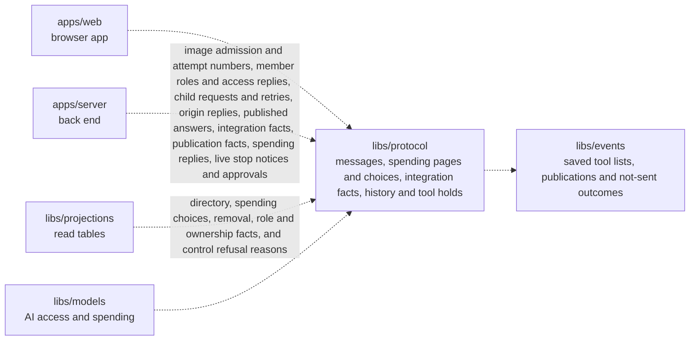

# Protocol

## What this is

Shared message shapes for the OpenCrane browser app and back end. Both sides use the same schemas, written rules for what each message must contain, to check messages before using them. The package also defines the shapes for chat, computers, integrations, budgets, held spend, approvals, model access and receipts for saved changes.

Control refusal history explains when someone was not the requester or their attempt
conflicted with saved control. It contains no private computer or turn details.

Removal, role and ownership history replies identify the affected person and saved operation.
Detail replies can also say whether read tables and permissions have applied that change.
These receipts do not say whether departure cleanup has finished.

## Where it fits

This shared library is used by the browser app (`apps/web`), the back end (`apps/server`), the [read-table](../../GLOSSARY.md#read-table-projection) library (`libs/projections`) and the models library (`libs/models`). It depends on Zod, a library for checking data. It does not store [events](../../GLOSSARY.md#event) or decide who may act.



Tool rule messages include saved tool lists and their check and expiry dates.
They also identify the server and silo, and carry the rule revision used by waiting approvals.
A separate publication position keeps the tool review identifiable when a reload ends
old approvals.

## What it is responsible for

Published child answers and interim updates carry the publisher and kind in parent chat replies.
They carry no child link or hidden result references.

Describe saved publication requests and their gateway receipts separately from tool availability.
A saved receipt alone cannot prove that a gateway is still running.

- Carries whether a hosted tool server needs startup review before calls can run.
- Check safe control references and affected-turn counts in history records.

- Checks linked dispatch records, native consent refusals and separate approval actions.

- Define the messages exchanged over the live browser connection.
- Define the data returned for chat, computers, integrations, budgets, held spend and the history of changes.
- Check change history dates, safe actors, search filters and small evidence pages.
- Check tool call names and completion status in chat rows. Check access outcomes
  on decision rows, so delivered uploads keep their own outcome values.
- Reject messages with missing or wrongly typed fields. Live-connection messages also reject fields they do not know; some page data allows extra fields so that newer data still loads.
- Provide the same schemas and types to browser and Node.js code.
- Check invitation email requests, create and renew commands, status parameters and saved receipts.
- Check tool explanations with separate person, assistant and account results.
  Keep unavailable checks separate from missing grants. Check permission replies
  that omit private tool rules when a grant is missing.
- Check member access reasons and departure reviews without private content.
  Report when a complete departure review permits removal.
  Keep unknown history separate from a checked absence.
  Keep member headers separate from the admin directory.
- Check the directory and detail management flags as booleans, while ordinary
  member headers keep false flags.
- Check Member and Admin role requests, saved receipts and separate progress for
  the member list and access rules.
- Check own-group picker pages, reviewed member snapshots and human group chat rows.
- Check group and child chat participant edits and the current people list.
- Check child origin replies: a visible parent link or a restricted result without details.
- Check archive and read requests, and each person's saved choice in chat lists.
- Check flat group rows and create, add or remove commands for the People & groups screen.
- Carry a tool server's saved hold after its catalogue changes.

Saved integration facts separate registration, account requirements, saved grants
and publication. Their strict reply shape excludes tool definitions and addresses.
Unavailable checks stay explicit; saved grants do not establish call permission.

## Processes it handles

Tool outcome messages can say that the models process refused a call before sending,
even when its start was already saved.

Child requests carry reviewed choices and a signed review. Status replies show only
the requester’s saved request and child id, or a saved refusal with its stage and attempt.
A retry identifies the saved failure and keeps the same child and first input.
They contain no source message text.

Spending stop replies carry saved reasons, execution status and call statuses.
They distinguish money held, charged or released, and calls that might have been
sent. The server decides who may read them and whether to include amounts. A live stop notice
names the original request so the browser can read its saved status. Reconnecting
uses that same read; it does not send the request again.
Approval cards carry saved UTC decision, use and end times, dated uses and fixed
cancellation reasons. Older replies can omit these fields.
Approval cards may name their saved turn. The browser then shows a stopped card
without decision controls.

Call spending pages carry original dates, safe references, held and settled cents,
accounting evidence and a continuation. A missing settlement differs from recorded zero.

Spending choice pages carry names, resource revisions and explicit cap states.
An absent cap differs from a zero cap and from a cap that could not be read.

1. **A browser sends a live message.** The server checks the message against the shared schema before handling it. The browser checks server replies before showing them.
2. **A person opens a conversation or settings page.** The server returns data in a shared shape, and the browser checks that shape before drawing the page.
   Conversation lists include a continuation for loading another visible page.
   Ordinary late joiners receive their join time and current participants, without
   earlier creation details. Older replies still load.
   Participant requests carry the last access position so stale edits can be refused.
   Child invitations also acknowledge that all shared child history will be released.
   Archive and read requests name the current join. Replies let another device
   use the same saved choice and check an uncertain request by its original id.
3. **A person reviews the history of changes.** The server filters the response, then both sides use the same shapes for the request and result.

Chat replies include a typed computer state. After a computer is lost, they also
include when it was lost so the browser can explain recovery. The browser uses
that time and the chat's last turn to decide whether a request was lost.

## How to run or test it

```sh
npm test -- libs/protocol
npm run typecheck -w libs/protocol
```

A small example checks a greeting from the browser:

```ts
import { clientMessageSchema } from '@opencrane/protocol';

const message = clientMessageSchema.parse({ type: 'hello', text: 'Hello' });
```

## Where to read more

- [README.robot.md](README.robot.md): message contracts and test detail.
- [The browser app](../../apps/web/README.md) and [the back end](../../apps/server/README.md) share these shapes.
- [The glossary](../../GLOSSARY.md) explains shared system terms.

Hosted image admission reports dated check results. All four checks must pass before
an image is admitted. Admission grants no tool access and starts no process.

Spending choice replies accept saved group names and ids, including older values. Displaying a
choice does not change the checks used to save its limit.
