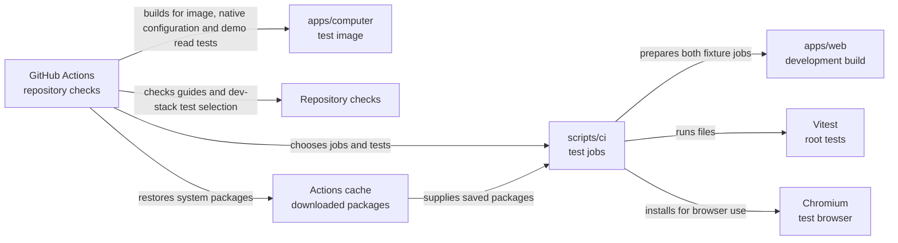

# CI test jobs

## What this is

These scripts share the root tests between GitHub Actions jobs. Separate jobs run
tests that need the computer image and tests that need Chromium. Other test jobs
avoid that setup.

## Where it fits

GitHub Actions calls these scripts to choose jobs and share tests. Vitest runs the tests.



## What it is responsible for

- Run image and browser tests in parallel jobs.
- Balance four test jobs, called shards, using saved test durations.
- Skip expensive jobs for documentation changes only when the base commit permits it.
- Refuse a passing result if a root test file is missing or runs twice.
- Require every dev-stack test to run in CI or have an exclusion with a reason.
- Save test reports on main so future changes can use measured times.

## Processes it handles

The longest files go to the shard with the least work assigned so far. Image
fixture files use Vitest's usual worker count, based on the runner's CPUs. Browser
files run one at a time because concurrent Angular servers miss their startup
deadlines. A development build prepares Angular before tests start their own servers.

The image job runs the offline demo read through a real computer and local services.
It also checks native private tool discovery with the generated configuration.
It installs Chromium because the screenshot test needs both.
Chromium setup checks installed system packages first. When they are present,
it installs only the browser and avoids an apt update or package download.
The browser job also runs the hosted integration-row journey regression.
Fresh runners install missing packages from the Actions cache without downloading
them again. A cache miss downloads and saves the packages, with a time limit.

Each test job saves a small list of its files. The final `ci-ok` job compares
those lists with all the files Vitest finds. It follows local helper imports and
scripts launched by tests. A test that reaches Playwright or the image helpers
must join a fixture group. Both fixture jobs must pass. Documentation-only pull
requests run documentation checks and the event security tests. Main pushes
always run all jobs.

The checks job also compares every dev-stack test file with its Node test commands.
Any excluded test needs a named reason. It reuses Chromium for the budget editor
and ownership controls, running those two browser files one at a time.

Documentation checks also require folder guides and reject ticket and phase
references in those guides. The README check uses Node and Git without extra installs.

## How to run or test it

```sh
nice -n 10 node --test scripts/ci/*.test.mjs
nice -n 10 node scripts/ci/run-tests.mjs fixtures-image
nice -n 10 node scripts/ci/run-tests.mjs fixtures-browser
```

The fixture tests need Docker, PostgreSQL, Chromium and the built test image.
The [test details](README.robot.md) explain their setup.

## Where to read more

- [Test details and limits](README.robot.md).
- [The CI workflow](../../.github/workflows/ci.yml).
- [The computer image](../../apps/computer/README.md).
