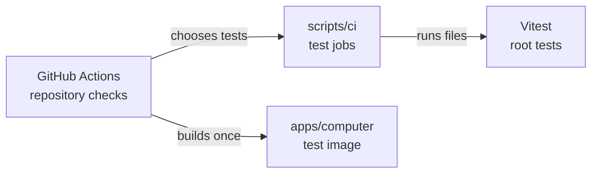

# CI test jobs

## What this is

These scripts share the root tests between GitHub Actions jobs. Tests that need
the computer image or Chromium run together, so other jobs avoid that setup.

## Where it fits

GitHub Actions calls these scripts. Vitest finds and runs the tests.



## What it is responsible for

- Keep image and browser tests in one job.
- Share the remaining files between four test jobs, called shards.
- Refuse a passing result if a test file is missing or runs twice.
- Save test reports on main so future changes can use measured times.

## Processes it handles

Each test job saves a small list of its files. The final `ci-ok` job compares
those lists with all the files Vitest finds. It also follows local helper imports
and scripts launched by tests. A test that reaches Playwright or the image helpers
must join the fixture job.

## How to run or test it

```sh
nice -n 10 node --test scripts/ci/*.test.mjs
nice -n 10 node scripts/ci/run-tests.mjs fixtures
```

The fixture tests need Docker, PostgreSQL, Chromium and the built test image.
The [test details](README.robot.md) explain their setup.

## Where to read more

- [Test details and limits](README.robot.md).
- [The CI workflow](../../.github/workflows/ci.yml).
- [The computer image](../../apps/computer/README.md).
