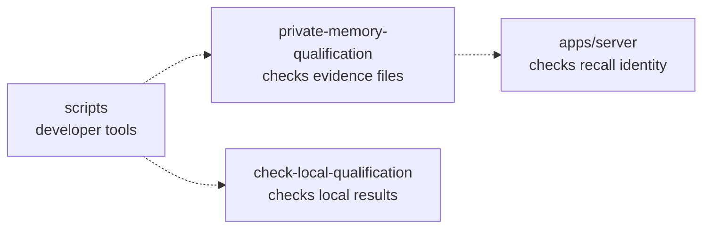

# Private memory evidence collector

## What this is

This developer tool checks files describing private memory tests.
It checks that every required result belongs to the same installation and run.
A file that passes these checks does not enable memory. Live collection is not built yet.

## Where it fits

The collector belongs to the developer tools layer, beside the local qualification checker.
It uses the server's existing source, image and environment checks.



## What it is responsible for

- Refuse missing, changed, oversized or incomplete evidence.
- Match results to one source revision, image, environment, installation and run.
- Check file digests: hashes used to detect changed bytes.
- Keep failures free of private paths and child process output.
- Not built yet: live launch, deployment approval and production receipt writing.

## Processes it handles

A deployment tool supplies the expected run and a function that reads the current
installation identity. The collector checks the files, reads that identity again,
then checks the files again. Replacement makes the candidate unusable.

Tests supply invented evidence in a temporary directory. Even a complete matching
bundle cannot approve a deployment or write a production receipt.

## How to run or test it

From the repository root:

```sh
nice -n 10 npx vitest run --config scripts/private-memory-qualification/vitest.config.mjs
nice -n 10 npx tsc -p scripts/private-memory-qualification/tsconfig.json
```

## Where to read more

- [Collector contract](README.robot.md): file formats, limits and live collection requirements.
- [Server contract](../../apps/server/README.robot.md): existing recall checks.
