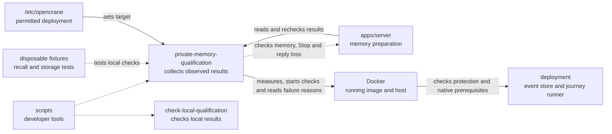

# Private memory evidence collector

## What this is

This developer tool collects private memory test results from a running deployment.
It reads the deployment identity itself and starts each check inside that image.
It also checks older evidence files, which cannot qualify a deployment.
Admission remains off. The runner checks host settings, saved memory invalidation,
separation between sessions and saved Stop delivery after reconnect. It also checks
two native processes and their cleanup before private-turn or recall checks can proceed.
It reports unfinished journeys without qualifying them.

## Where it fits

The collector belongs to the developer tools layer, beside the local qualification checker.
It uses Docker on the deployment host and reads the deployment's event store.



## What it is responsible for

- Read the permitted container and silo from deployment-owned configuration.
- Stop each journey and its children when it exceeds a limit or the collector exits.
- Measure the source revision, image, host, silo and installation before collecting results.
- Refuse an old or used event store, changed deployment, or missing check.
- Refuse swap, crash dumps, unsafe process limits and unreadable host settings.
- Allow only prerequisite results when the container protects its runner but other processes remain unchecked.
- Save protection refusals with a fixed message naming the failed check.
- Accept results only from processes it starts in the measured image.
- Save its own result in a protected file and recheck the deployment whenever it is used.
- Refuse copied, edited, stale or foreign receipts.
- Keep failures free of private paths and child process output.

## Processes it handles

The deployment owner records the permitted container and silo in a protected file.
The collector reads that file, Docker and the event store, then starts each check with a new random
challenge. It checks the deployment again around every run. Each child must complete
within two minutes. A supervisor inside the container stops the journey and its
children on timeout, excessive output or collector exit. A retry cannot start until
the previous journey has stopped. Only complete, matching results can pass.

The fixed journey runner is copied into the deployment image by the existing image build.
It reads kernel settings and process core limits itself. Even safe host settings cannot
complete a journey. The runner shares its assertions with server tests to check
correction and forgetting against the measured event store. It checks that unrelated
facts and other sessions keep their recorded state. It saves encrypted fixture facts
using the deployment's memory key store. It also checks exact saved Stop delivery,
refusal of other identities and retry after a failed send. Recorded sends do not prove
that a native process or browser cleared memory. The replacement check records a
lost computer and a new generation. It checks that a pending server reply is cleared,
new subscribers cannot recover it, and delayed old output is refused. Cold reads
retain saved references and status without granting execution or restoring private input. It records these checks as PARTIAL and missing
journeys as NOT RUN. For private turns, it requires the pinned Codex executable,
two fresh empty threads, disabled tools, separate homes in RAM and safe process limits.
It closes the first process and checks that its home is gone while the second still
answers with its original identity. It then closes and checks the second before returning
PARTIAL for private turns. Recall checks require the same native observations and
the matching silo before and after the work. The shipped recall journey still returns NOT RUN: empty
threads cannot prove that an answer used a stored fact. Missing native files refuse
both checks. Cleanup checks process start times before signalling and keeps its first
result, so another cleanup call leaves reused process IDs alone. Memory tool calls, full process isolation and live storage checks are still pending. The package image does not
contain Codex or its launch helpers, so its native check refuses. Tests add those
files to a separate disposable image; they do not change the deployment image.
Tests build the package image and run all six memory checks against a disposable event store.
Another test stores facts for two people, then uses a scripted native peer and the
real server, bridge and gateway to recall only the requester's fact. It checks the
saved reference before delivery and refuses the other person's scope. This test
does not generate a model answer or qualify the deployment. A separate one-use checker
compares native answer notifications with the saved fact and its reference in memory.
It refuses changed identities, revisions, expired grants and missing output. Tests feed
it scripted native notifications; connecting it to measured native execution is still pending.
A storage scanner now checks named folders for private test bytes, including hidden files.
It reports private text found in storage separately from an inspection that could not finish.
Missing folders, unreadable files and redirected paths keep the inspection unfinished.
It checks once during simulated work and again after it stops, without printing file names
or private text.
These folder tests do not establish which storage a deployment uses or prove native tool refusal.
The runner still leaves the persistence journey unfinished.
Other tests use simulated observations and disposable containers to check refusal and cleanup.
They do not qualify a deployment or enable memory.

The container alternative reads the runner's own Linux control group, which limits
memory and swap. An image-owned helper disables dumps in that Node process and
measures its dumpability and core limits. The runner also reads `kernel.core_pattern`
and `fs.suid_dumpable`. It refuses a crash dump helper unless `fs.suid_dumpable` is 0.
Unreadable settings refuse too. It never changes host settings.
This path returns only NOT RUN until
the server, bridge, supervisor, proxy and native processes have equivalent proof.

## How to run or test it

From the repository root, on the deployment host:

```sh
nice -n 10 node --experimental-strip-types scripts/private-memory-qualification/run.mjs
nice -n 10 npx vitest run --config scripts/private-memory-qualification/vitest.config.mjs
nice -n 10 npx tsc -p scripts/private-memory-qualification/tsconfig.json
```

The first command needs the protected deployment configuration described in the contract below.
It prints safe measurements and results, or a fixed message naming the failed protection.
It also saves its own result in a protected file. Initial loading reads that file
and checks the current deployment again. Recall preparation uses the same checked
measurements to build its tool list. Callers cannot upload replacement evidence.

## Where to read more

- [Collector contract](README.robot.md): deployment requirements, limits and live journeys.
- [Server contract](../../apps/server/README.robot.md): existing recall checks.
