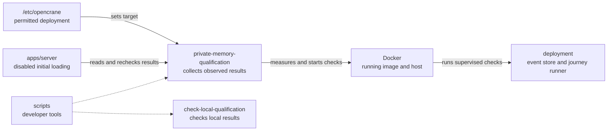

# Private memory evidence collector

## What this is

This developer tool collects private memory test results from a running deployment.
It reads the deployment identity itself and starts each check inside that image.
It also checks older evidence files, which cannot qualify a deployment.
Admission remains off. The live journey runner is not built yet.

## Where it fits

The collector belongs to the developer tools layer, beside the local qualification checker.
It uses Docker on the deployment host and reads the deployment's event store.



## What it is responsible for

- Read the permitted container and silo from deployment-owned configuration.
- Stop each journey and its children when it exceeds a limit or the collector exits.
- Measure the source revision, image, host, silo and installation before collecting results.
- Refuse an old or used event store, changed deployment, or missing check.
- Accept results only from processes it starts in the measured image.
- Save its own result in a protected file and recheck the deployment whenever it is used.
- Refuse copied, edited, stale or foreign receipts.
- Keep failures free of private paths and child process output.

## Processes it handles

The deployment owner records the permitted container and silo in a protected file.
The collector reads that file, Docker and the event store, then starts each check with a new random
challenge. It checks the deployment again around every run. Each child must complete
within two minutes. A supervisor inside the container stops the journey and its
children on timeout, excessive output or collector exit. A retry cannot start until
the previous journey has stopped. Only complete, matching results can pass.

The fixed journey runner must be part of the deployment image. It is still pending,
so current installations cannot pass. Tests use simulated receipts and disposable Docker containers to check refusal
and process cleanup. They do not run live memory journeys or enable memory.

## How to run or test it

From the repository root, on the deployment host:

```sh
nice -n 10 node --experimental-strip-types scripts/private-memory-qualification/run.mjs
nice -n 10 npx vitest run --config scripts/private-memory-qualification/vitest.config.mjs
nice -n 10 npx tsc -p scripts/private-memory-qualification/tsconfig.json
```

The first command needs the deployment-owned runner described in the contract below.
It prints safe measurements and results, or one fixed failure reason.
It also saves its own result in a protected file. Initial loading reads that file
and checks the current deployment again. Callers cannot upload replacement evidence.

## Where to read more

- [Collector contract](README.robot.md): deployment requirements, limits and live journeys.
- [Server contract](../../apps/server/README.robot.md): existing recall checks.
