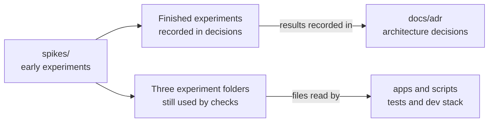

# spikes

## What this is

This folder holds early experiments, called [spikes](../GLOSSARY.md#spike), that tested
choices for OpenCrane. Each experiment answered a design question before, or while, the
working apps and libraries were built.
Some experiment files are still used by the current tests and developer stack.

## Where it fits

The experiments sit beside the working apps and libraries. Their results are recorded in
the architecture decisions, while a few scripts and build files remain part of today's
checks.

## What it is responsible for

- Keeps the original experiments and their detailed results.
- Links each experiment to the decision or working code that followed it.
- Names the experiment files that current tests or developer tools still read.

| Experiment | Question and answer | Where the result lives | Still used |
| --- | --- | --- | --- |
| [Codex as the assistant](s0-1-codex/README.md) | Can [Codex](../GLOSSARY.md#codex) do the assistant's work? Yes. | `apps/computer` and [why Codex runs on each computer](../docs/adr/0003-harness-codex.md). | No |
| [The isolated computer](s0-1b-proxy-gvisor/README.md) | Can a [computer](../GLOSSARY.md#computer) limit its network access? Yes. | `apps/computer`. | Yes. Computer tests read its probe, gateway settings and services, and build their test image from it. |
| [A capped model request](s0-1c-real-model-smoke/README.md) | Can one limited model request pass through the safety checks? Yes. | `libs/models` and `apps/computer`. | Yes, root tests and the dev stack fetch the [AI gateway](../GLOSSARY.md#agentgateway-ai-gateway) from here. |
| [Checking AI calls](s0-2-gateway/README.md) | Can the gateway ask OpenCrane before sensitive calls? Yes. | `libs/models` and [why agentgateway checks each call](../docs/adr/0002-gateway-agentgateway.md). | No |
| [Reusing computers](s0-3-warm-pool/README.md) | Can a computer stop and restart with its files kept? Yes. Waking takes about 10 to 14 seconds, which was accepted. | `apps/computer`, `apps/ops` and [how computer disks and screen viewing work](../docs/adr/0006-computer-disk-and-live-view.md). | Yes, computer tests import small command helpers from `lab.mjs`. |
| [Watching a computer screen](s0-5-live-view/README.md) | Can people watch a computer screen safely? Yes. Others can only watch, and only the person who asked can take control. | `apps/computer`, `apps/server` and [how computer disks and screen viewing work](../docs/adr/0006-computer-disk-and-live-view.md). | The warm-pool lab reads it for the warm-pool and live-view runs. Current tests do not. |
| [The event log](s0-7-jetstream/README.md) | Can NATS JetStream keep the [event log](../GLOSSARY.md#event-log-event-store)? Yes. | `libs/event-store` and [why NATS JetStream keeps the event log](../docs/adr/0001-event-store-nats-jetstream.md). | No |
| [Background work](s0-8-handler-runtime/README.md) | Which job runner handles background work? pg-boss was chosen provisionally. | `libs/handlers` and [why pg-boss runs background reactions](../docs/adr/0004-handler-runtime.md). | No |

## Processes it handles

1. **A design question needs an answer.** An experiment tests one approach and records
   what happened. A decision or working package then records the choice. Some current
   checks still read files from three experiment folders.

## How to run or test it

Each experiment runs on its own, and its README.robot.md gives the command. For example,
see [the event log record](s0-7-jetstream/README.robot.md). Before it runs, `npm test` at
the repository root runs `spikes/s0-1c-real-model-smoke/scripts/fetch-tools.sh` to
download the [AI gateway](../GLOSSARY.md#agentgateway-ai-gateway).

## Where to read more

- [Architecture decisions](../docs/adr/README.md): why the main components were chosen.
- [Working code](../README.md): the current system map.
