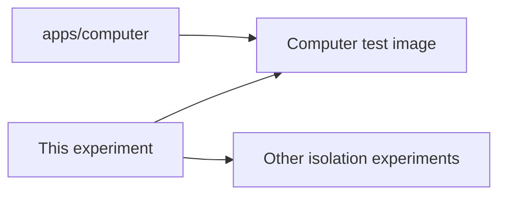

# The isolated computer

## What this is

An experiment that tested a computer which limits what its programs can reach.
The computer image tests still use its pinned Linux Codex packages and scripts.

## Where it fits

The computer package uses this folder to build its test image. Other isolation
experiments reuse its provider and gateway scripts.

## What it is responsible for

- Pins the Codex packages used in the Linux x64 computer image.
- Stops the image build if a required Codex program cannot be downloaded.
- Supplies `probe.mjs`, `gateway.yaml` and `services.mjs` to computer tests.

## Processes it handles

1. The image build installs Codex and checks that its native host can run.
2. The experiment runs Codex through a checked local proxy and AI gateway.
3. Its probes check that file tools cannot use the computer's private access.

## How to run or test it

The [experiment record](README.robot.md#run) describes the required local cluster
and run command. That command creates temporary resources in the cluster.
The computer's `codex-install.test.ts` checks the required package without a cluster.

## Where to read more

- [Experiment record](README.robot.md): settings, limits and earlier results.
- [Runtime licences](LICENCES.md): reviewed package versions and notices.
- [Computer package](../../apps/computer/README.md): the maintained computer image.
