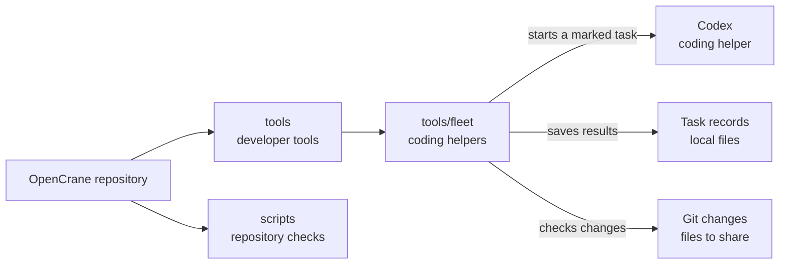

# Fleet coding helpers

## What this is

This folder holds two developer scripts: one runs an AI coding task and keeps its
results; the other checks changes for possible passwords or keys before sharing.
[Fleet](../../GLOSSARY.md#fleet) means the group of AI coding agents that build OpenCrane.

## Where it fits

This is developer tooling under `tools`, alongside the repository's check scripts.
OpenCrane apps do not call it. It uses [Codex](../../GLOSSARY.md#codex) as a coding
helper for developers, rather than as the assistant inside the product.
Codex has full control of the developer machine, so this setup is for a disposable machine.



## What it is responsible for

- Runs one coding task without an interactive screen and saves its log and final reply.
- Runs the task at low computer priority so other work can continue.
- Marks the task so it cannot start or test the owner's own copy of the product,
  even if it runs in a terminal.
- Checks staged changes or a range of commits for common password and key patterns.
- Checks that the contents of explicitly listed private files are absent from changes,
  without printing their values.
- Shows likely findings with the sensitive text hidden.

## Processes it handles

1. **A planning assistant or developer starts a task.** The launcher runs Codex in
   the chosen work folder. It marks the task and saves logs, the final reply and
   exit code under `~/.fleet`.
2. **Someone checks changes before sharing them.** The scanner checks staged files
   or a supplied range of commits. It reports likely matches with sensitive text
   hidden, or prints `CLEAN` when it finds none.

## How to run or test it

The scanner runs only when someone calls it. Codex must be installed to run a coding
job. These examples run from the repository root:

```sh
tools/fleet/secret-scan.sh
tools/fleet/secret-scan.sh origin/main..HEAD
tools/fleet/codex-task.sh task-name /path/to/worktree /path/to/prompt.md
```

The scanner's optional `SECRET_FILES` setting lists private files separated by colons.

## Where to read more

- [README.robot.md](README.robot.md): task settings, saved files and the disposable machine setup.
- [Repository map](../../README.md#layers-and-folders): where developer tools fit.
- [Secret rules](../../AGENTS.md#secrets): how OpenCrane stores private values.
