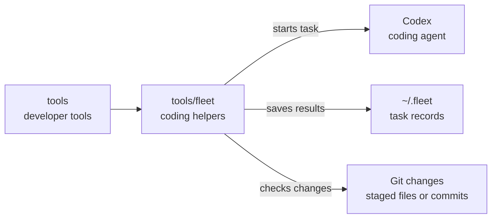

# tools/fleet

## What this is

Two scripts that help people and coding agents who build OpenCrane. One runs a
[Codex](../../GLOSSARY.md#codex) coding task and keeps its results. The other checks
changes for text that looks like a password or key before a commit or pull request.

## Where it fits

This is developer tooling, outside the running product. People run the scripts from a
development machine; OpenCrane apps do not call them. Codex runs with full control of the
developer box. This is safe only because that box is disposable.



## What it is responsible for

- Run one Codex coding task without an interactive screen and save its log and final reply.
- Run the task at low computer priority so other work can continue.
- Check staged changes or a range of commits for common secret shapes.
- Check that the contents of the secret files listed in `SECRET_FILES` (separated by colons)
  are not in the changes, without printing them.
- Show likely findings with the secret portion hidden.

## Processes it handles

1. **The lead coding agent starts a task.** `codex-task.sh` runs Codex in the chosen work folder.
   It saves the event log, error log, final reply and exit code under `~/.fleet`.
2. **Someone checks a change before sharing it.** `secret-scan.sh` checks staged changes,
   or a supplied commit range. It prints `CLEAN` when it finds no likely secrets, or
   reports the matching lines with secret text shortened.

## How to run or test it

The secret check does not run automatically. People run it before committing or opening a
pull request. Codex must be installed to run a coding task.

```sh
tools/fleet/secret-scan.sh
tools/fleet/secret-scan.sh origin/main..HEAD
tools/fleet/codex-task.sh task-name /path/to/worktree /path/to/prompt.md
```

## Where to read more

- [README.robot.md](README.robot.md): model choice, saved files and why Codex runs without
  its own sandbox.
- [Where developer tools fit](../../README.md#layers-and-folders): the repository map.
- [Secret rules](../../AGENTS.md#secrets): how OpenCrane stores secrets.
